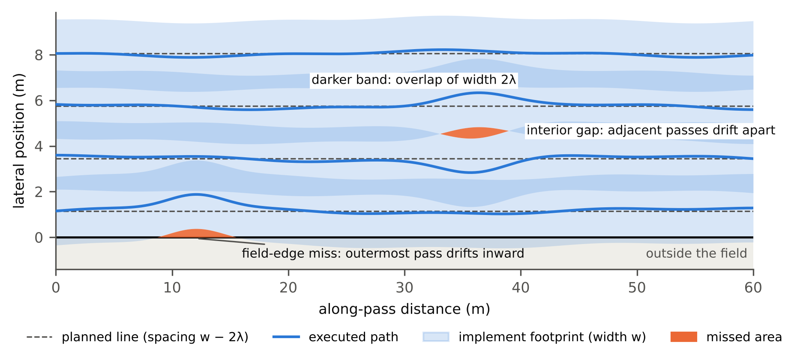
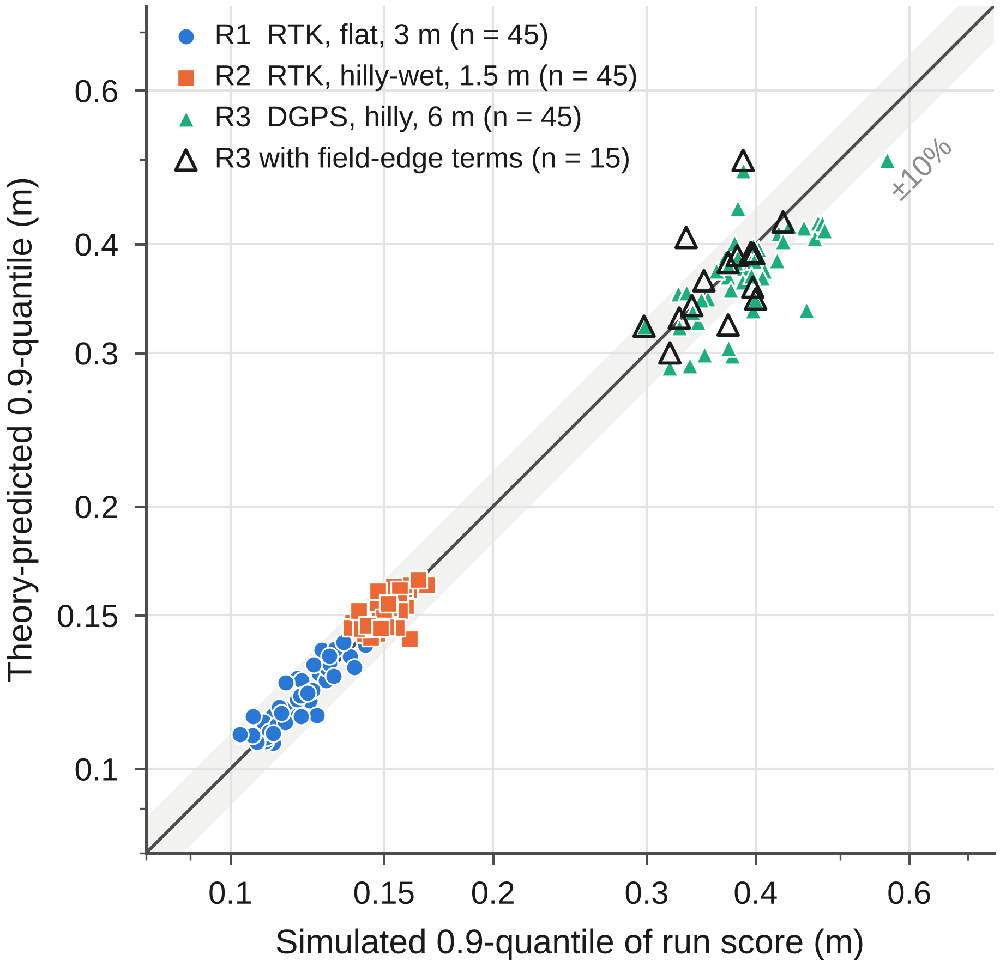
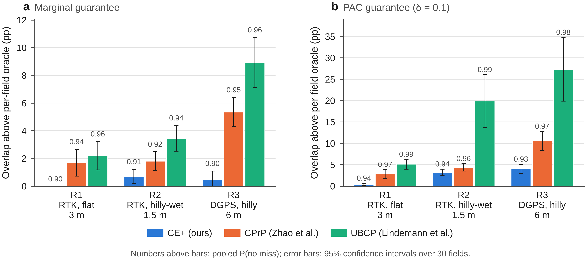
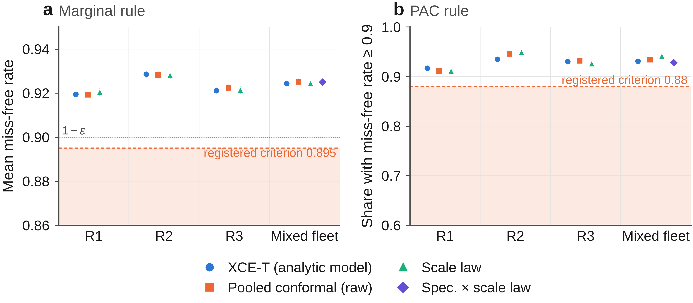
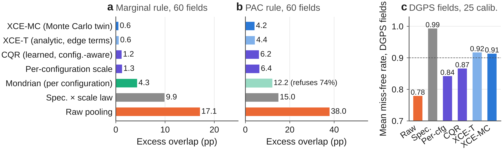
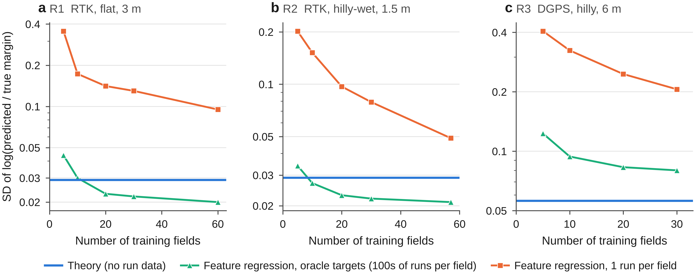
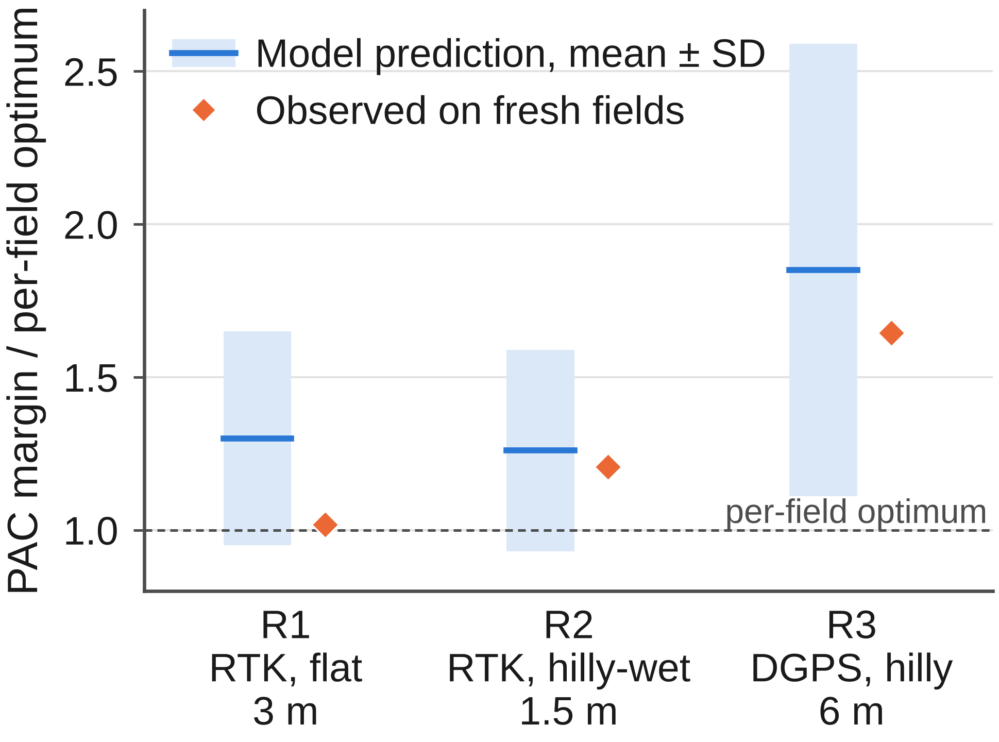

# Certified Coverage Planning under Execution Uncertainty: Conformal Erosion with Theory-Pivoted Calibration for Agricultural Field Operations

<!-- Manuscript prepared for Computers and Electronics in Agriculture. Every number is copied from a file in this repository; each table carries an HTML comment naming its source. The full archive of the analysis is docs/paper/draft.md; material moved out of the main text is in docs/paper/supplementary.md (cited as "Supplementary Sx" / "Appendix A"). -->

## Abstract

Coverage path planners for agricultural field operations assume exact execution. In practice, cross-track error between adjacent passes leaves unworked strips, and a fixed overlap has no stated reliability. We formulate coverage planning under execution uncertainty as a chance constraint and reduce the zero-miss event exactly to a scalar run score, the covering radius of the executed passes. Conformal erosion (CE) calibrates a footprint margin on a reference plan with at least as many passes as the deployed plan, giving finite-sample, distribution-free zero-miss certificates; the exact score is the smallest valid score, and a coupling inequality bounds the effect of changing the plan. A five-layer extreme-value theory predicts the required margin from controller, terrain and GNSS statistics without run data; field-edge terms reduced its DGPS bias from −4.0% to +0.8%. Used as a pivot for cross-field conformal calibration (CE-EVT-R), the theory certifies fields with no operation history. In simulations with real field boundaries, terrain and GNSS errors, a pre-registered comparison on 90 fresh fields met all validity and efficiency claims, with 4.0–54.7% less overlap than two conformal planners, and a pre-registered resampling check confirmed the coverage guarantee in 26 of 26 cells. Three pre-registered zero-data experiments are reported in full: the first failed, the second met its claims mainly through realised-coverage differences, and the third met them in part. Within one machine configuration all field-level pivots sit at an information limit; across a mixed fleet the theory pivot cut excess overlap from 29.80 to 2.96 percentage points versus raw pooling.

**Keywords:** coverage path planning; conformal prediction; GNSS guidance; pass-to-pass accuracy; extreme-value theory; precision agriculture

### Highlights

- Zero-miss coverage reduces exactly to a scalar run score, the tightest valid one
- Conformal erosion certifies a miss-free probability without an error model
- Extreme-value theory predicts the margin; edge terms explain misses under DGPS
- Fields without history are certified; the guarantee held in 26 of 26 checks
- The theory pivot pays off across machine types, not within one configuration

---

## 1. Introduction

Field operations such as spraying, fertilising, seeding and tillage are planned as sets of parallel passes whose spacing equals the implement width minus an overlap. The plan is optimal only if the machine follows it exactly. Real execution deviates from the planned line because of GNSS positioning error, wheel slip on slopes and wet soil, antenna roll on side slopes, mounting offsets and the finite bandwidth of the steering controller. A missed strip arises whenever two adjacent passes drift apart by more than the overlap, so the relevant quantity is the relative error between adjacent passes, which the industry calls pass-to-pass accuracy. Overlap set to absorb this deviation applies inputs twice on the overlapped strip. With global agricultural pesticide use of about 3.73 million tonnes of active ingredients in 2023 (FAO, 2025) and a global cropland nitrogen use efficiency of only about 40–46% (Zhang et al., 2015, 2021), both under-application (missed strips) and over-application (overlap) carry agronomic and environmental cost. The trend towards autonomous tractors (Global Market Insights, 2026) removes the operator who used to correct visible gaps by eye.

Current practice sets a fixed overlap, typically from a vendor's pass-to-pass specification or from operator experience. In our simulations with real GNSS error series, the vendor rule (twice the nominal pass-to-pass accuracy) never met a 0.9 zero-miss target and under RTK left a gap on essentially every run, while an overlap tuned by hand on a few fields met the target on 70–73% of new flat-RTK or DGPS fields and on 27% of wet hilly fields (Section 6.3). A fixed margin has no stated reliability and does not adapt to field size, terrain or receiver grade.

Coverage path planning (CPP) research (Galceran and Carreras, 2013) has produced efficient decompositions, swath-angle optimisation and smooth headland turns (Höffmann et al., 2024; Mier et al., 2023, 2025); terrain-aware planners adjust spacing to 3D geometry (Hameed et al., 2016). These planners assume perfect execution or add a heuristic margin. Control research reduces tracking error with slip observers (Lenain et al., 2006), offset-free model predictive control (Pannocchia and Rawlings, 2003) and tube MPC (Mayne et al., 2005), but a smaller error does not by itself yield a stated probability of complete coverage. Conformal prediction gives finite-sample, distribution-free guarantees and has recently been used for planning (Lindemann et al., 2023; Zhao et al., 2024). Three features of these methods are problematic for field coverage. (i) They calibrate on the nominal plan and then deploy a different, more conservative plan; when the score is a maximum over pass pairs, adding passes makes it stochastically larger, so the calibrated guarantee does not transfer. (ii) Union bounds over many constraints are conservative. (iii) They need many calibration runs on the target itself: at a miss level $\varepsilon=0.1$ a marginal conformal quantile needs at least 9 runs and a PAC (training-conditional) quantile with $\delta=0.1$ at least 22, while a field is worked a few times per year.

This paper addresses these three points. Its contributions are:

1. **Formulation and exact score.** Certified coverage planning is stated as a chance constraint on the missed area of a random set; the zero-miss event reduces exactly to a scalar run score, $\{M=0\}\iff\{S\le\lambda\}$, which is the smallest valid score, so that no order-statistic rule applied to another valid score deploys fewer passes (Sections 3, 5.1).
2. **Decision-dependent calibration.** Calibrating on a reference plan with at least as many passes as the deployed plan gives the correct dominance direction, and an exact coupling inequality bounds the coverage change caused by the plan (Sections 4.1, 5.2–5.3).
3. **A five-layer extreme-value theory of execution error** that predicts the run-score distribution from controller parameters, terrain and GNSS error statistics, including field-edge terms that explain why misses under DGPS concentrate at the field boundary (Sections 5.3, 6.2).
4. **Certification without target-field data (CE-EVT-R).** The theory's predicted quantile is used only as a ratio pivot for cross-field conformal calibration with one historical run per field; validity does not depend on the theory, and we verify it directly over both sources of randomness (Sections 4.3, 5.4, 6.5).
5. **Where a field-level pivot can and cannot help.** An information limit (Proposition 8) and a pre-registered experimental sequence show that the theory is decisive across machine configurations and as a zero-data predictor, but that within one configuration all field-level pivots are equivalent to within tenths of a percentage point (Sections 5.5, 6.4, 6.6).

The evaluation is transparent about status: pre-registered results are separated from exploratory and post hoc analyses, and failed claims are reported alongside met ones.

---

## 2. Related work

*Coverage path planning.* Boustrophedon cellular decomposition (BCD) with swath-angle optimisation is the standard for agricultural fields (Höffmann et al., 2024). Fields2Cover provides an open implementation with heading search and Dubins turns (Mier et al., 2023); Mier et al. (2025) add continuous-curvature headland paths; Hameed et al. (2016) compute 3D-terrain-equivalent spacing. None of these attaches a probability to complete coverage.

*Robust and model-based margins.* Tube MPC bounds tracking error by a robust invariant set (Mayne et al., 2005); Gaussian chance constraints propagate a parametric error model, optionally with Rice's extreme-value correction (Rice, 1944); Gaussian-process cautious control tightens constraints by a learned variance (Hewing et al., 2020); distributionally robust CVaR constraints use a Wasserstein ambiguity set (Mohajerin Esfahani and Kuhn, 2018); the scenario approach gives PAC guarantees from sampled constraints (Campi and Garatti, 2008). Parametric models misrepresent the heavy, temporally clustered tail of RTK errors (wrong fixes, float drift; Table 1), and worst-case sets are very conservative.

*Conformal prediction.* Split conformal prediction and its training-conditional (PAC) variant (Vovk, 2012); weighted conformal prediction under covariate shift (Tibshirani et al., 2019); conformalized quantile regression (Romano et al., 2019), the template of our learned (CQR-type) baseline; conformal risk control and Learn-then-Test (Angelopoulos et al., 2024, 2025); non-exchangeable conformal prediction (Barber et al., 2023); hierarchical conformal prediction with one sample per group (Dunn et al., 2023); functional conformal bands (Lei et al., 2015; Diquigiovanni et al., 2022), of which a sup-normalised run score is an instance. Conformal planning methods (Lindemann et al., 2023; Zhao et al., 2024; Sun et al., 2023; Wang and Ning, 2025) do not address the decision-dependent maximum over pass pairs, and performative prediction (Perdomo et al., 2020) studies decision-dependent distributions without coverage guarantees.

*Extremes of Gaussian processes.* Kac–Rice formulas and Rice's method (Azaïs and Wschebor, 2009; Piterbarg, 1996); maxima of stationary sequences and processes and normal comparison (Leadbetter et al., 1983; Li and Shao, 2002); convergence rates of normal extremes (Hall, 1979); statistical linearisation (Booton, 1954; Kazakov, 1956).

---

## 3. Problem formulation

**Fields, plans and erosion.** A field is a polygon $P\subset\mathbb R^2$; the evaluated **main area** $W\subset P$ is $P$ inset by twice the implement width $w$ (the remainder is headland). After boustrophedon decomposition and choice of the working direction, a plan is a set of straight pass centrelines $y_1<\dots<y_K$ in field coordinates $(x,y)$, with $x$ along the working direction. For an **erosion** (margin) $\lambda\ge0$, the greedy planner $\pi(\lambda)$ places passes at spacing $d=w-2\lambda$, i.e. it plans as if the footprint had half-width $w/2-\lambda$; the number of passes $K(\lambda)$ is non-decreasing in $\lambda$, and by a standard exchange argument for interval covering the greedy rule uses the fewest passes among placements that satisfy the gap condition.

**Execution model.** Pass $k$ is executed with lateral offset $e_k(x)$ from its centreline, so its footprint at section $x$ is $[y_k+e_k(x)-w/2,\ y_k+e_k(x)+w/2]$ (Fig. 1). The error process $e=(e_k)_k$ is random and unknown, correlated along and across passes (passes are driven in sequence and read the same GNSS error trajectory at different times), and its law depends on the plan through the terrain and time at which each pass is driven. Coverage is evaluated on a 1 m grid of sections across $W$ by exact interval union.



**Fig. 1.** Plan view of the problem (illustrative, not data). Dashed lines are planned pass centrelines at spacing $w-2\lambda$; solid lines are executed paths and shaded bands the implement footprints of width $w$, which overlap by $2\lambda$ on plan. Missed area (orange) arises in two ways: an *interior gap*, where two adjacent passes drift apart by more than the overlap, and a *field-edge miss*, where the outermost pass drifts inward and no neighbouring pass can cover the boundary. The exact run score (Lemma 1) measures the worst of both.

**Objective.** Let $M(\lambda,e)$ be the missed area of $W$ when $\pi(\lambda)$ is executed with error $e$. The certified coverage problem is
$$
\min_{\lambda}\ J(\pi(\lambda))\quad\text{s.t.}\quad \Pr_{e\sim\mathcal D(\pi(\lambda))}\big[M(\lambda,e)=0\big]\ \ge\ 1-\varepsilon ,
$$
where $J$ is the main-area overlap ratio (total swath area within $W$ divided by the area of $W$, minus one). A secondary cost, the applied overlap including swath that reaches into the headland, is also reported. Three features make the constraint hard: it acts on the measure of a random set; $\mathcal D$ is unknown and temporally correlated; and $\mathcal D$ depends on the decision $\lambda$.

**Lemma 1 (exact covering radius).** At section $x$, let $C(x)$ be the sorted executed centres of the passes relevant to the chord $[\ell(x),u(x)]$ of $W$. The chord is fully covered iff its covering radius
$$
r^\star(x)=\max\Big\{d(\ell,C),\ d(u,C),\ \max_{i:\ (c_i+c_{i+1})/2\in[\ell,u]}\tfrac12(c_{i+1}-c_i)\Big\}\ \le\ \tfrac w2 .
$$
For the executed plan $\pi(\lambda_{\rm ref})$ define the **exact run score** $S=\lambda_{\rm ref}+\max_x\big(r^\star(x)-w/2\big)$. Then $\{M=0\}\iff\{S\le\lambda_{\rm ref}\}$ (up to floating-point ties).

The score is the growth of the footprint half-width that would close the worst gap. Its interior terms are the pass-to-pass gaps $\tfrac12(e_{k+1}-e_k)$ adjusted for spacing; the boundary terms $d(\ell,C)$ and $d(u,C)$ are the field-edge terms. A common-mode error shared by adjacent passes, such as a slowly varying GNSS bias, cancels in the interior terms but not in the edge terms. Reading $S$ as the erosion needed by *another* plan $\pi(\lambda)$ is a transfer statement that holds exactly only for a shift-equivariant planner and execution (Section 5.2).

---

## 4. Method

All variants compute exact run scores of calibration runs on a **reference plan** $\pi(\lambda_0)$, take a conformal order statistic, and deploy an eroded plan. They differ in where calibration data come from and how scores are normalised. For $n$ calibration scores, the **marginal rule** takes the $k$-th smallest score with $k=\lceil(n+1)(1-\varepsilon)\rceil$; the **PAC rule** takes the smallest $k$ with $\mathrm{BinomCDF}(k-1;n,1-\varepsilon)\ge1-\delta$; if $k>n$ the quantile is $+\infty$ and nothing is deployed. Under exchangeability, the marginal rule gives $1-\varepsilon\le\Pr[S_{n+1}\le\hat\lambda]\le1-\varepsilon+1/(n+1)$ (upper bound without ties), and the PAC rule gives $\Pr[S_{n+1}\le\hat\lambda\mid\text{calibration}]\ge1-\varepsilon$ with probability at least $1-\delta$.

### 4.1 CE: conformal erosion with a dominating reference plan

**CE** (assumption-free) runs a pilot fixed point $\lambda_{\rm ref}\leftarrow1.10\,q$ until $q\le\lambda_{\rm ref}$, then takes a fresh certificate batch at the frozen $\pi(\lambda_{\rm ref})$ and deploys $\pi(\lambda_{\rm ref})$ itself when the fresh quantile $q^\star\le\lambda_{\rm ref}$; by Lemma 1 this needs no transfer assumption. **CE-q** deploys $\pi(q^\star)$, which uses the transfer results of Sections 5.2–5.3.

```
Algorithm 1  CE-q (conformal erosion, target-field calibration)
Input : field P, width w, miss level eps, [delta], reference erosion lam0, n runs
1  ys0 <- greedy_plan(P, w, lam0)                       # reference plan pi(lam0)
2  for i = 1..n: execute ys0, record offsets; S_i <- exact_score(ys0, offsets, lam0)
3  lam_hat <- order statistic k(n, eps[, delta]) of {S_i}
4  if lam_hat = +inf or lam_hat > lam0: refuse (or enlarge lam0 and recalibrate on fresh runs)
5  return greedy_plan(P, w, lam_hat)                    # K(lam_hat) <= K(lam0)
```

### 4.2 CE+: budget-matched, self-normalised calibration

CE+ uses exactly $n$ calibration runs on the field, the same budget as all comparators, with three changes. (1) The reference erosion comes from training fields only: $\lambda_0=1.25\times$ the largest $(1-\varepsilon)$ score quantile over five training fields; Proposition 2 bounds the price of this inflation. (2) Before the infield passes the machine drives one headland probe line; the autosteer's cross-track-error (XTE) RMS $z$ is a noisy reading of the day's roughness and slip. The score is $T=S/\sigma(z)$ with $\sigma(z)=\max(a+bz,\ 0.3\,\bar\sigma)$, $(a,b)$ fitted on training fields only after dividing each field's scores by its median. A new operation deploys $\lambda=t\,\sigma(z_{\rm new})$ with $t$ the conformal quantile of the calibration $T_i$; because $(S_i,z_i)$ are exchangeable across runs, the guarantee holds for any fixed $\sigma(\cdot)$. Under GNSS-dominated error the fit gives $b\approx0$ and CE+ reduces to CE-q. (3) The adaptive $\sigma(z)$ is used only if, in leave-one-field-out cross-validation on the training fields, it lowers the mean erosion needed for $1-\varepsilon$ coverage by at least 3% (training-only gate, Proposition 3); otherwise $\sigma$ is constant. Deployed erosions are rounded up to a 2 mm grid. **CE+ PAC** uses the PAC rule.

```
Algorithm 2  CE+ (training fields T, target field g)
Offline (training fields only):
1  for f in T: S_f <- exact scores of 40 runs at pi_f(lam_train); z_f <- probe-line XTE RMS
2  lam0 <- 1.25 * max_f quantile_{1-eps}(S_f)
3  fit sigma(z) = max(a + b z, 0.3 * mean sigma) on {(z_f, S_f / median S_f)}
4  if LOO saving on T < 3%: sigma <- constant                    # Proposition 3
Calibration on g (n runs at pi_g(lam0)):
5  T_i <- S_i / sigma(z_i);  t <- order statistic k(n, eps[, delta]) of {T_i}
Each new operation on g:
6  drive probe line, read z_new;  lam <- ceil_2mm(t * sigma(z_new));  execute pi_g(lam)
```

### 4.3 CE-EVT-R: certification with zero target-field runs

CE and CE+ need $n\ge9$ (marginal) or $n\ge22$ (PAC) runs on the target field. A farm or contractor more typically holds **many fields with one or two historical operations each**, and the new field has none. CE-EVT-R calibrates across fields and uses the theory of Section 5.3 only to put fields on a common scale. For each field $f$ and its reference plan $\pi_f(\lambda_0)$, the theory produces a predicted run-score CDF $\hat F_f$ from controller parameters, the digital elevation model (DEM) and the distribution of operating conditions, **without run data**; let $\hat q_f=\hat F_f^{-1}(1-\varepsilon)$. For calibration field $f_i$ with one historical score $S_i$, the **ratio pivot** is $V_i=S_i/\hat q_{f_i}$; $v^\star$ is the marginal or PAC order statistic of $\{V_i\}_{i\le n}$, and the new field $g$ receives $\lambda_g=\hat q_g\,v^\star$. A **$+\infty$ rule**, fixed in advance, sets $V_f=+\infty$ if $\hat F_f$ is not finite; if this happens on the target field, nothing is deployed and the field counts as a failure.

```
Algorithm 3  CE-EVT-R (one run on each of n calibration fields, none on target g)
1  for each field f in {f_1..f_n, g}:  F_hat_f <- EVT_predict_cdf(f, lam0)   # no run data
2      q_f <- F_hat_f^{-1}(1 - eps)   if F_hat_f finite, else mark f bad
3  for i = 1..n:  V_i <- S_i / q_{f_i}   (V_i <- +inf if f_i bad)
4  v* <- order statistic k(n, eps[, delta]) of {V_i}
5  if g bad or v* = +inf: refuse
6  return greedy_plan(g, w, q_g * v*)
```

**Validity does not depend on the theory.** $\hat q_f$ is a fixed function of field $f$'s geometry, terrain and controller, independent of all run data. If fields are drawn independently from a common population and each contributes one run, $(V_1,\dots,V_n,V_{\rm new})$ are exchangeable and the conformal guarantee holds (Proposition 5). Theory error affects only efficiency: the closer $V$ is to identically distributed across fields, the closer $\lambda_g$ is to field $g$'s own $(1-\varepsilon)$ quantile. Every field-measurable scale $q_f$ gives a valid method of the same form; we call such methods **scale pivots** and compare the theory with raw pooling ($q\equiv1$), the Gumbel scale law $q_f=\sqrt{2\log N_f}$ (Section 5.3), a vendor-specification scale and a learned CQR-type scale.

**Why a ratio pivot.** A first version used the probability-integral-transform (PIT) pivot $V_i=\hat F_{f_i}(S_i)$ with $\lambda_g=\hat F_g^{-1}(v^\star)$. The PIT inverse amplifies theory errors by $1/\hat f_g(\lambda)$, which diverges in the tail where $v^\star$ lies, whereas the ratio pivot is linear in $\hat q_g$ and evaluates the theory only at the $(1-\varepsilon)$ quantile, where it is most accurate (Proposition 6, Supplementary B).

### 4.4 Computational cost

CE and CE+ add only the exact-score evaluation (a sort of executed centres per 1 m section) and an order statistic to a standard planner. The theory predictor of CE-EVT-R is run once per field and reference plan, before any operation. On a single core with 200 sampled operating conditions it took 133–187 s per field in R1, 287–353 s in R2 and 16–51 s in R3 (three test fields per regime; Supplementary Table S21). The cost scales with total pass length, largest for the long R2 fields (5225–5703 m of passes) and smallest for the short R3 fields (324–1016 m), and is incurred offline when a field is added to the farm's records.

---

## 5. Theory

This section states the main results with proof sketches; complete proofs are in Appendix A of the Supplementary Material.

### 5.1 The exact score is the smallest valid score

Let $\bar\lambda(e)=\inf\{\lambda:\ M(\lambda,e)=0\}$ be the needed erosion of run $e$. A run-level score $S'$ is **valid** if $S'(e)\le\lambda\Rightarrow M(\lambda,e)=0$ for all $\lambda,e$, i.e. it never declares a missing run miss-free. The pass-pair score of CPP-style methods and the maximum of per-constraint scores (Lindemann et al., 2023) are valid when adjacent passes do not swap order.

**Lemma 2.** Every valid score satisfies $S'(e)\ge\bar\lambda(e)$.

**Theorem 1 (exact score attains the bound).** Under shift-equivariant transfer, the exact score of Lemma 1 at the reference plan satisfies $S^\star(e)=\bar\lambda(e)$; hence $S^\star\le S'$ run by run for every valid $S'$.

**Corollary 1 (dominance under any order-statistic rule).** If a certification rule takes the $k$-th order statistic of the calibration scores (marginal conformal, PAC conformal, or the scenario approach), then $S^\star_{(k)}\le S'_{(k)}$ for **every** calibration sample. Because $K(\lambda)$ is non-decreasing, CE deploys no more passes than the same rule applied to any valid score on the same data.

**Lemma 3 (union bounds are looser).** If $S'=\max_jS'_j$ and per-constraint quantiles $q_j$ are taken at level $\varepsilon/J$, then $\max_jq_j$ is at least the joint empirical $(1-\varepsilon)$ quantile.

*Sketch.* Lemma 2: if $S'(e)<\bar\lambda(e)$, validity at $\lambda=S'(e)$ contradicts the definition of $\bar\lambda$. Corollary 1: order statistics are monotone under pointwise order. Lemma 3: count exceedances over runs and constraints. A numerical check on 6 fields × 200 runs in three regimes found $\{M>0\}=\{S^\star>\lambda\}$ and $S^\star\le S_{\rm pair}$ on 100% of runs.

For a one-dimensional decision, the scenario approach applied to $S^\star$ is the PAC version of CE and marginal conformal applied to $S^\star$ is CE-q. The contribution of CE is therefore not the quantile rule but the score and the reference plan, and comparisons must be made **within a guarantee class** (marginal vs marginal, PAC vs PAC).

### 5.2 Decision dependence

**Proposition 1 (nominal-plan calibration does not transfer).** Methods that calibrate on the nominal plan $\pi(0)$ and deploy $\pi(\hat\lambda)$ with $K(\hat\lambda)\ge K(0)$ have no distribution-free guarantee on the deployed plan, because a maximum over more pass pairs is stochastically larger. CE calibrates on $\pi(\lambda_0)$ with $\lambda_0\ge\hat\lambda$, which gives the correct direction.

Write $T_j=\sup_x\tfrac12(e_{k+1}(x)-e_k(x))$ for pair $j=(k,k+1)$ over the main area, with boundary pseudo-pairs for the field edges, and $U_\pi=\max_{j\in J(\pi)}T_j$; $\pi(\lambda)$ is miss-free iff $U_{\pi(\lambda)}\le\lambda$. Assume a generative structure $e_k=\Psi(C,\phi_k,\tau_k,\xi_k)$ with a run-level operating condition $C$ (soil moisture, slip and roughness gains, roll compensation, mounting bias, GNSS error trajectory), per-pass terrain features $\phi_k$ and start time $\tau_k$, and independent per-pass noise $\xi_k$, and couple the reference plan $\pi_0=\pi(\lambda_0)$ and deployed plan $\pi_1=\pi(\hat\lambda)$ by sharing $C$ and $\xi_k$.

**Theorem 2 (multiplicative transfer, general form).** If $J(\pi_1)\subseteq J(\pi_0)$, coupled pair scores differ by at most $h$, $H$ bounds the hazard rate of the pair scores on $[t-h,t]$, and $\theta_t=1/\mathbb E[N_t\mid N_t\ge1]$ is the finite-threshold extremal index ($N_t$ the number of exceeding pairs), then $1-F_{\pi_1}(t)\le\big(1-F_{\pi_0}(t)\big)\big[1+(e^{hH}-1)/\theta_t\big]$.

The transfer error is relative: it scales with $\varepsilon$ and vanishes on flat homogeneous fields ($h=0$). Under the Gaussian structure of Section 5.3 it is replaced by the exact inequality of Theorem 5.

**Proposition 2 (price of an inflated reference plan).** With $h=0$ and identically distributed pairs, the over-coverage caused by the $a=|J(\pi_0)\setminus J(\pi_1)|$ extra reference pairs is at most $\varepsilon\,a/(K\theta)$, with $a\approx K\cdot2(\lambda_0-\hat\lambda)/(w-2\hat\lambda)$. For R1 ($\varepsilon=0.1$, $\lambda_0-\hat\lambda\approx5$ cm, $w=3$ m, $\theta\approx0.5$) this is at most about 0.7%, which justifies the inflation factor 1.25 of CE+.

**Proposition 3 (training-only gating).** A normalisation selected on training fields only is independent of calibration and test runs, so the normalised scores remain exchangeable and the marginal and PAC guarantees hold for whichever normalisation is selected.

### 5.3 A five-layer extreme-value theory of execution error

The theory turns the closed-loop vehicle model into a prediction of the run-score distribution. Each layer consumes only the previous layer's output:
$$
\underbrace{(A_t,B_t,P_t)}_{\text{L1: covariance}}\ \to\ \underbrace{\mu_j(t\mid C)}_{\text{L2: pair and edge exceedance}}\ \to\ \underbrace{P(U\le t\mid C)}_{\text{L3: product}}\ \to\ \underbrace{F_\pi(t)=\mathbb E_C[\cdot]}_{\text{L4: mixture, transfer}}\ \to\ \underbrace{t_\varepsilon\approx m+s\,a_N}_{\text{L5: Gumbel scale law}} .
$$

**L1: closed-loop covariance.** In the linear regime (no steering saturation, small angles, locally constant terrain gradient) one pass obeys $\xi_{t+1}=A\xi_t+Bw_t+b_t(C)$, with state (lateral offset, heading, steering angle, integrator, Ornstein–Uhlenbeck slip), Gaussian innovations $w_t$ independent across passes and a deterministic input $b_t(C)$ (projected GNSS error, roll-induced antenna offset, mean slip, mounting bias).

**Proposition 4 (conditional Gaussianity).** Given $C$, pass offsets are independent Gaussian processes whose mean is the closed-loop response to $b_t(C)$ and whose stationary covariance solves $P=APA^\top+B\Sigma_wB^\top$. The gap process $Z_j=\tfrac12(e_{k+1}-e_k)$ is Gaussian with variance $\tfrac12\lambda_0$ and slope variance $\tfrac12\lambda_2$ (spectral moments of one pass), **independent of the plan**; the plan affects only the mean $m_j$.

Three refinements were introduced because earlier validation checks failed: the exact variance of offsets interpolated to the 1 m evaluation grid (an earlier stationary approximation produced a negative variance on one field); time-varying quasi-linearisation along the noise-free trajectory, with describing functions for steering saturation and rate limits; and a leaky-integrator model of the anti-windup clamp, bracketed by the unclamped model as a safe upper bound (Supplementary B).

**L2: exceedance of one pass pair and of the field edges.** **Theorem 3.** (a) *Interior pairs (Kac–Rice).* Given $C$, with $\sigma(x),\sigma'(x),r(x)$ the variance, slope variance and cross-covariance of $Z_j$ and $\Psi(a)=\varphi(a)+a\Phi(a)$,
$$
\mu_j(t\mid C)\le\bar\Phi\Big(\tfrac{t-m_j(0)}{\sigma(0)}\Big)+\int_0^{L_j}\frac{\tilde\sigma'(x)}{\sigma(x)}\varphi\Big(\tfrac{t-m_j(x)}{\sigma(x)}\Big)\Psi\Big(\tfrac{\tilde m'(x;t)}{\tilde\sigma'(x)}\Big)dx ,
$$
with $\tilde m',\tilde\sigma'$ the conditional slope mean and standard deviation given $Z_j(x)=t$. Because misses are evaluated on the 1 m grid, the discrete version $\mu_j\le P(Z_{j,0}>t)+\sum_iP(Z_{j,i}\le t<Z_{j,i+1})$ is used; where the bound is loose (any pair with bound $\ge0.01$), the exact Gaussian exceedance is computed by Monte Carlo from the L1 covariance. (b) *Field-edge terms.* At section $x$, a field edge $b$ of the chord $[\ell(x),u(x)]$ is missed iff no executed footprint covers it. For each pass $k$ covering $b$, define the single-pass process $S_k=\lambda+(y_k-w/2-b)+e_k(x)$ if its centre lies inside the edge ($y_k>b$), and $S_k=\lambda+(b-y_k-w/2)-e_k(x)$ otherwise. The edge is missed at threshold $t$ iff $S_k>t$ for **all** passes covering it. Given $C$, pass fluctuations are independent (Proposition 4), so sections covered by one pass use the same discrete Kac–Rice bound and Gaussian Monte Carlo as interior pairs, applied to $S_k$; sections covered by two passes have a miss probability equal to the product of the two single-pass probabilities, combined across sections by a union bound.

*Sketch.* (a) $\{\sup Z>t\}\subseteq\{Z(0)>t\}\cup\{\text{an upcrossing of }t\}$ and the Kac–Rice formula for the expected number of upcrossings (Azaïs and Wschebor, 2009). (b) An edge is missed iff each covering footprint has receded; conditional independence of passes given $C$ gives the product.

*Physical insight.* The interior gap $(e_{k+1}-e_k)/2$ is a difference of two passes; DGPS error is largely common-mode across adjacent passes and cancels in it. The edge term takes the full error of a single pass, with no neighbour to cancel it. Under DGPS, misses therefore concentrate at the field edges; under RTK the error is small and the edge terms hardly matter (Section 6.2).

**L3: combining pairs.** Non-adjacent pairs are independent given $C$; adjacent pairs share one pass, which gives a same-section correlation of $-\tfrac12$ and, because the under-damped closed loop has single-pass autocorrelation about $-0.24$ at 10 m, a correlation that changes sign with lag. Neither Slepian's inequality nor a small-correlation argument applies, so we use a bound that needs only the independence of non-adjacent pairs. Let $A_j=\{T_j>t\}$, $\mu_j=P(A_j\mid C)$, $M=\sum_j\mu_j$ and $p_j=P(A_j\cap A_{j+1}\mid C)$.

**Theorem 4 (conditional product form, Bonferroni sandwich).** $1-M\le P(U_\pi\le t\mid C)\le 1-M+\sum_{|i-j|\ge2}\mu_i\mu_j+\sum_j p_j$ and $1-M\le\prod_j(1-\mu_j)\le1-M+\sum_{i<j}\mu_i\mu_j$; hence
$$
\Big|P(U_\pi\le t\mid C)-\prod_j\big(1-\mu_j(t\mid C)\big)\Big|\le \tfrac{M^2}{2}+\sum_j\min(\mu_j,\mu_{j+1})=:\eta(t\mid C).
$$
*Sketch.* First- and second-order Bonferroni inequalities, independence of non-adjacent pairs, and $p_j\le\min(\mu_j,\mu_{j+1})$; both quantities lie in an interval of length at most $\eta$.

At the certified level ($P\approx0.9$, $M\approx0.105$) the first term of $\eta$ is about 0.0055. The product is used rather than $e^{-M}$ because one pair can dominate under DGPS; at a fixed DGPS condition and the 0.3 quantile the product gives 0.2988 against a true 0.3000, while $e^{-M}$ gives 0.4851.

**L4: mixture over operating conditions and exact transfer.** **Lemma 4 (mixed representation).** $F_\pi(t)=\mathbb E_C\big[\prod_{j\in J(\pi)}(1-\mu_j(t\mid C))\big]+\rho_\pi(t)$ with $|\rho_\pi|\le\mathbb E_C[\eta(t\mid C)]$. By Jensen's inequality the extremal index satisfies $\theta_t\approx\mathbb E_C[1-e^{-M}]/\mathbb E_C[M]<1$: exceedances cluster because operating conditions differ between runs, not because of local pair dependence.

**Theorem 5 (decision-dependent transfer, exact form).** Let $J(\pi_1)\subseteq J(\pi_0)$, and suppose that, given $C$, paired gap processes have equal covariance (Proposition 4) and mean shifts $m_j^{(1)}(x\mid C)-m_j^{(0)}(x\mid C)\le\Delta(C)\le\bar\Delta$ at every section. Then for every threshold $t$
$$
1-F_{\pi_1}(t)\le 1-F_{\pi_0}(t-\bar\Delta)=\kappa(t)\big(1-F_{\pi_0}(t)\big),\qquad \kappa(t)=\frac{1-F_{\pi_0}(t-\bar\Delta)}{1-F_{\pi_0}(t)},
$$
with no approximation term. Consequently, deploying $\pi(\hat\lambda)$ after calibrating on $\pi_0$ with $\lambda_0\ge\hat\lambda$ gives $P(\text{miss})\le\kappa(\hat\lambda)\,\varepsilon$ for the marginal rule, and the same bound conditionally on calibration with probability at least $1-\delta$ for the PAC rule; on flat terrain ($\bar\Delta=0$) the bound is exactly $\varepsilon$.

*Sketch.* Fix $C$. Equal covariance allows both families to be realised with a common centred Gaussian part, $Z^{(1)}_j=Z^{(0)}_j+(m^{(1)}_j-m^{(0)}_j)\le Z^{(0)}_j+\Delta(C)$, so $\{U_{\pi_1}>t\}\subseteq\{U_{\pi_0}>t-\Delta(C)\}$; take probabilities and integrate over $C$.

$\kappa$ is computable from the L4 prediction $\hat F_{\pi_0}$; under a dominant Gaussian tail with standard deviation $s$ and largest standardised threshold $\bar u$, log-concavity of the Gaussian tail gives $\kappa\le\exp\big(\bar\Delta(\bar u+1/\bar u)/s\big)$. $\bar\Delta$ comes from the DEM (dominated by the roll-induced antenna offset) plus a GNSS timing term bounded by the modulus of continuity of the error series.

**L5: Gumbel scale law.** **Theorem 6.** For fixed $C$, stationary pairs with constant mean $m$ and effective length $N=\tfrac{s'}{2\pi s}\sum_jL_j$, $P\big(a_N(\tfrac{U-m}{s}-a_N)\le z\mid C\big)\to\exp(-e^{-z})$ as $N\to\infty$, with $a_N=\sqrt{2\log N}$ (Leadbetter et al., 1983). Hence
$$
t_\varepsilon(C)=m+s\Big[a_N-\frac{\log(-\log(1-\varepsilon))}{a_N}\Big]+o(s/a_N).
$$
The needed margin grows only like $\sqrt{2\log N}$ (a tenfold larger field raises it by about 15% at $N\sim10^3$) and is driven by the per-run noise scale $s(C)$, which is why normalising by the probe-line XTE in CE+ can help. The scale law $\sqrt{2\log N_f}$ is used as a theory-light comparator pivot. Normal extremes converge at rate $O(1/\log N)$ (Hall, 1979), so the law is a guide to scaling, not a substitute for L1–L4.

### 5.4 Validity of CE-EVT-R

**Proposition 5 (CE-EVT-R validity).** Suppose fields $f_1,\dots,f_n,g$ are i.i.d. from a population, each calibration field contributes one run at its reference plan, and $\hat q_f$ (with the $+\infty$ rule) is a measurable function of field $f$ only. Then $\Pr[S_{\rm new}\le\hat q_g v^\star]\ge1-\varepsilon$ for the marginal rule; for the PAC rule, with probability at least $1-\delta$ over calibration, the conditional probability is at least $1-\varepsilon$. The miss guarantee for $\pi_g(\hat q_gv^\star)$ follows by Theorem 5 when $\hat q_gv^\star\le\lambda_0$.

*Proof.* $S_{\rm new}\le\hat q_gv^\star\iff V_{\rm new}\le v^\star$; apply the split-conformal quantile lemma to the exchangeable $V$. $\square$

This is the two-level setting of Dunn et al. (2023) with one sample per group. The guarantee averages over two sources of randomness: which fields calibrate, and the outcome of each calibration field's single run. Given a fixed set of historical runs, the coverage of a new field is a draw from $\mathrm{Beta}(k,n+1-k)$; at $n=29$ and $k=27$ this has standard deviation about 0.054, so one realised coverage can fall well below $1-\varepsilon$ without contradicting the guarantee. Section 6.5 checks the guarantee over both sources.

**Proposition 7 (per-field validity criteria).** For per-field evaluation with 200 test runs and a one-sided binomial test at 0.05, a field with true coverage exactly 0.9 fails with probability 0.043. With $n=100$ calibration runs and $\varepsilon=0.1$, the per-field coverage of an exactly calibrated marginal method is Beta(91, 10), with theoretical failure rate 14.5%; a PAC method ($\delta=0.1$) is Beta(95, 6), with failure rate 1.2%. A marginal method meeting the target on about 85% of fields is therefore behaving as designed, and a PAC method is declared invalid if 9 or more of 30 fields fail.

### 5.5 An information limit for cross-field certification with one run per field

**Proposition 8 (margin inflation under the ideal scale).** Let $G_f$ be the run-score distribution on field $f$, $\lambda^\star_f=G_f^{-1}(1-\varepsilon)$, and take the ideal (unavailable) scale pivot $q_f=\lambda^\star_f$. With $H(v)=\mathbb E_f[G_f(v\lambda^\star_f)]$ one has $H(1)=1-\varepsilon$ and, for every target field,
$$\frac{\lambda_g}{\lambda^\star_g}=H^{-1}(B),\qquad B\sim\mathrm{Beta}(k,\,n+1-k).$$
*Proof.* Under the ideal scale the $V_i$ are i.i.d. with distribution $H$; the probability integral transform of the $k$-th order statistic is $\mathrm{Beta}(k,n+1-k)$, and $\lambda_g/\lambda^\star_g=V_{(k)}$ does not depend on $g$. $\square$

For the PAC rule with $n=29$ and $\varepsilon=\delta=0.1$, $k=n$ and $\mathbb E[B]=29/30$. If normalised shapes coincide, the inflation is the within-field tail ratio, roughly $\Gamma^{-1}(0.967)/\Gamma^{-1}(0.9)$: a property of run-to-run randomness that **no field-level prediction can remove**. A field-level pivot can only remove between-field variation of $\lambda^\star_f$; it pays off when that variation is large compared with the pivot's own error. Because excess overlap is a nonlinear (pass-count) function of $\lambda$, a common margin ($q\equiv1$) can even be cheaper than the ideal scale when between-field spread is small and tails are heavy. Both decisive quantities, the between-field spread relative to the theory error and the within-field tail ratio, can be computed from the theory before any experiment; Section 6.6 tests this prediction.

---

## 6. Experiments

### 6.1 Data, simulator, regimes and protocol

**Data.** All data are public. Field boundaries and working directions come from 250 combine-harvester GNSS trajectories of the field–road trajectory dataset of the national agricultural machinery operation platform (Wu et al., 2023); DBSCAN extracts 964 fields, of which 137 paddy fields (hilly south of China) and 162 wheat fields (North China Plain) are used. Terrain comes from Copernicus GLO-30 DEM windows (European Space Agency, 2021). GNSS error comes from 12 NOAA CORS station pairs (NOAA CORS network; baselines 5–30 km, mainly in agricultural regions of the US Midwest and Great Plains), 8 days each across four seasons of 2024–2025, processed with RTKLIB (Takasu and Yasuda, 2009) in its demo5 fork (Everett, n.d.) at four receiver grades (Table 1); 30 s epochs are interpolated to 1 Hz and high-frequency residuals from a vehicle GNSS/INS dataset (Tang et al., 2022) are added. Each simulated run draws a station-pair-day and start time.

<!-- source: docs/experiments_report.md -->
| Grade | RMS | 95% | 99.9% | Max |
|---|---|---|---|---|
| RTK fixed | 2.7 cm | 4.2 cm | 24 cm | 1.39 m |
| RTK float | 2.9 cm | 4.7 cm | 24 cm | 1.39 m |
| DGPS | 30 cm | 53 cm | 1.8 m | 6.0 m |
| Single point | 1.5 m | 2.8 m | 5.0 m | 7.2 m |

*Table 1. Horizontal GNSS error of the processed CORS series. The RTK-fixed tail comes from real wrong fixes (fix flag set but error 0.3–0.6 m) and float drift lasting minutes; a Gaussian with the same RMS underestimates it by orders of magnitude. Static geodetic antennas lack vehicle multipath and vibration, so these RTK errors are a lower bound on machine errors.*

**Simulator.** A closed-loop simulator (time step 0.05 s, speed 2 m/s) integrates kinematic steering with a first-order steering lag of 0.25 s, 35° saturation and a 30°/s rate limit; terrain slip proportional to lateral gradient plus Ornstein–Uhlenbeck roughness, both scaled by per-run soil moisture; a 2.6 m antenna with roll-compensation factor $0.85\pm0.05$; a per-run mounting bias (standard deviation 1.5 cm); and GNSS error projected on the lateral axis, with passes executed in real time order including headland turns, so that adjacent passes read the same error series one pass duration apart. Controllers: pure pursuit, Stanley, LQR, and LQR with integral action (LQR-I, default). Further details are in Supplementary C.

<!-- source: docs/experiments_report.md -->
| Regime | Fields | GNSS grade | Width $w$ | Soil | Vendor pass-to-pass |
|---|---|---|---|---|---|
| R1 RTK flat 3 m | wheat (plain) | RTK fixed | 3 m | normal | 2.5 cm |
| R2 RTK hilly-wet 1.5 m | paddy (hilly) | RTK fixed | 1.5 m | wet (moisture 0.6–0.9) | 2.5 cm |
| R3 DGPS hilly 6 m | paddy (hilly) | DGPS | 6 m | normal | 20 cm |

*Table 2. Operating regimes. Each regime is one machine configuration (implement width, GNSS grade, controller); the mixed fleet of Section 6.6 pools all three.*

**Field splits.** Fields are ordered once with a fixed seed and split by index, so that every confirmatory experiment uses fields not seen by the analyses that designed it: indices 0–4 are training fields; 5–19 are the E-low v3 test fields (used earlier only in system experiments with target-field data); 20–49 the exploratory v7 comparison; 50–79 the v8 confirmatory comparison and, for a different question, the E-low v2 test fields and v3 calibration pool (the v8 method was fixed before E-low v2); 80 onward E-low v1 and its exploratory analyses (Supplementary C).

**Protocol with target-field data.** A system is a coverage planner × tracking controller × margin or certification layer; all systems share the simulator, fields, evaluator and random numbers. Each system is calibrated on 100 runs per field and tested on 200 fresh runs, with $\varepsilon=\delta=0.1$. Metrics are pooled P(no miss); the **meet rate**, the fraction of fields whose P(no miss) is not significantly below 0.9 (Proposition 7); main-area overlap; and **regret**, overlap minus the per-field oracle overlap in percentage points (pp). The oracle iterates $\lambda\leftarrow$ the 0.9 quantile of exact scores of test-distribution runs at $\pi(\lambda)$ itself and is not attainable by any method. Baselines comprise about 25 published or industry systems (Supplementary C), including vendor-specification and farmer-tuned overlaps, Fields2Cover (Mier et al., 2023), 3D terrain spacing (Hameed et al., 2016), slip-observer and offset-free MPC controllers, tube MPC, Gaussian and GP chance constraints (Hewing et al., 2020), the scenario approach, Wasserstein DRO-CVaR, and the conformal planners of Lindemann et al. (2023) and Zhao et al. (2024, CPP), with PAC versions of the last two.

**Protocol without target-field data (E-low).** Stack BCD + LQR-I. Each test field is a new field; calibration fields each contribute **one** historical run at their reference plan. The deployed plan is evaluated on fresh runs. The primary efficiency metric is **excess overlap**, the deployed plan's main-area overlap minus the per-field oracle overlap (pp). Because pivots that deploy different margins also reach different realised coverage, we also report excess overlap **at matched coverage**: each pivot family is rescaled by one common factor so that its realised coverage equals the target, which separates efficiency from calibration-draw luck. Pre-registrations were committed to the repository before the corresponding computations; every result below is labelled pre-registered, exploratory, developmental or post hoc. **All pre-registered results (v8 and E-low v1–v3) were computed with the theory without the field-edge terms of Theorem 3(b)**; validity is unaffected, because the guarantee does not depend on the theory, and only R3 efficiency comparisons could change.

### 6.2 Is the theory accurate?

The theory was validated layer by layer on development fields, each layer using only the previous layer's output and the simulator only for checking. This validation is **developmental**: the observation-operator correction, the Bonferroni sandwich, the product form and the integrator model were introduced because earlier checks failed. After these corrections, pair standard deviations matched simulation to a ratio of 1.00 (R1) and 0.999 (R2), the product form gave 0.888, 0.882 and 0.900 at a true 0.900, and coverage after a plan change (Theorem 5) was predicted as 0.901, 0.890 and 0.920 against simulated 0.899, 0.885 and 0.922 (Supplementary Table S5). Table 3 shows how the predicted 0.9 quantile of the run score evolved.

<!-- source: docs/theory_evt.md (section 6.2) -->
| Regime | First version | Final (product form, time-varying L1, integrator model, hybrid exact L2) | Safe upper bound |
|---|---|---|---|
| R1 flat RTK | 11.03 / 11.01 | 10.94 / 11.01 (−0.6%) | 11.02 |
| R2 hilly-wet RTK | 15.75 / 15.26 | 15.39 / 15.26 (+0.9%) | 15.76 |
| R3 DGPS | 36.0 / 37.3 (−3.5%) | 37.61 / 37.09 (+1.4%) | 37.97 |

*Table 3. Required margin $q_{0.9}$ (cm), theory-predicted / simulated, on one development field per regime, without any calibration run (developmental). The safe upper bound uses the unclamped linear model, which can only overstate variance.*

On fresh fields the theory was checked against the empirical 0.9 quantile of 200 independent runs per field (Fig. 2). Under RTK the predictions lie on the diagonal; against the per-field required margin $\lambda^\star_f$, the log-error standard deviation on the 30 E-low v2 test fields was 0.029 in R1 and R2 and 0.056 in R3 (Table 9). Under DGPS, however, the theory without field-edge terms was biased low. Theorem 3(b) was derived after this observation and validated on the 15 E-low v3 R3 fields and on 4 fields each of R1 and R2 (post hoc).



**Fig. 2.** Theory-predicted versus simulated 0.9 quantile of the exact run score (m, log–log), one point per field, for the 45 E-low v2 and v3 fields of each regime (filled circles; theory without field-edge terms). The simulated value is the empirical 0.9 quantile of 200 independent runs on the field's reference plan. Open circles show the 15 E-low v3 R3 fields with the field-edge terms of Theorem 3(b). Notice that the RTK regimes lie on the diagonal, that the DGPS points without edge terms scatter below it, and that the edge terms move them onto it. Data: results/lowdata_v2, results/lowdata_v3, results/lowdata_v3/check_boundary_R3.txt.

<!-- source: results/lowdata_v3/check_boundary_R3.txt; results/lowdata_v3/check_boundary_R1_R2.txt; docs/theory_evt.md (Theorem 2.4) -->
| Regime (fields) | Without edge terms: mean log(q/sim) / sd | With edge terms: mean log(q/sim) / sd |
|---|---|---|
| R3 DGPS (15) | −0.040 / 0.108 | **+0.008 / 0.106** |
| R1 RTK (4) | +0.003 / 0.048 | +0.004 / 0.048 |
| R2 RTK (4) | +0.009 / 0.046 | +0.018 / 0.047 |

*Table 4. Effect of the field-edge terms on the predicted 0.9 quantile (post hoc). "sim" is the empirical 0.9 quantile of 200 independent runs on the reference plan. In R3, about 0.066 of the spread is estimation noise of the 200-run reference under the heavy DGPS tail, so the theory's own spread is about 0.08.*

The edge terms remove the DGPS bias (−4.0% to +0.8%) and leave RTK essentially unchanged (R1 +0.3% to +0.4%, R2 +0.9% to +1.8%). This is the physical mechanism of Theorem 3(b): DGPS error is largely common-mode across adjacent passes, which are driven only one pass duration apart, so it cancels in interior gaps but not at the field edge, where a single pass has no neighbour. Under DGPS, misses therefore concentrate at the field edges (Fig. 1); under RTK they are rare everywhere and interior gaps dominate. The practical consequence is that headland and boundary passes, not the field interior, set the certified margin under sub-metre GNSS. Two earlier versions of the edge terms overestimated the margin (Supplementary B); the reported version treats sections covered by two passes by the product of single-pass probabilities.

The tail remains sensitive to moment errors: at a standardised threshold of about 4, a 1–2% error in standard deviation becomes a 20–30% error in exceedance probability. The ratio pivot of CE-EVT-R uses the theory only at the 0.9 quantile, where these errors are smallest.

### 6.3 With target-field data: confirmatory comparison

The v8 comparison was pre-registered with two claims on 90 fresh fields (30 per regime, indices 50–79): **V** (validity) — CE+ pooled P(no miss) not significantly below 0.9, and CE+ PAC failing the per-field meet test on fewer than 9 of 30 fields; **E** (efficiency within the guarantee class) — CE+ has lower main-area overlap than CPP (Zhao et al., 2024) and the pair-level conformal planner of Lindemann et al. (2023), in both classes, by one-sided paired Wilcoxon tests with Holm correction over 12 comparisons. Both claims were met in every regime.

<!-- source: results/v8/summary.txt; results/v8/regret_table.txt -->
| Regime | Class | Overlap %: CE+ v8 | CPP (P) | Lindemann pair-level (P) | Reduction vs CPP / Lindemann | Regret pp: CE+ v8 / CPP / Lindemann |
|---|---|---|---|---|---|---|
| R1 | marginal | 8.39 (P 0.903) | 10.35 (0.944) | 10.86 (0.959) | 18.9% / 22.7% | −0.26 / +1.69 / +2.20 |
| R1 | PAC | 9.04 (P 0.941) | 11.47 (0.967) | 13.76 (0.988) | 21.2% / 34.3% | +0.38 / +2.82 / +5.10 |
| R2 | marginal | 25.62 (P 0.911) | 26.72 (0.923) | 28.38 (0.944) | 4.1% / 9.7% | +0.70 / +1.80 / +3.46 |
| R2 | PAC | 28.14 (P 0.944) | 29.32 (0.956) | 44.80 (0.991) | 4.0% / 37.2% | +3.22 / +4.40 / +19.87 |
| R3 | marginal | 15.73 (P 0.896) | 20.63 (0.946) | 24.22 (0.960) | 23.8% / 35.1% | +0.45 / +5.35 / +8.94 |
| R3 | PAC | 19.30 (P 0.933) | 25.89 (0.969) | 42.61 (0.983) | 25.5% / 54.7% | +4.02 / +10.61 / +27.33 |

*Table 5. v8 confirmatory comparison (pre-registered; 30 fresh fields per regime, BCD + LQR-I stack). P is pooled P(no miss). All 12 overlap reductions are Holm-significant at 0.05 (largest Holm p 0.0225). CE+ v8 marginal is not significantly below 0.9 (field-clustered one-sided p 0.70, 0.98, 0.29), and CE+ v8 PAC fails the per-field test on 0 of 30 fields in every regime. Regret (overlap above the per-field oracle; mean oracle overlap 8.65%, 24.92% and 15.28%) is a post hoc reading of the same runs.*



**Fig. 3.** Regret (main-area overlap above the per-field oracle, pp) of CE+ v8 and the two conformal planners on the 90 fresh fields of the v8 confirmatory comparison, for the marginal (left) and PAC (right) guarantee classes; bars are means over 30 fields, error bars 95% intervals, and the numbers above bars are pooled P(no miss). Notice that the comparators over-cover (P 0.92–0.99) within the same guarantee class while CE+ stays near its target, and that this over-coverage is what their extra overlap buys. Data: results/v8/system_v8.csv.

Two qualifications apply. First, part of the gain is that the comparators, calibrated on the nominal plan or through a union bound, over-cover (Fig. 3); this is the mechanism the exact score and the dominating reference plan were designed to remove (Sections 5.1–5.2). Second, in R2 the relative reduction over CPP is small (about 4%, still significant) because the 1.5 m implement makes even the oracle plan overlap by 24.9% on average, which dilutes relative differences; CE+ also chose constant normalisation in R2 through its training-only gate. Measured as regret, CE+ is 27–92% below the comparators in the ten comparisons where its regret is positive, and below the oracle in R1 marginal (Table 5). The secondary metric, applied overlap including the headland, gave the same direction in all 12 comparisons (reductions 2.8–29.3%, all Holm-significant; Supplementary Table S22).

**Exploratory comparison (v7).** An earlier comparison on fields 20–49 with about 25 systems on six planner–controller stacks was used to refine the method and is exploratory (Supplementary Tables S1–S4). Vendor-specification overlap had a meet rate of 0.00 in all three regimes on every stack; farmer-tuned overlap met the target on 0.733 (R1), 0.27 (R2) and 0.700 (R3) of fields; union-bound calibration was 10.3–53.2 pp worse than the oracle, consistent with Lemma 3; and the lowest-regret certified system on every regime was a CE variant, on stacks with better controllers than the default. CE+ was not uniformly best: in R3, CE-q had lower regret than CE+, as expected when GNSS dominates the error and the XTE normalisation carries little information.

### 6.4 Without target-field data: the pre-registered E-low sequence

Three zero-data experiments were pre-registered in sequence, each designed from the previous one's results and run on fields that no earlier E-low analysis had used. Table 6 summarises them; full tables are in Supplementary D.

<!-- source: results/lowdata/summary.txt; results/lowdata_v2/summary.txt; results/lowdata_v2/matched_coverage.txt; results/lowdata_v3/summary.txt -->
| Experiment | Method; test fields; $n_{\rm cal}$ | Registered claims | Outcome |
|---|---|---|---|
| E-low v1 | CE-EVT (PIT pivot); 148 fields, indices 80+; 30 | In every regime, valid and ≥ 10% less excess overlap than the strongest valid comparator of its class | **Not met** in R1, R2, R3 (CE-EVT excess +5.35, +3.98, +5.70 pp vs +3.22, +3.26, +1.31 pp) |
| E-low v2 | CE-EVT-R (ratio pivot); 90 fields, 50–79; 29 | C1: R1 PAC ≥ 10% better than pooled raw PAC. C2: R3 marginal ≥ 10% better than pooled raw | **Both met** (C1 +0.27 vs +1.56 pp, Holm p 0.0002; C2 −0.38 vs +1.10 pp, Holm p 0.0012). Post hoc: at matched coverage +0.06 vs +0.41 pp and +0.46 vs +0.66 pp; all pivots within ≤ 0.42 pp per cell |
| E-low v3 | CE-EVT-R and gated CE-EVT-R-G; 45 fields, 5–19 (+ mixed fleet); 25 | C3: mixed fleet, ≥ 10% better than every comparator in both classes. C4: gated variant never worse than the best comparator (6 cells). C5 (secondary): gate predicts gains | **Partly met.** C3: 5 of 8 comparisons met, claim as registered not met. C4: 1 of 6 cells, not met. C5: 5 of 8 hits |

*Table 6. The pre-registered zero-data sequence. Excess overlap is the deployed overlap minus the per-field oracle overlap. All registered results used the theory without field-edge terms.*

**E-low v1 failed.** Post hoc analysis on the same fields (exploratory) identified three causes: a stationary approximation in the observation operator gave a negative variance on one R3 field and an all-NaN predicted CDF, which was ranked highest and pushed the PIT quantile to the extreme tail (CE-EVT PAC could deploy on none of the 31 R3 fields); the PIT pivot amplifies tail errors (Proposition 6); and the registered field-clustered validity test ignored that all test fields share almost the same calibration pool, so even classical pooled conformal was judged invalid in R2. The exploratory analysis also predicted, and the v2 registration recorded, that field-level normalisation can remove only between-field differences, which bounds the gains of any pivot (Proposition 8).

**E-low v2 met both claims, but mostly through realised coverage.** The v2 registration introduced the ratio pivot, the corrected theory, a Beta-quantile validity check that accounts for the shared calibration set, and exactly two claims. Both were met with CE-EVT-R valid (Table 6), and 5 of 6 registered predictions of no gain or gain versus pooled raw were borne out; the exception was R2 marginal, where room for improvement existed and CE-EVT-R was worse (+5.26 vs +3.02 pp). A post hoc matched-coverage analysis then showed that the large relative gains were mostly differences in realised coverage at the single calibration draw: raw pooled PAC realised 0.948 against 0.914 for CE-EVT-R PAC in C1, and raw pooling 0.909 against 0.885 in C2. At matched coverage, all pivots in a regime, including the unattainable ideal one and excluding a one-run-trained CQR scale, lay within 0.30 pp (R1 marginal), 0.35 pp (R1 PAC), 0.08–0.10 pp (R2) and 0.34–0.42 pp (R3) of each other. The v2 results therefore do not show that the theory pivot is materially more efficient than raw pooling within one machine configuration. The realised marginal coverage of 0.844 for CE-EVT-R in R1 is one draw from the conditional Beta(27, 3) distribution (5% quantile 0.798); Section 6.5 checks the guarantee itself.

**E-low v3 met its claims in part.** v3 tested where the theory should help, on a mixed fleet pooling all three machine configurations (claim C3), and whether a gate trained on separate fields could make the method never worse than the best classical pivot within one configuration (C4). It evaluated each method over 400 calibration subsets and reported matched-coverage results throughout. In the mixed fleet, the theory pivot reduced mean excess overlap from 24.80 to 1.87 pp against raw pooling and from 3.16 to 1.87 pp against the learned CQR scale (marginal rule), with all comparisons against raw pooling, the scale law and marginal CQR Holm-significant (Section 6.6). Three comparisons were not met: against the vendor-specification × scale-law pivot the mean gains were large (+1.87 vs +13.18 pp marginal, +7.91 vs +20.05 pp PAC) but not significant (Holm p 0.1805 and 0.9555), and against CQR in the PAC class the gain was 12.3% (Holm p 0.0648). The gated variant met its 'never worse' claim only in R1 PAC: within one configuration, the differences between pivots at matched coverage (at most 0.17 pp in R1, 0.11 pp in R2, 0.06 pp in R3 PAC) are of the same order as the 0.25 pp non-inferiority margin, the best comparator on 15 test fields is largely selected by noise (in R1 marginal it was itself invalid), and the training-only gate mispredicted the direction of the theory's gain in three of six same-regime cells. The one within-regime cell where the theory pivot was clearly worse at matched coverage, R3 marginal (+1.64 vs +0.56 pp for the scale law), lies in the DGPS regime, the only one in which the missing field-edge terms bias the theory (Section 6.2; whether they explain this cell was not tested); over redrawn historical runs the difference was small (+5.06 vs +4.74 pp, Table 7). Re-reading v3 with margin curves extended to $0.25\lambda^\star$, which removes readings below the curve grid, changed no claim outcome (Supplementary Table S18).

### 6.5 Does the guarantee hold?

Every check above held one source of randomness fixed: the single historical run of each calibration field. A pre-registered resampling check therefore tested Proposition 5 over both sources. For each regime, the 45 fields of E-low v2 and v3 (135 for the mixed fleet) each received a bank of 200 independent historical runs at the reference plan, with seeds distinct from all evaluation seeds. Each of 4000 replicates per scenario × method × class drew 25 calibration fields at random, the remaining fields being new; drew one historical run per calibration field from its bank; and deployed $\lambda_g=\min(q_gt,\text{cap})$ on every new field. Criteria: marginal, mean coverage over replicates at least $1-\varepsilon-0.005=0.895$; PAC, fraction of replicates with coverage at least 0.9 no lower than $1-\delta-0.02=0.88$. Because the theorem applies to every scale pivot, this tests the guarantee and its implementation, not the methods against each other.

<!-- source: results/lowdata_v3/validity_resample_extended_curves.txt -->
| Scenario | Class | Raw pooling | Scale law | Spec × scale law | Theory (CE-EVT-R) |
|---|---|---|---|---|---|
| R1 | marginal | 0.9193 / 0.700 / +1.16 | 0.9205 / 0.707 / +0.92 | — | 0.9194 / 0.689 / +0.92 |
| R1 | PAC | 0.9597 / 0.911 / +3.99 | 0.9604 / 0.911 / +3.75 | — | 0.9607 / 0.917 / +3.77 |
| R2 | marginal | 0.9283 / 0.754 / +2.95 | 0.9282 / 0.767 / +2.90 | — | 0.9286 / 0.759 / +3.06 |
| R2 | PAC | 0.9655 / 0.946 / +11.15 | 0.9652 / 0.949 / +10.63 | — | 0.9641 / 0.935 / +10.56 |
| R3 | marginal | 0.9224 / 0.733 / +5.20 | 0.9214 / 0.717 / +4.74 | — | 0.9211 / 0.717 / +5.06 |
| R3 | PAC | 0.9605 / 0.932 / +21.68 | 0.9595 / 0.926 / +21.04 | — | 0.9603 / 0.930 / +21.45 |
| Mixed fleet | marginal | 0.9251 / 0.737 / +29.80 | 0.9244 / 0.747 / +37.18 | 0.9250 / 0.736 / +12.82 | 0.9243 / 0.747 / **+2.96** |
| Mixed fleet | PAC | 0.9612 / 0.934 / +61.97 | 0.9625 / 0.941 / +73.86 | 0.9629 / 0.928 / +23.21 | 0.9625 / 0.931 / **+14.69** |

*Table 7. Direct coverage check over 4000 replicates (pre-registered; random 25-field calibration split and redrawn historical run). Each cell: mean coverage / fraction of replicates with coverage ≥ 0.9 / mean excess overlap (pp, descriptive). Standard errors of mean coverage 0.0005–0.0008. Coverage and overlap are read from per-field margin curves extended to $0.25\lambda^\star$. Every one of the 26 cells passes its criterion.*



**Fig. 4.** Direct check of the coverage guarantee over both sources of randomness (pre-registered; 4000 replicates per point). Left: mean coverage of the marginal rule; right: share of replicates whose coverage reaches 0.9 under the PAC rule; dashed lines mark $1-\varepsilon=0.9$ (left; the registered criterion is 0.895) and $1-\delta-0.02=0.88$ (right). Colours are scale pivots (raw pooling, scale law, spec × scale law in the mixed fleet only, and the theory pivot of CE-EVT-R). Notice that all 26 points lie on the valid side, and that the pivots are indistinguishable in coverage, as the theorem predicts. Data: results/lowdata_v3/validity_resample_extended_curves.txt.

**The guarantee holds in all 26 cells** (Table 7, Fig. 4). Marginal mean coverage is 0.9193–0.9286, between $1-\varepsilon$ and the upper bound $1-\varepsilon+1/(n+1)$; the PAC fraction is 0.911–0.949 against a required 0.88. The fraction of replicates with marginal coverage of at least 0.9 (0.689–0.767) shows how often a single set of historical runs falls below 0.9 although the guarantee holds; the sub-0.9 realised coverages of E-low v2 (0.844) and v3 (0.877, R1 marginal) were such draws. The marginal rule is correct on average over calibration data; a per-calibration statement requires the PAC rule.

### 6.6 When does the theory matter?

**Across machine configurations.** Within one regime all fields share implement width, GNSS grade and controller, so the between-field spread that a pivot can remove is modest. A farm or contractor, however, typically runs several configurations. A developmental design probe on the v1 and v2 fields of all three regimes, computed before E-low v3, measured how well each scale predicts the per-field required margin $\lambda^\star_f$ (Table 9, upper block): the theory reached a log error of 0.047 without run data, against 0.388–0.433 for width- and vendor-specification-based scales and 0.136 for a ridge regression on field features and machine configuration trained with one run per field. Table 8 and Fig. 5 show the pre-registered consequence.

<!-- source: results/lowdata_v3/summary.txt (registered means); results/lowdata_v3/summary_extended_curves.txt (matched coverage); results/lowdata_v3/validity_resample_extended_curves.txt (resampling) -->
| Pivot | v3 mean excess pp, marginal / PAC (registered) | v3 excess at matched coverage, marginal / PAC | Resampling mean excess, marginal / PAC |
|---|---|---|---|
| Raw pooling | +24.80 / +54.02 | +15.54 / +18.61 | +29.80 / +61.97 |
| Scale law | +33.97 / +66.95 | +20.55 / +21.46 | +37.18 / +73.86 |
| Spec × scale law | +13.18 / +20.05 | +10.68 / +9.97 | +12.82 / +23.21 |
| CQR (one-run trained, configuration-aware) | +3.16 / +9.01 | +1.41 / +2.54 | — |
| **CE-EVT-R (theory)** | **+1.87 / +7.91** | **+0.73** / +2.64 | **+2.96 / +14.69** |

*Table 8. Mixed fleet of three machine configurations (E-low v3: 45 test fields, 400 calibration subsets of 25 from a pool of 90; resampling: 135 fields, 4000 replicates). Matched-coverage values use the extended margin curves (no readings below the curve grid); the registered reading with a $0.6\lambda^\star$ grid floor gives the same ordering (Supplementary Table S15).*



**Fig. 5.** Mean excess overlap (pp above the per-field oracle) of four scale pivots on a mixed fleet of three machine configurations (RTK 3 m, RTK 1.5 m, DGPS 6 m), averaged over 4000 resampling replicates with random 25-field calibration splits and redrawn historical runs; marginal (left) and PAC (right) rule. All four pivots are valid (Fig. 4); they differ only in efficiency. Notice that configuration-blind pivots (raw pooling, scale law) cost an order of magnitude more overlap than the theory pivot, and the vendor-specification scale recovers only part of the difference. Data: results/lowdata_v3/validity_resample_extended_curves.txt.

Configuration-blind pooling pays for the widest-error configuration on every field, which is why raw pooling and the scale law cost tens of percentage points. The vendor-specification scale captures GNSS grade but not terrain, slip or implement width, and recovers only part of the gap. A learned, configuration-aware scale (CQR) was the strongest comparator; the theory was cheaper in the marginal class (40.9% less excess, Holm-significant; +0.73 vs +1.41 pp at matched coverage) and comparable in the PAC class (+2.64 vs +2.54 pp at matched coverage).

**As a zero-data predictor.** A natural question is whether a regression on field features could replace the five-layer theory. Fig. 6 and Table 9 compare their accuracy (post hoc).

<!-- source: docs/prereg_lowdata_v3.md (section 0); results/lowdata_v2/feature_learning_curve.txt -->
| Setting | Predictor of $\lambda^\star_f$ | Run data needed | log-error sd |
|---|---|---|---|
| Mixed fleet (v1/v2 fields, three configurations) | Theory (CE-EVT-R scale) | none | **0.047** |
| | Normalised by implement width | none | 0.388 |
| | Vendor pass-to-pass spec × scale law | none | 0.433 |
| | Ridge regression on features + configuration, trained with one run on each of 147 fields | one run per field | 0.136 |
| | Same regression trained on oracle $\lambda^\star_f$ | hundreds of runs per field | 0.054 |
| Within R1 / R2 / R3 (30 test fields each) | Theory | none | **0.029 / 0.029 / 0.056** |
| | Features, one run per field (full pool: 60 / 57 / 30 fields) | one run per field | 0.095 / 0.049 / 0.206 |
| | Theory corrected by features learned from one run per field | one run per field | 0.091 / 0.045 / 0.146 |
| | Features trained on oracle $\lambda^\star_f$ (full pool) | hundreds of runs per field | 0.020 / 0.021 / 0.080 |

*Table 9. Accuracy of predictors of the per-field required margin: standard deviation of log(predicted / $\lambda^\star_f$). Upper block: developmental design probe for E-low v3 on v1/v2 data. Lower block: post hoc, on the E-low v2 test fields, mean over 40 random training subsets.*



**Fig. 6.** Learning curves of field-feature predictors of the per-field required margin, compared with the zero-data theory, for each regime: standard deviation of log(predicted / true optimum) on the 30 E-low v2 test fields (log scale) against the number of training fields, mean over 40 random training subsets. Orange: ridge regression trained on one historical run per field (the data the low-data setting provides); green: the same regression trained on oracle targets that require hundreds of runs per field; blue line: the theory, which needs no run data. Notice that the one-run predictor never reaches the theory within the available pools, and that in R3 (DGPS) even oracle training does not. Data: results/lowdata_v2/feature_learning_curve.txt (post hoc).

Trained on one run per field, a feature predictor does not reach the zero-data theory within the available pools, and learning a feature correction of the theory from one run per field degrades it. A feature predictor matches the theory only when trained on oracle targets from about 10 fields in R1 and R2, which requires hundreds of runs per field, the very data whose absence motivates the setting; in R3 even oracle training on 30 fields does not reach it (0.080 vs 0.056). We do not claim that the theory is the most accurate pivot when such data exist.

**The information limit.** Within one configuration, Proposition 8 bounds what any field-level pivot can achieve. On the E-low v2 fields an ideal pivot that divides each field's score by its true $\lambda^\star_f$ would have reduced R2 PAC excess overlap by only 9.3% relative to raw pooling, and in R3 PAC it was worse than raw pooling (+12.86 vs +10.36 pp; Supplementary Table S12): with DGPS, the maximum of 29 normalised scores is driven by the worst single run, and equalising fields does not help. Under raw pooling, the between-field standard deviation of $\lambda_g/\lambda^\star_g$ was only 0.051 in R2, against 0.088 in R1 and 0.113 in R3, which leaves little for any pivot to remove. Proposition 8 also predicts the PAC inflation itself from the theory alone (Fig. 7).



**Fig. 7.** Information limit of cross-field PAC certification with one run per field (Proposition 8). Vertical axis: ratio of the deployed PAC margin to the per-field optimum $\lambda^\star_g$ under the ideal (unavailable) scale pivot, with $n=29$ calibration fields. Blue: prediction from the theory alone (mean ± standard deviation over 2000 simulated calibrations using the theory CDFs as run-score distributions); orange: value observed on the 30 fresh E-low v2 fields of each regime. Notice that all observations lie within one predicted standard deviation and that the heavier DGPS tail (R3) is predicted to, and does, give the largest inflation. Post hoc; data: docs/theory_limit.md, results/lowdata_v2/feature_pivot.txt.

The predicted ideal inflations were $1.30\pm0.35$ (R1), $1.26\pm0.33$ (R2) and $1.85\pm0.74$ (R3), against 1.018, 1.207 and 1.645 observed, with theory tail ratios $\hat F^{-1}(0.97)/\hat F^{-1}(0.9)$ of 1.19, 1.16 and 1.54. The large predicted spread is itself a prediction: the PAC threshold at $n=29$ is a sample maximum. This analysis is post hoc, but it uses only the theory and could have been computed before any experiment, which makes it a planning tool: the between-field spread relative to the theory error indicates room for the marginal rule, and the within-field tail ratio the floor for the PAC rule.

### 6.7 Field validation on a real vehicle

> **TODO.** All results above come from simulation driven by real field boundaries, terrain and GNSS error series. Planned are (a) offline replay on CitrusFarm RTK robot logs (123 rows; Teng et al., 2023), and (b) data collection on a commercial RTK autosteer tractor with a PPK rover as ground truth, one operation on each of 20–40 fields, using fields as the exchangeable unit as in CE-EVT-R. A passive logger and offline certification tools exist in the repository. In particular, the relation between headland-probe XTE and pass-to-pass error, and the concentration of DGPS misses at field edges predicted by Theorem 3(b), must be checked on real data.

---

## 7. Discussion

### 7.1 When the method helps

The coverage guarantee holds, and it holds independently of how accurate the theory is. With target-field data, CE+ met its pre-registered validity and efficiency claims on 90 fresh fields, and most of its advantage over conformal planners comes from calibrating the exact score on a dominating reference plan rather than over-covering through nominal-plan calibration or union bounds. Without target-field data, Proposition 5 guarantees coverage for any field-measurable scale, and the resampling check confirmed it over random field splits and redrawn historical runs in all 26 cells, including the mixed fleet.

Efficiency is where the theory matters, and Proposition 8 explains where it can. A field-level scale removes between-field variation of the required margin; what remains under even the ideal scale is the within-field tail ratio. The pivot therefore pays off when between-field variation is large relative to the predictor's error. Across machine configurations it is large: implement width, GNSS grade and terrain change $\lambda^\star_f$ by factors that a width or vendor-specification scale captures only to a log error of 0.388–0.433, while the theory attains 0.047 without run data. Correspondingly, in the mixed fleet the theory pivot cut mean excess overlap from 29.80 (raw pooling) and 12.82 pp (spec × scale law) to 2.96 pp under the marginal rule, and from 61.97 and 23.21 to 14.69 pp under the PAC rule, over 4000 resampled replicates. The second advantage is that the theory needs no run data: learned predictors trained on the one run per field that the setting provides do not reach it (Fig. 6). The theory also explains a physical effect that a learned scale would have to discover: under DGPS, misses concentrate at field edges because GNSS error is common-mode across adjacent passes.

### 7.2 When it cannot help

Within one machine configuration all field-level pivots, including the ideal one, are at or near the information limit. At matched coverage they differ by tenths of a percentage point in E-low v2 (at most 0.42 pp per cell), in E-low v3 and in the resampling check. Three consequences follow. First, the registered E-low v2 gains were mostly differences in realised coverage at one calibration draw, not efficiency; we report them as met claims with this caveat. Second, no pivot choice can be made reliably from training data: the gated variant met its 'never worse' claim in 1 of 6 cells, because a gate that ranks pivots whose true efficiency differs by tenths of a point cannot choose reliably from 30–60 training fields with one run each. Third, PAC margins are set by run-to-run randomness; only more runs per field or more calibration fields reduce them, and a better pivot cannot. We therefore do not claim that the method is best in every cell: in the mixed fleet its advantage over the vendor-specification scale was large in the mean but not significant, its advantage over a configuration-aware learned scale was significant only under the marginal rule, and the registered C3 claim, which required every comparator in both classes, was not met.

### 7.3 Limitations

1. **Simulation.** All quantitative results come from a closed-loop simulator. Field boundaries, terrain and GNSS errors are real, but execution is simulated; CORS antennas are static, so RTK errors are a lower bound on vehicle errors. The relation between probe-line XTE and pass-to-pass error has not been verified on a vehicle (Section 6.7).
2. **Transfer assumptions.** Deploying a plan other than the reference plan relies on Theorem 2 or Theorem 5; only the assumption-free CE variant avoids this. The GNSS term of $\bar\Delta$ requires a modulus of continuity of the error series, which may be large under DGPS.
3. **Theory assumptions.** L1 assumes a linear regime, extended by quasi-linearisation and describing functions; the integrator model is an approximation bracketed by a safe upper bound. L3 rests only on the independence of non-adjacent pairs, and its bound is loose when per-pair exceedance probabilities are not small. The Gumbel law is asymptotic while real fields have 10–150 pass pairs. The field-edge terms were derived and validated post hoc, on 15 DGPS and 8 RTK fields, and were not used in any pre-registered experiment.
4. **Exchangeability of fields.** CE-EVT-R assumes calibration and target fields come from one population. That population may mix machine configurations, provided each is represented in the calibration pool; it does not cover a new field type or an unseen configuration.
5. **Resolution of efficiency comparisons.** Excess overlap at one calibration draw mixes efficiency with calibration luck; the matched-coverage comparisons that separate the two are post hoc (v2) or secondary (v3). With 15 test fields per regime, within-regime differences of tenths of a point are not resolvable.
6. **Cost metric.** Main-area overlap does not charge swath that extends into the headland; applied overlap is reported as a secondary metric and gave the same direction in the confirmatory comparison.

### 7.4 Practical guidance

- Replace a fixed vendor overlap by a certified margin. Under RTK, twice the nominal pass-to-pass accuracy left a gap on essentially every simulated run (P(no miss) 0.000), and under DGPS on more than half of the runs (0.410–0.453).
- Record the exact run score (covering radius per section, including the field edges) rather than per-pair or pointwise errors; it is the tightest valid score.
- Calibrate on a plan with at least as many passes as will be deployed; do not calibrate on the zero-margin nominal plan.
- With at least 22 recorded operations on a field (at least 9 for a marginal guarantee), use CE+ with the reference plan from training fields; choose the PAC rule when a per-calibration guarantee is required.
- With many fields but one or two operations each, use cross-field conformal calibration; the guarantee holds for any field-level scale. When fields are worked by different machine configurations, use the theory pivot. Within one configuration, the theory, the scale law and raw pooling are equivalent to within tenths of a point at matched coverage; choose the simplest.
- Under DGPS, pay particular attention to boundary passes, which set the certified margin.
- The theory predictor takes 16–353 s per field on one core and is computed once, offline.

---

## 8. Conclusion

We cast coverage planning under execution uncertainty as a chance constraint on the missed area of a random set and showed that it reduces exactly to a scalar run score, the covering radius of the executed passes. Calibrating this score with conformal prediction on a dominating reference plan yields finite-sample, distribution-free zero-miss certificates; the score is the smallest valid one, and an exact coupling inequality bounds the effect of the plan on the error distribution. In a pre-registered comparison on 90 fresh fields, this certificate was valid in every regime and used 4.0–54.7% less overlap than two conformal planners. A five-layer extreme-value theory derived from the closed-loop vehicle model predicts the required margin without calibration runs; its field-edge terms reveal that misses under DGPS concentrate at field boundaries. Used only as a pivot for cross-field conformal calibration, the theory certifies fields with no operation history; the guarantee does not depend on its accuracy and held in all 26 cells of a pre-registered resampling check. A sequence of three pre-registered zero-data experiments locates the theory's value: within one machine configuration all field-level pivots sit at an information limit that the theory itself predicts, whereas across configurations, and as a predictor that needs no run data, the theory pivot is decisively better than configuration-blind scales and more accurate than learned predictors trained on one run per field. Validation on a real vehicle is the next step.

---

## Data availability

Code, pre-registrations (with version-control timestamps), raw results and the scripts that generate every table and figure are in the project repository (`experiments/`, `scripts/`, `docs/prereg_lowdata*.md`, `docs/prereg_validity.md`, `results/`, `scripts/make_paper_figures.py`). TODO: archive with a DOI before publication. Input data are public: the field–road trajectory dataset (Wu et al., 2023), Copernicus GLO-30 (European Space Agency, 2021), NOAA CORS observations, and the vehicle GNSS/INS data of Tang et al. (2022).

---

## References

- Angelopoulos, A.N., Bates, S., Candès, E.J., Jordan, M.I., Lei, L., 2025. Learn then test: calibrating predictive algorithms to achieve risk control. Ann. Appl. Stat. 19(2), 1641–1662. https://doi.org/10.1214/24-AOAS1998
- Angelopoulos, A.N., Bates, S., Fisch, A., Lei, L., Schuster, T., 2024. Conformal risk control. In: The Twelfth International Conference on Learning Representations (ICLR 2024). arXiv:2208.02814.
- Azaïs, J.-M., Wschebor, M., 2009. Level Sets and Extrema of Random Processes and Fields. John Wiley & Sons, Hoboken, NJ. https://doi.org/10.1002/9780470434642
- Barber, R.F., Candès, E.J., Ramdas, A., Tibshirani, R.J., 2023. Conformal prediction beyond exchangeability. Ann. Stat. 51(2), 816–845. https://doi.org/10.1214/23-AOS2276
- Booton, R.C., 1954. Nonlinear control systems with random inputs. IRE Trans. Circuit Theory CT-1(1), 9–18.
- Campi, M.C., Garatti, S., 2008. The exact feasibility of randomized solutions of uncertain convex programs. SIAM J. Optim. 19(3), 1211–1230. https://doi.org/10.1137/07069821X
- Diquigiovanni, J., Fontana, M., Vantini, S., 2022. Conformal prediction bands for multivariate functional data. J. Multivar. Anal. 189, 104879. https://doi.org/10.1016/j.jmva.2021.104879
- Dunn, R., Wasserman, L., Ramdas, A., 2023. Distribution-free prediction sets for two-layer hierarchical models. J. Am. Stat. Assoc. 118(544), 2491–2502. https://doi.org/10.1080/01621459.2022.2060112
- European Space Agency, 2021. Copernicus Global Digital Elevation Model, GLO-30 Public (2021 release). Distributed via the AWS Open Data Registry (bucket copernicus-dem-30m). https://doi.org/10.5270/ESA-c5d3d65
- Everett, T. (rtklibexplorer), n.d. RTKLIB demo5: a fork of RTKLIB optimised for low-cost receivers. https://github.com/rtklibexplorer/RTKLIB (rnx2rtkp built from the repository in October 2026; the exact commit was not recorded).
- FAO, 2025. Pesticides use and trade – 1990–2023. FAOSTAT Analytical Briefs, No. 109. Food and Agriculture Organization of the United Nations, Rome. https://www.fao.org/statistics/highlights-archive/highlights-detail/pesticides-use-and-trade-1990-2023/en
- Galceran, E., Carreras, M., 2013. A survey on coverage path planning for robotics. Robot. Auton. Syst. 61(12), 1258–1276. https://doi.org/10.1016/j.robot.2013.09.004
- Global Market Insights, 2026. Autonomous Tractors Market report (forecast 2026–2035). Global Market Insights Inc. https://www.gminsights.com/industry-analysis/autonomous-tractors-market
- Hall, P., 1979. On the rate of convergence of normal extremes. J. Appl. Probab. 16(2), 433–439. https://doi.org/10.2307/3212912
- Hameed, I.A., la Cour-Harbo, A., Osen, O.L., 2016. Side-to-side 3D coverage path planning approach for agricultural robots to minimize skip/overlap areas between swaths. Robot. Auton. Syst. 76, 36–45.
- Hewing, L., Kabzan, J., Zeilinger, M.N., 2020. Cautious model predictive control using Gaussian process regression. IEEE Trans. Control Syst. Technol. 28(6), 2736–2743. https://doi.org/10.1109/TCST.2019.2949757
- Höffmann, M., Patel, S., Büskens, C., 2024. Optimal guidance track generation for precision agriculture: a review of coverage path planning techniques. J. Field Robot. 41(3), 823–844. https://doi.org/10.1002/rob.22286
- Kazakov, I.E., 1956. Approximate probability analysis of the operational precision of essentially nonlinear feedback control systems. Autom. Remote Control 17, 423–450.
- Leadbetter, M.R., Lindgren, G., Rootzén, H., 1983. Extremes and Related Properties of Random Sequences and Processes. Springer Series in Statistics. Springer, New York. https://doi.org/10.1007/978-1-4612-5449-2
- Lei, J., Rinaldo, A., Wasserman, L., 2015. A conformal prediction approach to explore functional data. Ann. Math. Artif. Intell. 74, 29–43. https://doi.org/10.1007/s10472-013-9366-6
- Lenain, R., Thuilot, B., Cariou, C., Martinet, P., 2006. High accuracy path tracking for vehicles in presence of sliding: application to farm vehicle automatic guidance for agricultural tasks. Auton. Robots 21(1), 79–97. https://doi.org/10.1007/s10514-006-7806-4
- Li, W.V., Shao, Q.-M., 2002. A normal comparison inequality and its applications. Probab. Theory Relat. Fields 122, 494–508. https://doi.org/10.1007/s004400100176
- Lindemann, L., Cleaveland, M., Shim, G., Pappas, G.J., 2023. Safe planning in dynamic environments using conformal prediction. IEEE Robot. Autom. Lett. 8(8), 5116–5123. https://doi.org/10.1109/LRA.2023.3292071
- Mayne, D.Q., Seron, M.M., Raković, S.V., 2005. Robust model predictive control of constrained linear systems with bounded disturbances. Automatica 41(2), 219–224. https://doi.org/10.1016/j.automatica.2004.08.019
- Mier, G., Fennema, R., Valente, J., de Bruin, S., 2025. Continuous curvature path planning for headland coverage with agricultural robots. J. Field Robot. 42(3), 641–656. https://doi.org/10.1002/rob.22489
- Mier, G., Valente, J., de Bruin, S., 2023. Fields2Cover: an open-source coverage path planning library for unmanned agricultural vehicles. IEEE Robot. Autom. Lett. 8(4), 2166–2172. https://doi.org/10.1109/LRA.2023.3248439
- Mohajerin Esfahani, P., Kuhn, D., 2018. Data-driven distributionally robust optimization using the Wasserstein metric: performance guarantees and tractable reformulations. Math. Program. 171(1–2), 115–166. https://doi.org/10.1007/s10107-017-1172-1
- NOAA Continuously Operating Reference Stations (CORS) network, AWS Open Data (noaa-cors-pds).
- Pannocchia, G., Rawlings, J.B., 2003. Disturbance models for offset-free model-predictive control. AIChE J. 49(2), 426–437. https://doi.org/10.1002/aic.690490213
- Perdomo, J., Zrnic, T., Mendler-Dünner, C., Hardt, M., 2020. Performative prediction. In: Proceedings of the 37th International Conference on Machine Learning (ICML 2020). Proc. Mach. Learn. Res. 119, 7599–7609. https://proceedings.mlr.press/v119/perdomo20a.html
- Piterbarg, V.I., 1996. Asymptotic Methods in the Theory of Gaussian Processes and Fields. Translations of Mathematical Monographs, vol. 148. American Mathematical Society, Providence, RI.
- Rice, S.O., 1944. Mathematical analysis of random noise. Bell Syst. Tech. J. 23(3), 282–332. https://doi.org/10.1002/j.1538-7305.1944.tb00874.x
- Romano, Y., Patterson, E., Candès, E., 2019. Conformalized quantile regression. In: Advances in Neural Information Processing Systems 32 (NeurIPS 2019), pp. 3543–3553.
- Sun, J., Jiang, Y., Qiu, J., Nobel, P.T., Kochenderfer, M., Schwager, M., 2023. Conformal prediction for uncertainty-aware planning with diffusion dynamics model. In: Advances in Neural Information Processing Systems 36 (NeurIPS 2023), pp. 80324–80337.
- Takasu, T., Yasuda, A., 2009. Development of the low-cost RTK-GPS receiver with an open source program package RTKLIB. In: International Symposium on GPS/GNSS, International Convention Center Jeju, Korea.
- Tang, H., Zhang, T., Niu, X., Fan, J., Liu, J., 2022. Impact of the Earth rotation compensation on MEMS-IMU preintegration of factor graph optimization. IEEE Sens. J. 22(17), 17194–17204. https://doi.org/10.1109/JSEN.2022.3192552 (vehicle GNSS/INS data: https://github.com/i2Nav-WHU/awesome-gins-datasets)
- Teng, H., Wang, Y., Song, X., Karydis, K., 2023. Multimodal dataset for localization, mapping and crop monitoring in citrus tree farms. In: Advances in Visual Computing (ISVC 2023), Lecture Notes in Computer Science. Springer, Cham, pp. 571–582. https://doi.org/10.1007/978-3-031-47969-4_44
- Tibshirani, R.J., Barber, R.F., Candès, E.J., Ramdas, A., 2019. Conformal prediction under covariate shift. In: Advances in Neural Information Processing Systems 32 (NeurIPS 2019), pp. 2530–2540.
- Vovk, V., 2012. Conditional validity of inductive conformal predictors. In: Proceedings of the Asian Conference on Machine Learning (ACML 2012). Proc. Mach. Learn. Res. 25, 475–490. https://proceedings.mlr.press/v25/vovk12.html
- Wang, H., Ning, C., 2025. Conformal prediction in the loop: a feedback-based uncertainty model for trajectory optimization. In: Advances in Neural Information Processing Systems 38 (NeurIPS 2025). arXiv:2510.16376.
- Wu, C., Li, D., Zhang, X., Pan, J., Quan, L., Yang, L., Yang, W., Ma, Q., Su, C., Zhai, W., 2023. China's agricultural machinery operation big data system. Comput. Electron. Agric. 205, 107594. https://doi.org/10.1016/j.compag.2022.107594
- Zhang, X., Davidson, E.A., Mauzerall, D.L., Searchinger, T.D., Dumas, P., Shen, Y., 2015. Managing nitrogen for sustainable development. Nature 528(7580), 51–59. https://doi.org/10.1038/nature15743
- Zhang, X., Zou, T., Lassaletta, L., Mueller, N.D., Tubiello, F.N., et al., 2021. Quantification of global and national nitrogen budgets for crop production. Nat. Food 2, 529–540. https://doi.org/10.1038/s43016-021-00318-5
- Zhao, Y., Yu, X., Sesia, M., Deshmukh, J.V., Lindemann, L., 2024. Conformal predictive programming for chance constrained optimization. arXiv:2402.07407.
