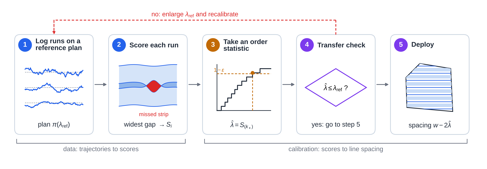
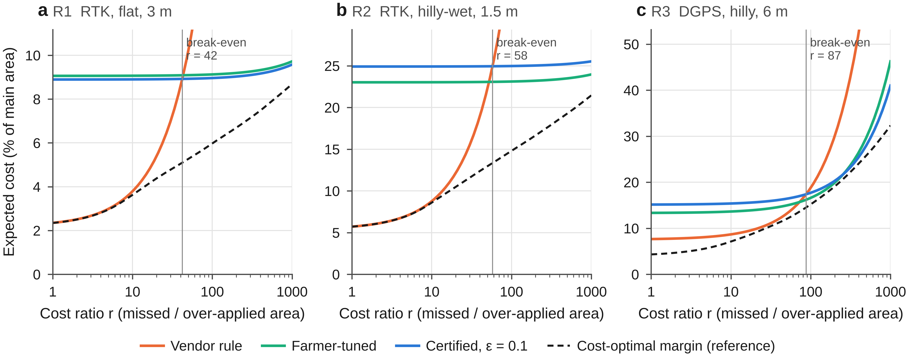

# Calibrating pass overlap from logged runs to bound the probability of missed strips in agricultural field coverage

## Abstract

The overlap between adjacent passes needed to avoid unworked strips depends on GNSS grade, terrain, implement and controller, yet the fixed overlap used in practice carries no stated reliability. This paper proposes conformal erosion, a method that calibrates the pass margin λ (planned overlap 2λ; guidance line spacing = implement width − 2λ) from logged runs, each a complete operation of a field. It sets the margin for a chosen probability of a run with any missed strip in the main area and, equally, states the miss probability of any margin or gap tolerance the user picks. Each run is reduced to one coverage score, the margin at which its executed passes would just leave no strip unworked; the margin is one of the sorted scores, taken by rank. Fields with history are calibrated on their own runs; fields without history on one run from each of many other fields, put on a common scale by a vehicle–terrain–GNSS model (analytic, or a Monte Carlo digital twin) that uses no run data. The bound is distribution-free, given exchangeable runs or fields. In pre-registered simulations with real field boundaries, terrain and GNSS errors, the target miss level was met in the confirmatory checks, but not when guidance coupled successive passes. With 100 runs per field the method used 4–55% less overlap than two conformal planners at the same nominal level; without target-field data it stayed 0.6 percentage points above the per-field oracle, against 1.2–4.4 for learned, empirical and per-configuration baselines. A zero-miss margin paid off against the vendor rule only when a missed area cost roughly 40–90 times an over-applied one.

**Keywords:** coverage path planning; pass-to-pass accuracy; overlap; GNSS guidance; conformal prediction; precision agriculture

### Highlights

- Pass overlap is calibrated from logged runs to bound the chance of a missed strip
- The same runs state the miss probability of any margin or gap tolerance chosen
- Fields without history are calibrated across fields with a vehicle model
- Simulation: miss level met; 4–55% less overlap than two conformal planners
- Zero-miss margins paid off only if misses cost about 40–90 times overlap

### Nomenclature

| Symbol / acronym | Meaning |
|---|---|
| $w$ | implement (swath) width |
| $W$ | main area: field inset by $2w$ (the rest is headland) |
| $\lambda$ | margin: planned overlap between adjacent passes is $2\lambda$, guidance line spacing $w-2\lambda$ |
| $\pi(\lambda)$, $K(\lambda)$ | equal-spacing plan with margin $\lambda$ and its number of passes |
| $J(\lambda)$ | main-area overlap ratio of $\pi(\lambda)$ |
| $e_k(x)$ | lateral offset of executed pass $k$ at along-pass position $x$ |
| $M(\lambda,e)$ | missed (unworked) area of the main area |
| $c_i$; $\ell$, $u$ | sorted executed pass centres at a cross-section; ends of the main-area chord |
| $r^\star(x)$ | covering radius at cross-section $x$ (Section 3.3) |
| $S$ | coverage score of a run (Section 3.3) |
| $\lambda_\mathrm{ref}$ | margin of the reference plan on which scores are recorded |
| $\varepsilon$, $\delta$ | tolerated probability of a run with a missed strip; confidence parameter of the PAC rule |
| $n$, $k_\star$ | number of calibration runs (or fields); rank of the order statistic used as the margin |
| $q^\star$ | order statistic $S_{(k_\star)}$ of the CE verification batch |
| $\lambda^\star_f$ | oracle margin of field $f$: smallest margin with miss-free rate $\ge1-\varepsilon$ on test runs |
| $\hat q_f$ | model scale: predicted $(1-\varepsilon)$ score quantile of field $f$ |
| $V_i$, $v^\star$ | scaled scores $S_i/\hat q_{f_i}$; their order statistic (Section 3.5) |
| $z$, $\sigma(z)$, $t$ | probe-line XTE RMS; CE+ normaliser; conformal quantile of $S/\sigma(z)$ |
| $\kappa$ | inflation of the miss level when fewer passes are deployed than on the reference plan (Section 3.8) |
| $\tau$, $r$, $r_\mathrm{be}$ | tolerated gap width; cost ratio of a missed to an over-applied unit area; break-even cost ratio |
| CE, CE-q, CE+ | conformal erosion calibrated on the field's own runs (Table 2) |
| XCE, XCE-T, XCE-MC | cross-field conformal erosion; with an analytic (theory-based) or Monte Carlo model scale |
| CPrP, UBCP | comparators: conformal predictive programming (Zhao et al., 2024); union-bound conformal planning, pair level (Lindemann et al., 2023) |
| CQR | conformalized quantile regression (Romano et al., 2019) |
| BCD, CPP | boustrophedon cellular decomposition; coverage path planning |
| LQR-I, MPC | linear-quadratic regulator with integral action; model predictive control |
| RTK, DGPS, PPK | real-time kinematic, differential and post-processed kinematic GNSS |
| CORS | continuously operating reference stations |
| XTE, RMS | cross-track error reported by the autosteer; root mean square |
| PAC | probably approximately correct (holds with probability $1-\delta$ over the calibration data) |
| pp | percentage points |

---

## 1. Introduction

Field operations such as spraying, fertilising, seeding and tillage are planned as parallel passes whose spacing equals the implement width minus an overlap. Real passes deviate from the planned line because of GNSS positioning error, wheel slip on slopes and wet soil, antenna roll on side slopes, mounting offsets and the finite bandwidth of the steering controller. A strip is left unworked whenever two adjacent passes drift apart by more than their overlap, or the outermost pass drifts away from the field boundary; what matters is the relative error between adjacent passes, the pass-to-pass accuracy. Both outcomes carry a cost: missed strips lose yield or leave weeds and pests untreated, and overlap applies seed, fertiliser and pesticide twice (FAO, 2025; Zhang et al., 2015, 2021). On autonomous machines no operator is present to see and correct a gap, so the margin must be right in advance.

Current practice sets a fixed overlap, typically twice the vendor's pass-to-pass specification or a value learned by experience. Such a margin has no stated reliability and does not adapt to field shape, terrain, receiver grade or implement width. Coverage path planning (CPP) assumes perfect execution (Galceran and Carreras, 2013; Höffmann et al., 2024); control research reduces tracking error but does not state how often a strip will be missed (Lenain et al., 2006); and conformal prediction, which turns logged data into a margin with a finite-sample, distribution-free guarantee, has been used for planning (Lindemann et al., 2023; Zhao et al., 2024) but not for field coverage, which differs in three ways:

1. A run is miss-free only if every pair of adjacent passes and every field edge is covered, so the guarantee must hold for the worst of many pass pairs at once.
2. The line spacing on which data are logged differs from the spacing finally deployed. A narrower spacing means more passes and more chances of a gap, so reliability measured at one spacing does not carry over to a narrower one.
3. A field is worked only a few times per year, while a conformal margin at a miss level of 10% needs at least 9 logged runs of the same field, or 22 if the guarantee must hold with confidence 0.9 for the particular runs logged.

This paper proposes **conformal erosion**, a method that calibrates the overlap of a coverage plan from logged runs. Erosion means planning every pass as if the implement were narrower by a margin $\lambda$ on each side, which leaves an overlap of $2\lambda$ between adjacent passes. The output is a line-spacing setting, $w-2\lambda$, that can be entered into a guidance terminal, together with the probability that a run at this setting leaves any strip unworked; conversely, for any margin the user prefers, the same data state its miss probability. Fig. 1 shows the workflow. The contributions answer the three features above:

1. **An exact coverage score** (Section 3.3) that decides whether a run left any strip unworked, field edges included. Being the smallest such score, it gives a margin never larger than the per-pair scores of earlier conformal planners (feature 1).
2. **Calibration for fields with operation history** (Sections 3.4 and 3.6), on runs logged on a reference plan with at least as many passes as the deployed one; a transfer check enforces this order (feature 2).
3. **Calibration for fields without history** (Section 3.5). A farm or contractor typically holds many fields with one or two logged operations each; the method pools one run from each, and a vehicle–terrain–GNSS model computed without run data only puts the fields on a common scale (feature 3).
4. **A pre-registered simulation evaluation** (Sections 3.9 and 4) on 30 to 135 unseen fields per experiment, against conformal planners, practice rules, configuration-aware baselines and learned predictors, with robustness tests and a cost analysis.

**Fig. 1.** Workflow of the proposed method. Logged runs, of the target field or one on each of many other fields, are reduced to one coverage score each (step 2); an order statistic of the scores, divided by a model scale computed without run data when they come from other fields, gives the margin (step 3); the user's planner generates the deployed plan (step 4). Transfer check: if $\hat\lambda>\lambda_\mathrm{ref}$, recalibrate on a larger reference plan.

All confirmatory experiments were pre-registered: protocols and decision criteria were archived in a time-stamped repository before the experiments were run, so that results could not be selected afterwards. Failed and partly met claims are reported alongside met ones, and post hoc analyses are labelled (Supplementary Table S20).

---

## 2. Related work

*Coverage path planning.* Boustrophedon cellular decomposition (BCD) with swath-angle optimisation is the standard for agricultural fields (Höffmann et al., 2024). Fields2Cover provides an open implementation with heading search and Dubins turns (Mier et al., 2023), Mier et al. (2025) add continuous-curvature headland paths, and Hameed et al. (2016) compute 3D-terrain-equivalent spacing. None attaches a probability to complete coverage; the proposed method supplies the margin that such planners take as input.

*Robust and model-based margins.* Tube MPC (Mayne et al., 2005), Gaussian chance constraints with Rice's extreme-value correction (Rice, 1944), Gaussian-process cautious control (Hewing et al., 2020), Wasserstein distributionally robust CVaR (Mohajerin Esfahani and Kuhn, 2018) and the scenario approach (Campi and Garatti, 2008) bound tracking error by a model, a worst case or sampled constraints. Parametric models misrepresent the heavy, temporally clustered tail of RTK errors (Section 3.9), and worst-case sets are conservative. Offset-free MPC (Pannocchia and Rawlings, 2003) and slip observers (Lenain et al., 2006) reduce the error without bounding the miss probability.

*Conformal prediction.* The method builds on split conformal prediction and its training-conditional (PAC) variant (Vovk, 2012), conformal prediction under covariate shift and beyond exchangeability (Tibshirani et al., 2019; Barber et al., 2023), conformalized quantile regression (CQR; Romano et al., 2019), conformal risk control (Angelopoulos et al., 2024, 2025), hierarchical conformal prediction with one sample per group (Dunn et al., 2023) and functional conformal bands (Lei et al., 2015; Diquigiovanni et al., 2022), of which the coverage score is an instance. Conformal planning methods (Lindemann et al., 2023; Zhao et al., 2024; Sun et al., 2023; Wang and Ning, 2025) do not address a maximum over pass pairs that changes with the plan.

---

## 3. Materials and methods

### 3.1 Problem statement

**Fields, plans and margins.** A field is a polygon; its **main area** $W$ is the field inset by $2w$, with $w$ the implement width (an evaluation convention that does not affect the method), and the rest is headland. A plan is a set of straight pass centrelines $y_1<\dots<y_K$ along the working direction $x$. For a **margin** $\lambda\ge0$ the planner $\pi(\lambda)$ lays parallel lines from one edge at spacing $w-2\lambda$, so that adjacent planned footprints overlap by $2\lambda$; the number of passes $K(\lambda)$ does not decrease as $\lambda$ grows. The overlap ratio $J(\lambda)$ is the swath area within $W$ divided by the area of $W$, minus one.

**Execution.** Pass $k$ is driven with lateral offset $e_k(x)$, so its footprint at position $x$ is $[y_k+e_k(x)-w/2,\ y_k+e_k(x)+w/2]$ (Fig. 2). Offsets are random, correlated along and across passes (adjacent passes read the same GNSS error trajectory a pass duration apart), and depend on the plan through the terrain and time at which each pass is driven. Coverage is evaluated on cross-sections of $W$ spaced 1 m apart along the working direction.

**Objective.** Let $M(\lambda,e)$ be the missed area of $W$ when $\pi(\lambda)$ is executed with offsets $e$. The ideal is the smallest overlap for which the probability of a run without any missed strip is at least $1-\varepsilon$:
$$
\min_{\lambda}\ J(\lambda)\quad\text{s.t.}\quad \Pr\big[M(\lambda,e)=0\big]\ \ge\ 1-\varepsilon ,
$$
with $\varepsilon=0.1$ in all experiments. The distribution of $e$ is unknown, so this minimiser, the **oracle margin** $\lambda^\star_f$ of field $f$, cannot be computed; the method returns instead the smallest margin that the logged runs support.

**Fig. 2.** The coverage problem. (a) One simulated run of the DGPS configuration (R3, 6 m implement; Section 3.9) on a real paddy field, planned with that field's oracle margin; the main area is inside the dashed line, and the missed strip (red, width exaggerated) is where two adjacent passes drifted apart by more than their planned overlap. (b) Detail of the framed area; the widest gap is 12 cm. (c) Cross-section at one along-pass position (schematic): the chord $[\ell,u]$ is fully covered unless two executed centres are more than $w$ apart (interior gap) or the outermost centre is more than $w/2$ from the boundary (field-edge miss).

### 3.2 Method overview

Conformal erosion turns logged runs into a margin in four steps (Fig. 1):

1. **Generate a reference plan** $\pi(\lambda_\mathrm{ref})$ with a generous margin, using the user's planner. Runs are logged on this plan, or on the reference plans of other fields.
2. **Score each logged run**: reduce the executed implement track to one coverage score $S$ (Section 3.3).
3. **Calibrate the margin** $\hat\lambda$ as an order statistic of the scores, chosen so that a new run exceeds it with probability at most $\varepsilon$, on average over the calibration data (marginal rule) or with confidence $1-\delta$ (PAC rule). The scores come from the field itself (Section 3.4) or, for a field without history, from one run on each of many other fields, each divided by a model-predicted scale (Section 3.5).
4. **Plan and deploy** $\pi(\hat\lambda)$ after a transfer check that $\hat\lambda\le\lambda_\mathrm{ref}$ (Section 3.6). The user sets the line spacing in the guidance terminal to $w-2\hat\lambda$.

Tables 1 and 2 list the inputs and the variants. All variants share step 2; they differ in how $\lambda_\mathrm{ref}$ is chosen, where the scores come from and how they are scaled, and whether the deployed plan is the reference plan itself (CE) or one with a smaller margin (CE-q, CE+, XCE).

<!-- source: docs/paper/supplementary.md Appendix C.5; results/revision/rv1_v8_reanalysis.txt (reference margins) -->
| Input | Requirement |
|---|---|
| Planner | accepts a margin, i.e. lays passes at spacing $w-2\lambda$ |
| Logged runs | complete operations with the track of the implement's working centre (not the tractor) from an independent reference much more accurate than the margin, e.g. a PPK rover on the implement; guidance logs alone are not sufficient |
| Pooling | same tractor, implement, receiver, correction source, controller settings and speed, same mix of seasons and soil states; segments in which production would stop (e.g. loss of RTK fix) removed |
| Number of runs $n$ | ≥ 9 (marginal) or ≥ 22 (PAC) per field, or calibration fields for XCE |
| Reference margin | CE: raised by pilot batches; CE+, XCE: 1.25 × largest $(1-\varepsilon)$ score quantile of five training fields (17.5, 19.4, 43.4 cm in R1–R3) |
| $\varepsilon$, $\delta$, $\tau$ | chosen before the calibration scores are examined |
| XCE only | per field: controller settings, terrain model, GNSS grade, width; a vehicle simulator (twin) or the analytic model |
| CE+ only | five training fields; autosteer XTE on one headland probe line per operation |
| Output | $\hat\lambda$ (line spacing $w-2\hat\lambda$) or refusal; miss probability of any margin fixed in advance |

*Table 1. Inputs the user provides.*

<!-- source: docs/paper/supplementary.md Appendix A -->
| Variant | Calibration data | Score scale | Deployed plan | Guarantee on the deployed plan |
|---|---|---|---|---|
| CE | target-field runs (pilot + verification batch) | none | reference plan | distribution-free, given exchangeable runs (Appendix A.4) |
| CE-q | $n$ target-field runs | none | $\pi(\hat\lambda)$ | as CE, inflated by $\kappa$ under the coupling assumption (Appendix A.15) |
| CE+ | $n$ target-field runs + 5 training fields | probe-line XTE, if it passes cross-validation | $\pi(t\,\sigma(z))$ | for $S/\sigma(z)$; deployed plan: bound on $P(S_\mathrm{new}>t\sigma(z_\mathrm{new})-\bar\Delta)$ under the coupling assumption (Appendix A.9) |
| XCE-T / XCE-MC | one run on each of $n$ other fields | model quantile $\hat q_f$ (analytic / Monte Carlo twin) | $\pi(\hat q_g v^\star)$, $g$ = target field | score: distribution-free given exchangeable fields (Appendix A.17); plan: factor $\kappa$ |

*Table 2. Variants of the proposed method. CE-q is the core variant, CE+ an optional refinement. All but CE require a deployed margin of at most $\lambda_\mathrm{ref}$.*

### 3.3 Coverage score of a run (step 2)

In words: at each cross-section, check whether two adjacent executed passes are more than one implement width apart and whether the outermost pass is more than half a width from the boundary; the worst place in the field decides how much margin the run needed. Formally, at cross-section $x$ let $c_1<c_2<\dots$ be the executed centres of the passes whose footprint meets the chord $[\ell(x),u(x)]$ of $W$, plus the nearest pass on each side, and $Y(x)$ their set. The chord is fully covered if and only if
$$
r^\star(x)=\max\Big\{\mathrm{dist}(\ell,Y),\ \mathrm{dist}(u,Y),\ \max_{i:\ (c_i+c_{i+1})/2\in[\ell,u]}\tfrac12(c_{i+1}-c_i)\Big\}\ \le\ \tfrac w2 ,
$$
where the first two terms are the field-edge terms and the third is half the widest gap between adjacent passes. For a run of the reference plan the **coverage score** is
$$
S=\lambda_\mathrm{ref}+\max_x\big(r^\star(x)-w/2\big).
$$
It measures, on the plan actually driven, how far every executed footprint could be narrowed ($S<\lambda_\mathrm{ref}$) or would have to be widened ($S>\lambda_\mathrm{ref}$) before a strip is missed: the run is miss-free if and only if $S\le\lambda_\mathrm{ref}$. Reading $S$ as the margin needed by a different plan requires the coupling assumption (Section 3.8).

The score decides complete coverage of the main area exactly, whatever the error process (Appendix A.1). Among all scores that decide complete coverage at every margin (every virtual widening or narrowing of the executed footprints) it is the smallest (Appendix A.3), so for the same runs and rule it gives a margin at least as small as any other such score, in particular the per-pair maxima of earlier conformal planners. An interior gap is a difference of two passes, in which error shared by adjacent passes cancels; an edge term takes the full error of one pass and therefore carries at least $\sqrt2$ times the spread. Section 4.3 reports how often edge terms set the score.

### 3.4 Calibration on the field's own runs (step 3a; CE, CE-q, CE+)

For $n$ scores sorted from smallest to largest, the **marginal rule** takes the $k_\star$-th with $k_\star=\lceil(n+1)(1-\varepsilon)\rceil$, for example the 28th of 30; on average over the logged runs, at most one new run in ten then exceeds it. The **PAC rule** takes the smallest $k_\star$ with $\mathrm{BinomCDF}(k_\star-1;n,1-\varepsilon)\ge1-\delta$: with confidence $1-\delta$ (here 0.9) the miss probability is at most $\varepsilon$ for the particular runs logged. If $k_\star>n$, nothing is deployed; at $\varepsilon=\delta=0.1$ the rules need $n\ge9$ and $n\ge22$.

**CE** first searches for a sufficient reference margin and then verifies it: (1) log a pilot batch on $\pi(\lambda_\mathrm{ref})$ and compute the empirical $(1-\varepsilon)$ quantile $q$ of its scores; (2) if $q>\lambda_\mathrm{ref}$, set $\lambda_\mathrm{ref}=1.10\,q$ and repeat; (3) freeze the plan and log a fresh verification batch; (4) deploy $\pi(\lambda_\mathrm{ref})$ if the verification order statistic $q^\star=S_{(k_\star)}$ is at most $\lambda_\mathrm{ref}$, otherwise nothing. Because the deployed plan is the scored plan, CE needs no assumption beyond exchangeable runs. **CE-q** deploys $\pi(q^\star)$, which has no more passes and no more overlap than the reference plan. **CE+** fixes the budget at $n$ runs, takes $\lambda_\mathrm{ref}$ from training fields (Table 1) and may normalise each score by a predicted scale $\sigma(z)$, a linear function of the RMS $z$ of the autosteer's XTE on a headland probe line driven before the infield passes; it deploys $t\,\sigma(z_\mathrm{new})$, with $t$ the conformal quantile of $S_i/\sigma(z_i)$. The XTE reflects slip and roughness, not GNSS error, which the receiver cannot see. The normalisation is used only if it lowers the mean margin by at least 3% in leave-one-field-out cross-validation on the training fields (constants in Appendix C.5).

**Worked example.** R1 field 440 ($w=3$ m) has a reference margin of 17.5 cm and $n=29$ logged runs, so $k_\star=27$. The scores range from 4.5 to 16.5 cm (median 7.0 cm), and the 27th smallest is 9.4 cm. CE-q therefore deploys a margin of 9.4 cm: line spacing 281.1 cm, main-area overlap 6.97%. The field's oracle margin is 10.7 cm (overlap 7.58%). This particular set of 29 runs gives a miss-free rate of 0.745 on test runs; over 2000 redraws of 29 runs the mean is 0.890 (10th–90th percentile 0.811–0.963). The bound holds on average over the logged runs, which is why the PAC rule exists.

### 3.5 Calibration across fields (step 3b; XCE)

For a target field $g$ without logged runs, XCE pools one run from each of $n$ other fields. A **model scale** $\hat q_f$ predicts each field's $(1-\varepsilon)$ score quantile on its reference plan from controller settings, terrain model and GNSS grade, **without run data**. XCE forms $V_i=S_i/\hat q_{f_i}$ for each calibration field, takes the marginal or PAC order statistic $v^\star$, and gives the target field $\lambda_g=\hat q_g\,v^\star$. A field whose prediction fails ($\hat q_{f_i}$ not finite) gets $V_i=+\infty$; on the target field nothing is then deployed.

Any scale computed from field properties alone keeps the field-averaged guarantee on the score; the model's accuracy decides how tight the margins are and how evenly the miss-free rate is spread across fields and configurations. The comparators are raw pooling ($\hat q\equiv1$), per-configuration (Mondrian) pooling, a vendor-specification scale, a learned CQR-type ridge scale (Romano et al., 2019) and an empirical per-configuration scale; the last is estimated from the calibration fields' own scores, so its validity is checked only empirically.

*XCE-MC* runs a closed-loop vehicle simulation (a digital twin) 1000 times on the reference plan and takes the 0.9 quantile of the scores. *XCE-T* computes it analytically (Appendix B): the closed loop is linearised around the noise-free path, giving each pass a Gaussian lateral error given the operating condition; the probability that a gap or edge exceeds a threshold is bounded by Kac–Rice upcrossing sums or estimated by Gaussian Monte Carlo; pass pairs are combined and 200 operating conditions mixed. It builds on Kac–Rice formulas (Azaïs and Wschebor, 2009; Piterbarg, 1996), maxima of stationary processes (Leadbetter et al., 1983; Hall, 1979) and statistical linearisation (Booton, 1954; Kazakov, 1956). Both are computed once per field, offline: XCE-T took 16–353 s per field on one core without field-edge terms (Table S21) and a median of 271 s (129–2356 s) with them (Appendix B.3); XCE-MC a median of 8–21 s (shared four-core machine).

### 3.6 Deployment and transfer check (step 4)

For every variant that deploys a plan other than the reference plan (CE-q, CE+, XCE), the deployed margin must not exceed $\lambda_\mathrm{ref}$; otherwise the deployed plan has more passes than the plan on which the scores were recorded, and the guarantee does not apply. If $\hat\lambda>\lambda_\mathrm{ref}$, neither $\pi(\hat\lambda)$ nor the reference plan is deployed (the calibration has just shown $\lambda_\mathrm{ref}$ to be too small); the field is recalibrated on a reference plan with a larger margin: CE logs a new pilot batch with $\lambda_\mathrm{ref}$ raised, and XCE re-plans the reference plans with a larger margin and recomputes the model scales. The pre-registered experiments ran without this check; Sections 4.1 and 4.3 report how often it would have been triggered.

### 3.7 Gap tolerance and choice of $\varepsilon$

Where a narrow strip is tolerable, for example where the tapering spray of a boom's end nozzles is made up by the adjacent pass, the event becomes "no gap wider than $\tau$": an interior gap has width $2(r^\star-w/2)$ and an edge strip $r^\star-w/2$, so $S_\tau=S-\tau/2$ is valid (conservative for edges) and the margin is $\hat\lambda-\tau/2$. The rectangular footprint fits operations uniform across the swath (boom spraying, rotary tillage); seeding and spinner spreading need their own score. The level $\varepsilon$ is an economic choice (Section 4.4). $\varepsilon$ and $\tau$ must be fixed before the scores are examined; choosing them by cost from the same scores voids the marginal guarantee unless a bound valid for all margins at once (e.g. a DKW band) is used.

### 3.8 Assumptions behind the guarantee

For the user: deploying the plan on which the runs were logged is safest; the deployed line spacing may be wider (fewer passes) but never narrower; and a cross-field guarantee is a fleet average, so each machine configuration must be checked. Formal statements are in Appendix A.

- **Score.** Exact for interval footprints on the 1 m cross-section grid of the main area, given ground truth of the implement position (Appendix A, F1–F2).
- **Exchangeable runs (CE).** The logged runs and the new run are exchangeable (i.i.d. for the PAC rule): the same mix of seasons, soil states and GNSS conditions, with no trend or equipment change. The marginal rule gives P(deploy and miss) $\le\varepsilon$ averaged over the calibration data; the PAC rule, with probability $1-\delta$ over the calibration data, a miss probability of at most $\varepsilon$ given deployment (Appendix A.4).
- **More passes.** A plan with more passes typically has a stochastically larger score, so a threshold calibrated on the nominal plan $\pi(0)$, as earlier conformal planners do, has no distribution-free guarantee on the deployed plan; with i.i.d. pair scores, as an illustration, its miss-free rate is about $(1-\varepsilon)^{K_1/K_0}<1-\varepsilon$ for $K_1>K_0$ pairs (Appendix A.6).
- **Coupling assumption (CE-q, CE+, XCE).** The guarantee carries over to a plan with fewer passes if each gap or edge term of the deployed plan exceeds its coupled counterpart on the reference plan by at most a noise-independent amount. The miss level is then inflated by at most a factor $\kappa$ for CE-q and XCE; $\kappa$ was not estimated here and is small when terrain and timing effects of the plan change are small (Appendix A.15). The assumption holds for a linear loop when only the deterministic response changes with the plan, approximately when re-timing shifts the GNSS error each pass reads, and not for guidance that steers each pass relative to the previous one. For CE+ with a non-constant normaliser the bound is $P(S_\mathrm{new}>t\sigma(z_\mathrm{new})-\bar\Delta)$ (Appendix A.9).
- **Exchangeable fields (XCE).** With exchangeable fields (i.i.d. for PAC), one run per calibration field at its reference plan and a scale that depends only on field properties, the score guarantee holds whatever the model's accuracy (Appendix A.17), as in the two-layer setting of Dunn et al. (2023). It averages over calibration fields, their runs and target fields: for one fixed set of runs and i.i.d. fields the mean miss-free rate on new fields is one draw of $\mathrm{Beta}(k_\star,n+1-k_\star)$ (standard deviation 0.054 for $n=29$). It is not a statement per field or configuration.
- **Ideal scale.** Even with each field's oracle margin as scale, a new field's margin is its requirement times an order statistic of within-field tail ratios set by $n$, $k_\star$ and the within-field score distribution; this is an identity for the ideal scale, not a lower bound for every scale (Appendix A.20).

### 3.9 Simulation study

**Data.** All inputs are public. Field boundaries and working directions come from 250 combine-harvester GNSS trajectories of the national agricultural machinery operation platform of China (Wu et al., 2023); density-based clustering extracts 964 fields, of which, after filtering, 137 paddy fields (hilly south) and 162 wheat fields (North China Plain) are used. Terrain comes from Copernicus GLO-30 (European Space Agency, 2021). GNSS error comes from 12 NOAA CORS station pairs (baselines 5–30 km, US Midwest and Great Plains), 8 days each across four seasons of 2024–2025, processed with RTKLIB (Takasu and Yasuda, 2009) in its demo5 fork (Everett, n.d.) as a moving rover at four receiver grades (Table 3); 30 s epochs are interpolated to 1 Hz and high-frequency residuals of a vehicle GNSS/INS record (Tang et al., 2022) added.

<!-- source: results/table_gnss.txt (scripts/table_gnss.py) -->
| Grade | Processing | RMS | 95% | 99.9% | Max |
|---|---|---|---|---|---|
| RTK | carrier phase, ambiguity resolution (84% of epochs fixed, 16% float) | 2.4 cm | 3.3 cm | 24.5 cm | 1.39 m |
| RTK float | carrier phase, no ambiguity resolution | 2.6 cm | 4.0 cm | 24.6 cm | 1.39 m |
| DGPS | code differential | 32.5 cm | 57.8 cm | 2.05 m | 6.05 m |
| Single point | L1 code | 1.51 m | 2.78 m | 4.97 m | 7.16 m |

*Table 3. Horizontal error of the processed CORS series (96 station-pair-days per grade). The RTK tail comes from wrong fixes and float drift lasting minutes, which a guidance terminal would flag; a Gaussian with the same RMS underestimates the probability of errors beyond the 99.9th percentile by orders of magnitude. Static antennas lack vehicle multipath and correction-link outages.*

**Simulator.** A closed-loop simulator (time step 0.05 s, speed 2 m/s) integrates kinematic steering with a 0.25 s steering lag, 35° saturation and a 30°/s rate limit; terrain slip proportional to the lateral gradient plus Ornstein–Uhlenbeck roughness, scaled by per-run soil moisture; a 2.6 m antenna with roll (terrain) compensation $0.85\pm0.05$; a per-run mounting bias (standard deviation 1.5 cm); and lateral GNSS error. Passes are driven in time order with headland turns. The default controller is LQR with integral action (LQR-I); the footprint is centred on the vehicle reference point (rigidly mounted implement). Details are in Appendix C.

<!-- source: experiments/exp_system.py (REGIMES) -->
| Configuration | Fields | GNSS | Width $w$ | Soil moisture | Vendor pass-to-pass |
|---|---|---|---|---|---|
| R1 RTK, flat, 3 m | wheat (plain) | RTK | 3 m | Beta(2, 3) | 2.5 cm |
| R2 RTK, hilly-wet, 1.5 m | paddy (hilly) | RTK | 1.5 m | 0.6–0.9 | 2.5 cm |
| R3 DGPS, hilly, 6 m | paddy (hilly) | DGPS | 6 m | Beta(2, 3) | 20 cm |

*Table 4. Machine configurations; the mixed fleet pools all three. Paddy slopes come from the 30 m elevation model, which does not resolve levelled basins.*

**Metrics.** The *miss-free rate* is the fraction of test runs with zero missed area, pooled over fields; "coverage" refers only to area. The *meet rate* is the fraction of fields whose miss-free rate over 200 test runs is not significantly below 0.9 (one-sided binomial test at 0.05); because a field's calibrated rate varies with its calibration runs, a correctly calibrated marginal method meets it on only about 85% of fields, a PAC method on about 99% (Appendix A.19). *Overlap* is the main-area overlap ratio $J$; *missed area* the mean unworked fraction of the main area; *excess overlap* the overlap minus that of the field's oracle plan, in percentage points (pp). The oracle margin, the smallest margin with a miss-free rate of 0.9 on test runs, uses the test distribution and is a reference, not a method.

**Experiments.** Fields are split by index so that each confirmatory experiment uses fields not used by the analyses that designed it (Appendix C.2). Table 5 maps the questions to the experiments; Table S20 maps each experiment to its pre-registration.

<!-- source: docs/prereg_revision.md; docs/prereg_validity.md; docs/prereg_lowdata*.md; docs/paper/supplementary.md Table S20 -->
| Question | Experiment | Status | Section |
|---|---|---|---|
| With field history: valid, and tighter than conformal planners? | A1: 30 fresh fields per configuration, 100 runs per field | pre-registered | 4.1 |
| What do few runs cost? | A2: $n=9$–100, 45 fields per configuration | pre-registered | 4.1 |
| How accurate is the model scale? | model vs 200-run quantiles; B6 learned predictors | descriptive; post hoc | 4.2 |
| Without field history: valid overall and per configuration, and efficient? | B1–B3 earlier designs; B4 resampling; B5 mixed fleet | pre-registered | 4.2 |
| How sensitive is the method to model error? | C1: six simulated realities | pre-registered | 4.3 |
| Do headland laps change the role of field edges? | C2 | pre-registered | 4.3 |
| When is a zero-miss margin worth its overlap? | cost analysis | descriptive | 4.4 |

*Table 5. Questions of the simulation study and the experiments that answer them.*

## 4. Results

### 4.1 Fields with operation history

On 6 fields × 200 runs the coverage score reproduced the missed-area outcome on every run (Appendix A.3).

**A1, pre-registered comparison.** Both registered claims were met in every configuration (Table 6): validity of CE+, and lower main-area overlap than conformal predictive programming (CPrP) and union-bound conformal planning at pair level (UBCP) under both rules. All methods used 100 runs per field, a number rarely available for one field, and the BCD + LQR-I stack; Fig. S4 shows excess overlap per configuration.

<!-- source: results/v8/summary.txt; results/revision/rv1_v8_reanalysis.txt; results/revision/rv8_transfer_check.txt -->
| Config. | Method | Miss-free rate | Meet rate | Missed area % | Overlap % | Excess overlap pp |
|---|---|---|---|---|---|---|
| R1 | CE+ / CE+ PAC | 0.903 / 0.941 | 0.93 / 1.00 | 0.001 / 0.001 | **8.39** / **9.04** | −0.26 / +0.38 |
| | CPrP / CPrP PAC | 0.944 / 0.967 | 1.00 / 1.00 | 0.001 / 0.000 | 10.35 / 11.47 | +1.69 / +2.82 |
| | UBCP / UBCP PAC | 0.959 / 0.988 | 1.00 / 1.00 | 0.001 / 0.000 | 10.86 / 13.76 | +2.20 / +5.10 |
| | Vendor rule; farmer-tuned | 0.000; 0.897 | 0.00; 0.70 | 0.216; 0.001 | 1.75; 9.22 | −6.90; +0.57 |
| R2 | CE+ / CE+ PAC | 0.911 / 0.944 | 0.90 / 1.00 | 0.001 / 0.001 | **25.62** / **28.14** | +0.70 / +3.22 |
| | CPrP / CPrP PAC | 0.923 / 0.956 | 0.97 / 1.00 | 0.001 / 0.001 | 26.72 / 29.32 | +1.80 / +4.40 |
| | UBCP / UBCP PAC | 0.944 / 0.991 | 0.97 / 1.00 | 0.001 / 0.000 | 28.38 / 44.80 | +3.46 / +19.87 |
| | Vendor rule; farmer-tuned | 0.000; 0.834 | 0.00; 0.20 | 0.642; 0.001 | 3.46; 23.00 | −21.46; −1.92 |
| R3 | CE+ / CE+ PAC (registered) | 0.896 / 0.933 | 0.90 / 1.00 | 0.027 / 0.020 | **15.73** / **19.30** | +0.45 / +4.02 |
| | CE+ / CE+ PAC, transfer check | 0.901 / 0.921 | — | 0.027 / 0.022 | **16.06** / **17.40** | +0.78 / +2.12 |
| | CPrP / CPrP PAC | 0.946 / 0.969 | 1.00 / 1.00 | 0.017 / 0.013 | 20.63 / 25.89 | +5.35 / +10.61 |
| | UBCP / UBCP PAC | 0.960 / 0.983 | 1.00 / 1.00 | 0.014 / 0.006 | 24.22 / 42.61 | +8.94 / +27.33 |
| | Vendor rule; farmer-tuned | 0.403; 0.834 | 0.00; 0.47 | 0.120; 0.036 | 7.59; 13.53 | −7.69; −1.75 |

*Table 6. Experiment A1 (pre-registered; 30 fresh fields per configuration). Registered claims: CE+ marginal not significantly below 0.9 (field-clustered p 0.70, 0.98, 0.29), CE+ PAC failing the meet test on fewer than 9 of 30 fields (0 everywhere), and lower overlap than CPrP and UBCP (one-sided paired Wilcoxon, Holm over 12 comparisons, largest Holm p 0.0225). Reductions against CPrP and UBCP: R1 18.9% and 22.7% (marginal), 21.2% and 34.3% (PAC); R2 4.1% and 9.7%, 4.0% and 37.2%; R3 23.8% and 35.1%, 25.5% and 54.7%. Transfer check (post hoc, descriptive): R3 fields whose mean deployed CE+ margin exceeds $\lambda_\mathrm{ref}$ (9 of 30 marginal, 19 of 30 PAC; none in R1, R2) take the CE result of the same field; reductions 22.2% and 33.7% (marginal), 32.8% and 59.2% (PAC). Practice rules (descriptive): vendor rule = twice the nominal pass-to-pass accuracy; farmer-tuned = tuned once on five training fields to a miss-free rate ≥ 0.9.*

*Source of the gain.* All methods deploy plans from the same family $\pi(\lambda)$, so the gain is calibration tightness, not a better plan family. The comparators calibrate pair or per-constraint scores on the nominal plan or through a union bound and over-cover (miss-free rates 0.92–0.99 at a nominal 0.9), which accounts for their extra overlap. Most of the gain comes from the exact score and the reference plan, not from the probe-line normalisation: CE-q reached 8.82%, 25.51% and 16.19% overlap in R1–R3 against 10.35%, 26.72% and 20.63% for CPrP. Applied overlap including the headland gave the same direction in all 12 comparisons (Table S22).

*Transfer check.* In R1 and R2 the deployed CE+ margin never exceeded $\lambda_\mathrm{ref}$. In R3 its mean exceeded $\lambda_\mathrm{ref}$ on 9 of 30 fields (marginal) and 19 of 30 (PAC), where the coupling assumption does not cover the deployment, although the measured miss-free rate met the target. With the check, these fields recalibrate as CE, and CE+ reaches 0.901 at 16.06% overlap (marginal) and 0.921 at 17.40% (PAC). The registered reductions are 4–55%; with the transfer check 4–59%.

*Other stacks and practice rules.* On six planner–controller stacks, CE and CE+ met their expected meet rates except CE+ on follow-previous-pass guidance in R2 (miss-free rate 0.850, meet rate 0.70), where steering each pass relative to the previous one couples the passes and violates the coupling assumption; CE met its target there (Table S23). The vendor rule missed some strip on almost every run, but only 0.12–0.64% of the main area. The farmer-tuned margin met the target on 70%, 20% and 47% of fields, with 0.8 pp more overlap than CE+ in R1 and 2.6 and 2.2 pp less in R2 and R3: it trades a lower miss-free rate for less overlap, which below the break-even cost ratio of Section 4.4 is the cheaper choice.

**A2, few runs per field (pre-registered).** For each of 45 fields per configuration, $n=9$–100 runs were drawn 2000 times from a 200-run bank, CE-q was calibrated on them, and the deployed plan was evaluated on independent test runs. Both registered predictions were met: the marginal mean miss-free rate was 0.896–0.943, in line with the exact $k_\star/(n+1)$ (0.900, 0.938, 0.913, 0.902, 0.901 for $n=9$, 15, 22, 40, 100), and the PAC fraction of replicates reaching 0.9 was 0.890–0.951 against a required 0.88 (Table S24). The price of few runs is overlap: with 9 runs the marginal rule cost 1.3, 4.0 and 8.3 pp of excess overlap in R1–R3; the PAC rule cost 3.4, 10.0 and 18.7 pp with 22 runs and 1.1, 3.2 and 4.3 pp with 100.

### 4.2 Fields without operation history

With fewer than about 20 logged operations per field, cross-field calibration is the practical route.

**Accuracy of the model scale.** These checks compare the model with the simulator it was built from, so they show internal consistency, not realism (Section 4.3 tests mismatch). Fig. 3 compares the predicted 0.9 score quantile on each field's reference plan with the empirical 0.9 quantile of 200 independent runs, 45 fields per configuration. The Monte Carlo twin differs from this reference by a standard deviation of the log ratio of 0.030 (R1), 0.032 (R2) and 0.083 (R3), essentially the sampling noise of the 200-run quantile. The analytic model differs by 0.039, 0.038 and 0.107 (mean bias +1.0%, +0.1%, +0.9%); net of the reference noise its own error is about 2–3% under RTK (e.g. $\sqrt{0.039^2-0.030^2}\approx0.025$ in R1). Without field-edge terms it was biased low under DGPS (−5.2%); the edge terms, derived on 15 fields and computed unchanged on the other 30, moved the bias there from −5.7% to +0.9% but widened the scatter from 0.089 to 0.106 (Appendix B.3). Learned predictors trained on one run per field were less accurate than the model (Appendix D.11).

**Fig. 3.** Predicted versus simulated 0.9 quantile of the coverage score (m, log–log), one point per field, 45 fields per configuration; both axes compare the model with the simulator it was built from. (a) Analytic model (R3 with field-edge terms); (b) Monte Carlo twin (1000 runs). Simulated value: empirical 0.9 quantile of 200 independent runs; shaded band ±10%.

**Validity: B1–B4.** Three earlier pre-registered cross-field experiments led to the ratio scale (Table S29, Appendix D.3–D.6): B1, with a probability-integral-transform scale, failed; B2 met both claims, mostly through its realised miss-free rate at one calibration draw; B3 was partly met. Single calibration draws gave 0.844 (B2) and 0.877 (B3) in R1 marginal; B4, which redrew both the calibration fields and their logged runs 4000 times, met all 26 cells (marginal means 0.919–0.929 against an exact 0.923; Table S19a, Fig. S1), so such values are consistent with the variation of a single draw. B4 cannot detect a failure of exchangeability.

**B5, mixed fleet (pre-registered).** B5 compares the model scales with configuration-aware baselines and reports the miss-free rate per configuration (Table 7, Fig. 4). All four registered predictions were met: every non-refusing scale was valid overall; raw pooling left the DGPS configuration below 0.85 while the model scale kept every configuration at or above 0.88; Mondrian pooling refused on more than 20% (marginal) and 95% (PAC) of fields with 25 calibration fields; and with 60 calibration fields the model scale was within 0.5 pp of the configuration-aware baselines or better, and the twin within 0.5 pp of the analytic model.

<!-- source: results/revision/rv2_resampling_edges45.txt -->
| Scale | $n=25$: miss-free rate R1 / R2 / R3 (marginal) | $n=25$ excess, marginal / PAC | $n=60$ excess, marginal / PAC |
|---|---|---|---|
| Raw pooling | 0.999 / 0.998 / **0.779** | +29.19 / +63.97 | +17.12 / +37.98 |
| Spec. × scale law | 0.944 / **0.840** / 0.993 | +12.95 / +23.09 | +9.93 / +14.98 |
| Mondrian (per configuration) | 0.958 / 0.960 / 0.957 | refuses on 56% / 100% | +4.35 / refuses on 74% |
| Per-configuration scale | 0.939 / 0.958 / **0.842** | +4.57 / +19.94 | +1.29 / +6.42 |
| CQR (configuration-aware) | 0.961 / 0.942 / **0.866** | +4.09 / +18.86 | +1.20 / +6.19 |
| **XCE-T** (analytic model) | 0.931 / 0.936 / 0.904 | **+2.89** / +14.56 | **+0.57** / +4.37 |
| **XCE-T** with field-edge terms | 0.927 / 0.931 / 0.917 | +3.03 / **+13.69** | +0.63 / +4.36 |
| **XCE-MC** (Monte Carlo twin) | 0.924 / 0.929 / 0.913 | **+2.68** / **+13.76** | **+0.55** / **+4.19** |

*Table 7. Experiment B5 (pre-registered): mixed fleet of 135 fields, 4000 replicates; excess overlap in pp. Overall validity held for every non-refusing scale (marginal mean 0.896–0.925; PAC fraction 0.892–0.955). Per-configuration rates are not part of the guarantee; bold: below 0.88 (same rule as Table 8). Mondrian excess is over deployed fields. XCE-T without edge terms is the registered scale. Full output: Table S26.*

Raw pooling gave the DGPS configuration only 0.779 while over-covering the RTK fields at 0.999: the overall guarantee can hide a badly served configuration. Under the marginal rule the model scales gave every configuration an observed miss-free rate of 0.885–0.936 at both calibration sizes (Table S26); with the field-edge terms the DGPS fields reached 0.899–0.924 instead of 0.834–0.904 (marginal mean or PAC fraction) at the same excess overlap. Mondrian pooling needs at least 9 (marginal) or 22 (PAC) calibration fields per configuration and, with 25 shared by three configurations, refused on 56% of new fields (marginal) and on all (PAC). With 60 calibration fields the model scales cost 0.55–0.63 pp (marginal) against 1.20–1.29 pp for the learned and empirical configuration-aware scales and 4.35 pp for Mondrian, and 4.2–4.4 pp (PAC) against 6.2–6.4 pp and 12.2 pp (Mondrian, on the 26% of fields it did not refuse). The configuration-aware scales left the DGPS fields at 0.82–0.87, because a scale learned from one run per field misses the heavier DGPS tail. The analytic model and the twin were within 0.8 pp in every cell.

**Fig. 4.** Experiment B5. Mean excess overlap of the scales with 60 calibration fields (XCE-T with field-edge terms) under the marginal (a) and PAC (b) rule (over deployed fields; pale bar: a scale that refuses on part of the fields); (c) mean miss-free rate of the DGPS fields, marginal rule, 25 calibration fields (dashed line 0.9).

### 4.3 Robustness

**C1, model mismatch (pre-registered).** Six simulated "truths" change the reality while all scales keep the nominal model: T1 intermittent wet patches with heavy-tailed slip pulses; T2 a trailed implement (5 m hitch, downhill crab); T3 speed 1.5–3.0 m/s with 0.15 s steering latency and a 0.3° deadband; T4 GNSS error × 1.5; T5 terrain gradients reduced to a quarter (levelled basins); T6 T1–T4 combined. For every field and variant, 200 calibration runs and the miss-free rate and overlap at 28 margins (the margin curve) were simulated from the truth (Table 8). None of the four registered predictions held in every variant (Table S27).

<!-- source: results/revision/rv4_mismatch_edges45.txt; results/revision/rv2_resampling_edges45.txt; results/revision/rv3_small_n.txt -->
| Truth | Model bias $\log(\hat q/q)$, R1 / R2 / R3 | XCE-T miss-free rate: all / DGPS (raw pooling DGPS) | Excess pp: XCE-T / XCE-MC / spec. × scale / Mondrian / raw | CE-q ($n=100$) miss-free rate R1 / R2 / R3 |
|---|---|---|---|---|
| Nominal | +0.01 / +0.00 / +0.01 | 0.902 / 0.899 (**0.718**) | 0.63 / 0.55 / 9.93 / 4.35 / 17.12 | 0.896 / 0.909 / 0.898 |
| T1 wet patches | −0.73 / −0.72 / −0.02 | **0.895** / 0.984 (**0.823**) | 2.39 / 1.77 / 45.53 / 23.49 / 7.81 | **0.893 / 0.891** / 0.897 |
| T2 trailed implement | +0.42 / +0.43 / +0.09 | 0.903 / **0.808** (**0.716**) | 0.49 / 0.52 / 3.93 / 3.81 / 17.86 | 0.900 / 0.903 / 0.902 |
| T3 speed, latency | +0.00 / +0.01 / −0.99 | 0.903 / **0.853** (**0.801**) | −18.07† / −17.51† / −9.02† / 40.68 / 3.93 | 0.899 / 0.899 / 0.924 |
| T4 GNSS × 1.5 | −0.04 / −0.02 / −0.35 | 0.901 / **0.803** (**0.711**) | 0.69 / 0.75 / 7.66 / 6.99 / 42.73 | 0.896 / 0.902 / 0.897 |
| T5 levelled terrain | −0.01 / +0.01 / +0.02 | 0.902 / 0.908 (**0.717**) | 0.56 / 0.47 / 9.99 / 3.98 / 16.47 | 0.904 / 0.899 / 0.904 |
| T6 combined | −0.48 / −0.45 / −1.82 | 0.905 / **0.780** (**0.753**) | 14.09 / 12.33 / 8.71 / 51.01 / 58.34 | 0.908 / 0.899 / 0.949 |

*Table 8. Experiment C1 (pre-registered). Model bias: mean log ratio of the nominal analytic-model quantile (with edge terms) to the truth quantile, 45 fields per configuration. Mixed fleet: marginal rule, 60 calibration fields, 2000 replicates. CE-q: mean over 500 replicates per field. Bold: at or below 0.895 overall, or below 0.88 for one configuration. †Negative because the DGPS fields are under-served, not an efficiency gain.*

*Validity.* All scales remained valid overall in five of six variants. In T1, whose slip pulses roughly double the RTK margin, the overall marginal miss-free rate of every scale fell to 0.892–0.895 with 60 calibration fields (criterion 0.895; exact expectation 0.902), and CE-q with 100 runs reached 0.893 (R1) and 0.891 (R2). The cause is the transfer step, not the conformal step: the reference margin had been set from nominal training fields, and the deployed RTK margin exceeded it on most fields. The transfer check would have refused these deployments and recalibrated on larger reference plans; the overlap of that recalibration was not computed.

*Model accuracy.* Mismatch that rescales the error left the model useful: with a trailed implement it over-predicted the margin by about 50% (log bias +0.42; the implement low-pass filters the tractor's lateral error), with degraded GNSS it under-predicted the DGPS margin (−0.35), and with levelled terrain it stayed accurate; in these variants XCE-T remained the most efficient scale (0.5–0.7 pp against 3.8–42.7 pp). Mismatch that changes the error structure did not: with wet patches the model underpredicted RTK margins by a factor of 2, with a faster vehicle, latency and deadband the DGPS loop became unstable and the model underpredicted by a factor of 2.7, and in the combined variant the vendor-specification scale was more efficient (8.7 vs 14.1 pp). The twin, which shares the model's assumptions, failed in the same cases.

*Per-configuration miss-free rate.* When the mismatch affected one configuration more than the others (T2, T3, T4, T6), the model scale no longer equalised the configurations: the DGPS fields reached 0.78–0.85, better than raw pooling (0.71–0.80) but below target.

**C2, headland laps (pre-registered).** In the main experiments only the outermost pass covers the edge of the main area. C2 adds one headland lap per side, planned to overlap the main area by $\lambda$ and driven after the infield passes. Without laps a field-edge term set the coverage score in 1.0% (R1), 0.8% (R2) and 10.0% (R3) of runs; with laps in 0.1%, 0.1% and 1.9%. Laps left the required margin unchanged under RTK and lowered it by about 6% under DGPS (oracle margin 0.391 → 0.366 m; overlap 15.12% → 14.01%). Both registered predictions were met: the DGPS edge share fell below 50%, and CE-q remained valid with laps (marginal mean 0.897–0.902; PAC fraction 0.885–0.907; Table S28).

### 4.4 What a calibrated zero-miss margin costs

The event "no strip missed with probability 0.9" counts a 1 cm sliver like a 1 m strip. Let $r$ be the cost of leaving one unit of area unworked divided by the cost of over-applying one unit (for an input-saving operation, the yield or control value lost on a missed strip over the input cost). The expected cost of a margin, in percent of the main area, is overlap $+\ r\times$ missed area. This counts only input costs: the extra passes, time and fuel of overlap and the damage of a double dose (lodging, herbicide injury) make overlap dearer and raise the ratio at which a zero-miss margin pays off, while missed slivers may be partly compensated by neighbouring rows and weed escapes can reseed for years. Table 9 and Fig. 5 evaluate the cost on the margin curves of 45 test fields per configuration (nominal model, descriptive).

<!-- source: results/revision/rv_cost.txt -->
| Config. | Policy | Miss-free rate | Overlap % | Missed % | Cost, $r=10$ | $r=30$ | $r=100$ | $r=300$ |
|---|---|---|---|---|---|---|---|---|
| R1 | vendor rule | 0.000 | 2.12 | 0.160 | 3.72 | 6.92 | 18.10 | 50.04 |
| | farmer-tuned | 0.882 | 9.05 | 0.001 | 9.06 | 9.07 | 9.11 | 9.24 |
| | calibrated, $\varepsilon=0.1$ (ideal) | 0.900 | 8.91 | 0.001 | 8.92 | 8.93 | 8.98 | 9.11 |
| | cost-optimal margin | 0.02–0.50 | 2.5–6.0 | | **3.54** | **4.69** | **5.92** | **7.10** |
| R2 | vendor rule | 0.000 | 5.38 | 0.336 | 8.74 | 15.45 | 38.95 | 106.09 |
| | farmer-tuned | 0.844 | 23.02 | 0.001 | 23.03 | 23.05 | 23.11 | 23.30 |
| | calibrated, $\varepsilon=0.1$ (ideal) | 0.900 | 24.93 | 0.001 | 24.94 | 24.95 | 24.99 | 25.11 |
| | cost-optimal margin | 0.00–0.32 | 5.9–15.0 | | **8.58** | **11.58** | **14.78** | **17.75** |
| R3 | vendor rule | 0.437 | 7.56 | 0.112 | 8.68 | 10.91 | 18.73 | 41.07 |
| | farmer-tuned | 0.853 | 13.35 | 0.033 | 13.68 | 14.33 | 16.62 | 23.16 |
| | calibrated, $\varepsilon=0.1$ (ideal) | 0.900 | 15.10 | 0.026 | 15.36 | 15.88 | 17.69 | 22.87 |
| | cost-optimal margin | 0.21–0.89 | 4.6–14.4 | | **7.15** | **10.31** | **15.21** | **21.90** |

*Table 9. Expected cost (overlap % + $r$ × missed-area %), descriptive. "Calibrated (ideal)": each field's oracle margin, which an exactly calibrated method would deploy; cost-optimal margin: minimises the expected cost per field given the test distribution (a reference, not a method). The vendor-rule overlap differs from Table 6 because the field sets differ (45 against 30).*

**Fig. 5.** Expected cost against the cost ratio $r$ (both axes logarithmic) for the vendor rule, the farmer-tuned margin, the calibrated margin at $\varepsilon=0.1$ (oracle margin) and the cost-optimal margin; means over the test fields of each configuration (a–c). The vertical line marks the break-even ratio $r_\mathrm{be}$ above which the calibrated margin is cheaper than the vendor rule.

Three conclusions follow:

1. Against the vendor rule, the calibrated zero-miss margin pays off only above a break-even ratio of $r_\mathrm{be}\approx43$ (R1), 58 (R2) and 88 (R3); with the per-configuration results of Experiment A1, 31–35 (RTK) and 88–117 (DGPS).
2. Under RTK the cost-optimal margin accepts frequent but tiny misses (slivers of 0.004–0.03% of the area): even at $r=300$ its miss-free rate is only 0.50 (R1) and 0.32 (R2). Only under DGPS, whose misses are wider, does it approach 0.9 ($r=300$: 0.89).
3. A tolerance helps where implements are narrow: "no gap wider than 2 cm" lowers the margin by 1 cm and saves 0.9, 2.0 and 0.4 pp of overlap in R1–R3; a 5 cm tolerance saves 2.0, 5.0 and 1.1 pp.

The value of $r$ is not estimated here. As a hypothetical illustration, a fertiliser strip whose omission loses a third of a crop worth five times the fertiliser cost gives $r\approx1.7$, while a miss that triggers a regulatory, quarantine or resistance-management cost can give $r$ in the hundreds. Below the break-even, the calibration still states the miss probability of a cheaper margin, provided $\varepsilon$ or $\tau$ is fixed in advance (Section 3.7). Conformal risk control of the expected missed area (Angelopoulos et al., 2024) would target cost directly, but its finite-sample term $B/(n+1)$, with $B$ the largest possible loss, exceeds the relevant missed-area levels (0.01–0.1%) unless thousands of runs are available.

---

## 5. Discussion

### 5.1 What the experiments showed about the guarantee

When the deployed margin stayed below the reference margin and passes were guided independently, the measured miss-free rate was consistent with the target (A1 with the transfer check; marginal means 0.896–0.943 in A2, B4, B5 and C2). It fell below the target when the deployed margin exceeded the reference margin (0.891–0.895, C1 wet patches), which the transfer check prevents, and when follow-previous-pass guidance coupled the passes (0.850), which no check in the method detects. The model scales do not affect the field-averaged guarantee, but they decide efficiency, how often the transfer check refuses, and how the miss-free rate is spread across configurations (0.78 for DGPS under raw pooling; 0.885–0.936 per configuration with a model scale under the nominal simulator).

### 5.2 Where the method helps, and where it does not

*With target-field data*, CE+ reached its target with 4–55% less overlap than two conformal planners, which over-covered. Against well-tuned practice the gain is small: the farmer-tuned margin used 0.8 pp more overlap than CE+ in R1 and 2.2–2.6 pp less in R2 and R3, at a lower miss-free rate (target met on 20–70% of fields); here the method's value is a stated miss probability. *Without target-field data*, the model scale was the only scale that kept every configuration close to the target while remaining efficient (0.6 pp above the oracle against 1.2–4.4 pp for configuration-aware baselines and 17 pp for pooling); the twin was as good as the analytic model and simpler to build when a simulator exists. Within one configuration, however, all field-level scales lay within 0.1–0.4 pp of each other at matched miss-free rate (post hoc; Appendix D.4), consistent with the inflation under an ideal scale (Section 3.8). The PAC rule with few runs is expensive (3–19 pp at $n=22$). And a zero-miss margin at $\varepsilon=0.1$, although cheaper than the vendor rule above a cost ratio of roughly 40–90, is the cost-optimal choice only when a miss costs several hundred times an over-applied unit (R3: miss-free rate 0.888 at $r=300$; R1: 0.495); for most input-saving operations a tolerance or a larger $\varepsilon$ is better.

### 5.3 Relation to practice

The calibrated margins are larger than field experience suggests: the R1 oracle margin is about 12 cm, about five times the vendor-rule margin of 2.5 cm, and the R2 overlap of about 25% follows from a similar absolute margin (about 15 cm) on a 1.5 m implement. Three reasons apply. The event is a zero-miss run over the whole field, which needs every one of tens to hundreds of pass pairs to stay covered, not a 95% pass-to-pass accuracy. The RTK series contain 16% float epochs and wrong fixes lasting minutes (Table 3), which a guidance terminal would flag or stop on, so the simulated tails may overstate those of commercial RTK with integrity monitoring. And the 30 m terrain model gives levelled paddy basins a slope. The vendor rule's misses, in turn, covered only 0.12–0.64% of the main area, mostly centimetre slivers that spray drift or spread patterns may fill. All comparisons assume that nobody patches a visible gap, so they apply to autonomous or unsupervised operation. Automatic section control lowers the cost of overlap and so raises $r$. The output is a single guidance parameter, line spacing $w-2\hat\lambda$, which fits existing guidance-terminal and task-controller workflows; the main practical demand is an independent implement-position reference, such as a PPK rover on the implement, for the logged runs.

### 5.4 Limitations

1. **Simulation only.** Field boundaries, terrain and GNSS errors are real; execution is simulated, with a kinematic vehicle, a rigid implement in the main experiments, one speed, US CORS errors applied to Chinese fields, and slopes from a 30 m model. The guarantee largely survived misspecification (C1) while the model's efficiency survived only mismatch that rescales the error. Field validation is outside the scope of this paper.
2. **Ground truth.** The score needs the true implement position; errors of the reference enter the scores.
3. **Coupling assumption.** CE-q, CE+ and XCE rely on it; follow-previous-pass guidance violated it.
4. **Exchangeability.** Calibration and new fields must come from one population; fields worked on the same day share GNSS conditions, which the experiments did not model.
5. **Scope.** Straight parallel passes in the main area; curved guidance lines, obstacles and the headland itself are not covered, and the zero-miss event ignores the size of a miss.

### 5.5 Practical guidance

1. Decide the cost ratio $r$, then $\varepsilon$ and $\tau$, before looking at any scores. Below roughly 40–90 (31–117 with the A1 results), a zero-miss margin at $\varepsilon=0.1$ costs more than the vendor rule; use a gap tolerance or a larger $\varepsilon$.
2. Log runs with independent ground truth of the implement position and pool only comparable runs (Table 1).
3. Choose a reference plan with at least as many passes as will be deployed, never the zero-margin plan.
4. With at least 22 logged operations per field (9 under the marginal rule, at 1–8 pp of extra overlap), calibrate on the field; with fewer, calibrate across fields with a model scale, for which a Monte Carlo twin is sufficient, check the miss-free rate per configuration, and validate the model against a few logged runs of each configuration.
5. Apply the transfer check; if $\hat\lambda>\lambda_\mathrm{ref}$, recalibrate on a larger reference plan.
6. Enter the line spacing $w-2\hat\lambda$ in the guidance terminal; recalibrate after changing machine, implement, receiver, correction source or speed. Headland laps that overlap the main area remove most edge-dominated misses.

---

## 6. Conclusion

This paper proposed conformal erosion, a method that calibrates the pass overlap of an agricultural coverage plan from logged runs. It sets the margin for a chosen probability of a run with any missed strip and, equally, states the miss probability of any margin or gap tolerance the user picks. Each run is reduced to one coverage score, the covering radius of the executed passes including the field edges; fields without history are calibrated across fields with a vehicle–terrain–GNSS model as common scale. The bound is distribution-free given exchangeable runs or fields. In a pre-registered simulation study with real field boundaries, terrain and GNSS errors:

1. With 100 logged runs per field, the method met its target miss level with 4–55% less overlap than two conformal planners at the same nominal level (4–59% with the transfer check).
2. Without target-field data, under the nominal simulator, a model scale (analytic or Monte Carlo twin) gave observed per-configuration miss-free rates of 0.885–0.936 across a mixed fleet at 0.6 pp of overlap above the per-field oracle, against 1.2–4.4 pp for configuration-aware baselines.
3. This efficiency advantage survived a trailed implement, degraded GNSS and levelled terrain, but not heavy-tailed slip or unstable steering. The miss level was missed when the deployed margin exceeded the reference margin, which the transfer check excludes, and when follow-previous-pass guidance violated the coupling assumption.
4. A zero-miss margin paid off against the vendor rule only when a missed area cost roughly 40–90 times an over-applied one; otherwise a gap tolerance or a larger miss level is the better setting, and the same calibration states its miss probability.

Field validation with independent ground truth is the next step.

---

## Data availability

Code, processed input data, pre-registrations (with version-control timestamps), raw results and the scripts that generate every table and figure are in the project repository, with a reproduction guide in its README; the archived version will receive a DOI on acceptance. Input data are public: the field–road trajectory dataset (Wu et al., 2023), Copernicus GLO-30 (European Space Agency, 2021), NOAA CORS observations (NOAA, n.d.), and the vehicle GNSS/INS data of Tang et al. (2022).

---

## References

- Angelopoulos, A.N., Bates, S., Candès, E.J., Jordan, M.I., Lei, L., 2025. Learn then test: calibrating predictive algorithms to achieve risk control. Ann. Appl. Stat. 19(2), 1641–1662. https://doi.org/10.1214/24-AOAS1998
- Angelopoulos, A.N., Bates, S., Fisch, A., Lei, L., Schuster, T., 2024. Conformal risk control. In: The Twelfth International Conference on Learning Representations (ICLR 2024). arXiv:2208.02814.
- Azaïs, J.-M., Wschebor, M., 2009. Level Sets and Extrema of Random Processes and Fields. John Wiley & Sons, Hoboken, NJ. https://doi.org/10.1002/9780470434642
- Barber, R.F., Candès, E.J., Ramdas, A., Tibshirani, R.J., 2023. Conformal prediction beyond exchangeability. Ann. Stat. 51(2), 816–845. https://doi.org/10.1214/23-AOS2276
- Booton, R.C., 1954. Nonlinear control systems with random inputs. IRE Trans. Circuit Theory CT-1(1), 9–18.
- Campi, M.C., Garatti, S., 2008. The exact feasibility of randomized solutions of uncertain convex programs. SIAM J. Optim. 19(3), 1211–1230. https://doi.org/10.1137/07069821X
- Diquigiovanni, J., Fontana, M., Vantini, S., 2022. Conformal prediction bands for multivariate functional data. J. Multivar. Anal. 189, 104879. https://doi.org/10.1016/j.jmva.2021.104879
- Dunn, R., Wasserman, L., Ramdas, A., 2023. Distribution-free prediction sets for two-layer hierarchical models. J. Am. Stat. Assoc. 118(544), 2491–2502. https://doi.org/10.1080/01621459.2022.2060112
- European Space Agency, 2021. Copernicus Global Digital Elevation Model, GLO-30 Public (2021 release). Distributed via the AWS Open Data Registry (bucket copernicus-dem-30m). https://doi.org/10.5270/ESA-c5d3d65
- Everett, T. (rtklibexplorer), n.d. RTKLIB demo5: a fork of RTKLIB optimised for low-cost receivers. https://github.com/rtklibexplorer/RTKLIB (rnx2rtkp built from the repository in October 2026; the exact commit was not recorded).
- FAO, 2025. Pesticides use and trade – 1990–2023. FAOSTAT Analytical Briefs, No. 109. Food and Agriculture Organization of the United Nations, Rome. https://www.fao.org/statistics/highlights-archive/highlights-detail/pesticides-use-and-trade-1990-2023/en
- Galceran, E., Carreras, M., 2013. A survey on coverage path planning for robotics. Robot. Auton. Syst. 61(12), 1258–1276. https://doi.org/10.1016/j.robot.2013.09.004
- Hall, P., 1979. On the rate of convergence of normal extremes. J. Appl. Probab. 16(2), 433–439. https://doi.org/10.2307/3212912
- Hameed, I.A., la Cour-Harbo, A., Osen, O.L., 2016. Side-to-side 3D coverage path planning approach for agricultural robots to minimize skip/overlap areas between swaths. Robot. Auton. Syst. 76, 36–45.
- Hewing, L., Kabzan, J., Zeilinger, M.N., 2020. Cautious model predictive control using Gaussian process regression. IEEE Trans. Control Syst. Technol. 28(6), 2736–2743. https://doi.org/10.1109/TCST.2019.2949757
- Höffmann, M., Patel, S., Büskens, C., 2024. Optimal guidance track generation for precision agriculture: a review of coverage path planning techniques. J. Field Robot. 41(3), 823–844. https://doi.org/10.1002/rob.22286
- Kazakov, I.E., 1956. Approximate probability analysis of the operational precision of essentially nonlinear feedback control systems. Autom. Remote Control 17, 423–450.
- Leadbetter, M.R., Lindgren, G., Rootzén, H., 1983. Extremes and Related Properties of Random Sequences and Processes. Springer Series in Statistics. Springer, New York. https://doi.org/10.1007/978-1-4612-5449-2
- Lei, J., Rinaldo, A., Wasserman, L., 2015. A conformal prediction approach to explore functional data. Ann. Math. Artif. Intell. 74, 29–43. https://doi.org/10.1007/s10472-013-9366-6
- Lenain, R., Thuilot, B., Cariou, C., Martinet, P., 2006. High accuracy path tracking for vehicles in presence of sliding: application to farm vehicle automatic guidance for agricultural tasks. Auton. Robots 21(1), 79–97. https://doi.org/10.1007/s10514-006-7806-4
- Lindemann, L., Cleaveland, M., Shim, G., Pappas, G.J., 2023. Safe planning in dynamic environments using conformal prediction. IEEE Robot. Autom. Lett. 8(8), 5116–5123. https://doi.org/10.1109/LRA.2023.3292071
- Mayne, D.Q., Seron, M.M., Raković, S.V., 2005. Robust model predictive control of constrained linear systems with bounded disturbances. Automatica 41(2), 219–224. https://doi.org/10.1016/j.automatica.2004.08.019
- Mier, G., Fennema, R., Valente, J., de Bruin, S., 2025. Continuous curvature path planning for headland coverage with agricultural robots. J. Field Robot. 42(3), 641–656. https://doi.org/10.1002/rob.22489
- Mier, G., Valente, J., de Bruin, S., 2023. Fields2Cover: an open-source coverage path planning library for unmanned agricultural vehicles. IEEE Robot. Autom. Lett. 8(4), 2166–2172. https://doi.org/10.1109/LRA.2023.3248439
- Mohajerin Esfahani, P., Kuhn, D., 2018. Data-driven distributionally robust optimization using the Wasserstein metric: performance guarantees and tractable reformulations. Math. Program. 171(1–2), 115–166. https://doi.org/10.1007/s10107-017-1172-1
- NOAA, n.d. Continuously Operating Reference Stations (CORS) network. AWS Open Data, bucket noaa-cors-pds.
- Pannocchia, G., Rawlings, J.B., 2003. Disturbance models for offset-free model-predictive control. AIChE J. 49(2), 426–437. https://doi.org/10.1002/aic.690490213
- Piterbarg, V.I., 1996. Asymptotic Methods in the Theory of Gaussian Processes and Fields. Translations of Mathematical Monographs, vol. 148. American Mathematical Society, Providence, RI.
- Rice, S.O., 1944. Mathematical analysis of random noise. Bell Syst. Tech. J. 23(3), 282–332. https://doi.org/10.1002/j.1538-7305.1944.tb00874.x
- Romano, Y., Patterson, E., Candès, E., 2019. Conformalized quantile regression. In: Advances in Neural Information Processing Systems 32 (NeurIPS 2019), pp. 3543–3553.
- Sun, J., Jiang, Y., Qiu, J., Nobel, P.T., Kochenderfer, M., Schwager, M., 2023. Conformal prediction for uncertainty-aware planning with diffusion dynamics model. In: Advances in Neural Information Processing Systems 36 (NeurIPS 2023), pp. 80324–80337.
- Takasu, T., Yasuda, A., 2009. Development of the low-cost RTK-GPS receiver with an open source program package RTKLIB. In: International Symposium on GPS/GNSS, International Convention Center Jeju, Korea.
- Tang, H., Zhang, T., Niu, X., Fan, J., Liu, J., 2022. Impact of the Earth rotation compensation on MEMS-IMU preintegration of factor graph optimization. IEEE Sens. J. 22(17), 17194–17204. https://doi.org/10.1109/JSEN.2022.3192552 (vehicle GNSS/INS data: https://github.com/i2Nav-WHU/awesome-gins-datasets)
- Tibshirani, R.J., Barber, R.F., Candès, E.J., Ramdas, A., 2019. Conformal prediction under covariate shift. In: Advances in Neural Information Processing Systems 32 (NeurIPS 2019), pp. 2530–2540.
- Vovk, V., 2012. Conditional validity of inductive conformal predictors. In: Proceedings of the Asian Conference on Machine Learning (ACML 2012). Proc. Mach. Learn. Res. 25, 475–490. https://proceedings.mlr.press/v25/vovk12.html
- Wang, H., Ning, C., 2025. Conformal prediction in the loop: a feedback-based uncertainty model for trajectory optimization. In: Advances in Neural Information Processing Systems 38 (NeurIPS 2025). arXiv:2510.16376.
- Wu, C., Li, D., Zhang, X., Pan, J., Quan, L., Yang, L., Yang, W., Ma, Q., Su, C., Zhai, W., 2023. China's agricultural machinery operation big data system. Comput. Electron. Agric. 205, 107594. https://doi.org/10.1016/j.compag.2022.107594
- Zhang, X., Davidson, E.A., Mauzerall, D.L., Searchinger, T.D., Dumas, P., Shen, Y., 2015. Managing nitrogen for sustainable development. Nature 528(7580), 51–59. https://doi.org/10.1038/nature15743
- Zhang, X., Zou, T., Lassaletta, L., Mueller, N.D., Tubiello, F.N., et al., 2021. Quantification of global and national nitrogen budgets for crop production. Nat. Food 2, 529–540. https://doi.org/10.1038/s43016-021-00318-5
- Zhao, Y., Yu, X., Sesia, M., Deshmukh, J.V., Lindemann, L., 2024. Conformal predictive programming for chance constrained optimization. arXiv:2402.07407.
