# 基于作业记录的农机作业行间重叠量校准方法

## 摘要

针对农机自动导航作业中行间重叠量缺乏概率依据、漏作业风险无法量化的问题，提出了一种基于作业记录的行间重叠量校准方法——共形收缩法。该方法由各横截面上执行作业行中心的覆盖半径$r^\star(x)$构造覆盖分数$S=\lambda_\mathrm{ref}+\sup_x[r^\star(x)-w/2]$，全田块无漏作业事件与$S\le\lambda_\mathrm{ref}$等价，且$S$在所有能正确判定漏作业的分数中逐点最小，由数百个行对和边界共同决定的覆盖可靠性问题由此化为标量分数的次序统计推断。取$n$次作业覆盖分数的第$k_\star=\lceil(n+1)(1-\varepsilon)\rceil$个次序统计量为裕量，在可交换条件下漏作业概率不超过$\varepsilon$；按二项分布尾概率选取秩次时，该保证以$1-\delta$的置信度对所用作业记录成立。对无作业记录的田块，由线性化闭环误差的协方差传播、离散Kac–Rice上穿界和行对极值合成计算模型尺度$\hat q_f$，对比值$S_i/\hat q_{f_i}$进行跨田块共形校准；行距改变后的概率保证由耦合假设下覆盖分数分布的平移界$1-F_{\pi_1}(t)\le\kappa(t)[1-F_{\pi_0}(t)]$给出。将矩形作业带换为伸缩的横向落量分布后，该方法可用于撒肥、撒料等撒施作业。基于真实田块边界、地形和GNSS误差数据的预注册仿真试验表明：除导航方式使相邻作业行相互关联或实施裕量大于基准裕量的情况外，漏作业概率均在设定水平以内；每块田有100次作业记录时，所需重叠率比2种共形规划方法低4%~55%；没有目标田块作业记录时，重叠率比逐田块理想值高0.6个百分点，其他方法高1.2~4.4个百分点；单位面积漏作业损失达到重复作业损失的40~90倍以上时，零漏作业裕量的成本才低于厂商经验规则。研究结果可为自动导航农机作业行距的设定提供参考。

**关键词：** 农业机械；自动导航；全覆盖路径规划；撒施作业；行间重叠量；共形预测

## 1 引言

施药、撒肥、撒料、播种和耕整等田间作业一般沿平行作业行进行，作业行距等于作业幅宽减去行间重叠量。由于GNSS定位误差、坡地和湿软地块上的车轮滑移、侧坡造成的天线横滚、安装偏差以及转向控制滞后等原因，农机实际行驶路径总会偏离规划路径。当相邻两行的偏离量之差大于重叠量，或最外侧一行向田内偏移时，田间就会留下漏作业带。漏作业会造成减产或病虫草害防治不到位，而重叠量留得过大又会使种子、化肥和农药重复施用 (FAO, 2025; Zhang et al., 2015, 2021)。在无人驾驶作业中，已经没有驾驶员目视发现漏缝并及时补作，重叠量必须在作业前就设定合理。

生产中行间重叠量一般取厂商标称行间精度的2倍，或由机手凭经验确定，这样设定的重叠量说不清漏作业的可能性有多大，也不会随田块形状、地形、接收机等级和作业幅宽的变化而调整。国内外学者在农机全覆盖作业路径规划方面做了大量工作。Höffmann 等 (Höffmann et al., 2024) 和 Galceran 等 (Galceran and Carreras, 2013) 对作业路径规划方法做了系统总结，牛耕式分区结合作业方向优化是农田路径规划的常用做法；Mier 等 (Mier et al., 2023) 开发了开源路径规划库Fields2Cover，后来又提出了连续曲率的地头转弯路径 (Mier et al., 2025)；Hameed 等 (Hameed et al., 2016) 按三维地形修正了作业行间距。这些方法都假定农机能够准确跟踪规划路径，没有考虑执行误差造成的漏作业。在路径跟踪方面，Lenain 等 (Lenain et al., 2006) 针对车轮滑移设计了高精度跟踪控制器，Pannocchia 等 (Pannocchia and Rawlings, 2003) 和 Mayne 等 (Mayne et al., 2005) 分别提出了无静差模型预测控制和管道模型预测控制，可以减小跟踪误差，但仍回答不了漏作业会以多大概率出现。基于模型的机会约束、分布鲁棒优化和场景法 (Rice, 1944; Hewing et al., 2020; Mohajerin Esfahani and Kuhn, 2018; Campi and Garatti, 2008) 要么需要给误差假定一个分布，要么按最坏情况取值。RTK定位误差偶尔会出现持续数分钟的大偏差，用常见的分布很难描述，按最坏情况取值又过于保守。

共形预测（conformal prediction）是近年来发展较快的一种统计方法，它不对数据的分布作假设，只用有限的样本就能给出带概率保证的预测区间 (Vovk, 2012; Tibshirani et al., 2019; Barber et al., 2023; Romano et al., 2019; Angelopoulos et al., 2024, 2025)，也已用于分组数据和函数型数据 (Dunn et al., 2023; Lei et al., 2015; Diquigiovanni et al., 2022)。Lindemann 等 (Lindemann et al., 2023) 和 Zhao 等 (Zhao et al., 2024) 将其用于机器人运动规划，Sun 等 (Sun et al., 2023) 和 Wang 等 (Wang and Ning, 2025) 将其用于轨迹优化。把这类方法用到农田全覆盖作业上，还有3个问题需要解决。第一，一次作业有没有漏作业，取决于所有相邻行和田块边界中最差的那一处，概率保证要对这个最大值成立，而逐行对校准再取联合界的做法过于保守。第二，采集数据时用的行距和最后实际采用的行距不一样，行距越小，作业行越多，出现漏缝的机会越多，在一个行距下得到的结论不能直接搬到更小的行距上。第三，同一块田一年只作业几次，而在10%的漏作业水平下，共形方法至少要有同一块田9次作业的记录，如果要求结论对手上这批记录以0.9的置信度成立，则至少要22次。

针对上述问题，本文提出共形收缩法。该方法把一次作业的全部执行轨迹映射为一个标量覆盖分数，使由所有行对和田块边界共同决定的“全田无漏作业”事件精确等价于该分数不超过基准裕量，覆盖可靠性问题因而成为一维次序统计量的有限样本推断，避免了联合界带来的保守性。在此基础上，以边际规则和PAC规则给出本田块的裕量；以线性化闭环误差的协方差传播、离散Kac–Rice上穿界和行对极值合成构成的解析模型（或蒙特卡洛数字孪生）计算田块尺度，对无作业记录的田块进行跨田块共形校准；以耦合假设下覆盖分数分布的平移界给出行距改变后的推广条件；并将覆盖分数推广到落量分布不均匀的撒施作业。本文用真实田块边界、地形和GNSS误差数据进行了预注册仿真试验，与已有的共形规划方法、基于模型的机会约束方法、学习方法和生产经验规则进行了对比，并分析了零漏作业裕量在不同成本条件下的经济性，以期为自动导航农机作业行距的设定提供参考。

## 2 问题描述与方法框架

### 2.1 作业模型与漏作业判定

田块为一多边形，将田块边界向内缩进2倍作业幅宽后的区域记为作业主区$W$，其余部分为地头。确定作业方向$x$后，作业路径由$K$条平行的直线作业行组成，第$k$行规划中心线的横向位置为$y_k$，$y_1<y_2<\cdots<y_K$。设作业幅宽为$w$，规划时在每行两侧各留出裕量$\lambda$，路径规划器$\pi(\lambda)$从田块一侧起按作业行距$w-2\lambda$依次布行，相邻作业行的规划重叠量为$2\lambda$，作业行数$K(\lambda)$随$\lambda$的增大而增加或不变。实际作业时，第$k$行在沿作业方向位置$x$处的横向偏移为$e_k(x)$，其作业带覆盖横向区间$[y_k+e_k(x)-w/2,\ y_k+e_k(x)+w/2]$。横向偏移是随机的，沿行方向和相邻行之间都存在相关性：各行按时间先后作业，相邻两行读到的是同一段GNSS误差序列中相隔一行作业时间的两部分，而各行经过的地形和作业时刻又由规划决定，因此偏移的联合分布$\mathcal P_{\pi(\lambda)}$与规划有关。作业主区的重叠率、一次作业的漏作业面积和理想裕量分别为

$$
\begin{aligned}
J(\lambda)&=\frac{1}{A(W)}\sum_{k=1}^{K(\lambda)}A\big(B_k(\lambda)\cap W\big)-1,\\
M(\lambda,e)&=\int_W\mathbf 1\Big\{\min_{1\le k\le K(\lambda)}\big|y-y_k(\lambda)-e_k(x)\big|>\frac w2\Big\}\,\mathrm dx\,\mathrm dy,\\
\lambda_f^\star&=\mathop{\arg\min}_{\lambda\ge0}\Big\{J(\lambda)\ :\ \Pr_{e\sim\mathcal P_{\pi(\lambda)}}\big[M(\lambda,e)=0\big]\ge1-\varepsilon\Big\}
\end{aligned}
$$

式中：$B_k(\lambda)$为第$k$行的规划作业带；$A(\cdot)$为面积，m²；$\mathbf 1\{\cdot\}$为示性函数；$(x,y)$为作业主区内的点，m；$\varepsilon$为允许的漏作业概率，本文取0.1。覆盖情况按沿作业方向间隔1 m的横截面判断（图 1）。由于$\mathcal P_{\pi(\lambda)}$未知且随$\lambda$变化，理想裕量$\lambda_f^\star$无法直接求出，本文的方法是根据已有的作业记录给出满足概率约束的最小裕量。

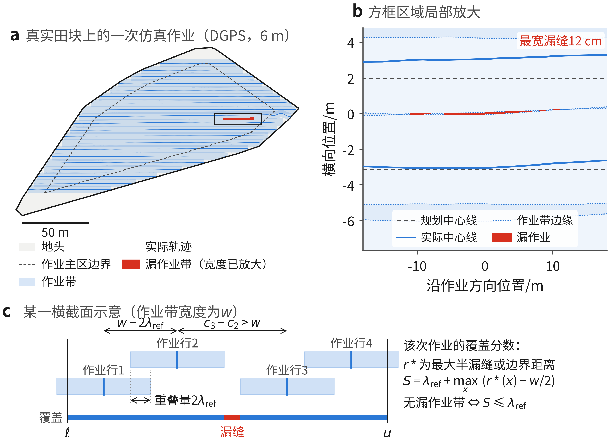

**图 1**　漏作业问题示意。a为DGPS导航、6 m幅宽条件下在一块真实水田上的一次仿真作业，虚线以内为作业主区，红色为漏作业带（宽度已放大），出现在相邻两行偏离量之差超过规划重叠量的位置；b为方框区域的局部放大，最宽漏缝为12 cm；c为某一横截面的示意，两行实际中心距离大于$w$时出现行间漏缝，最外侧一行中心距边界大于$w/2$时出现边界漏作业

### 2.2 方法总体框架

共形收缩法由4个模块组成（图 2）。模块1根据每次作业中农机具的实际轨迹计算覆盖分数；模块2只利用田块边界、地形、GNSS精度等级和控制参数，由解析模型或蒙特卡洛数字孪生计算各田块覆盖分数的尺度$\hat q_f$，用于把不同田块的分数折算到同一尺度上；模块3对（归一化后的）分数取次序统计量，得到裕量$\hat\lambda$；模块4检查$\hat\lambda$是否超过采集记录时所用的基准裕量$\lambda_\mathrm{ref}$，未超过时按$\hat\lambda$生成实施规划并输出作业行距$w-2\hat\lambda$，超过时加大$\lambda_\mathrm{ref}$重新校准。新的作业记录可以不断加入校准集。

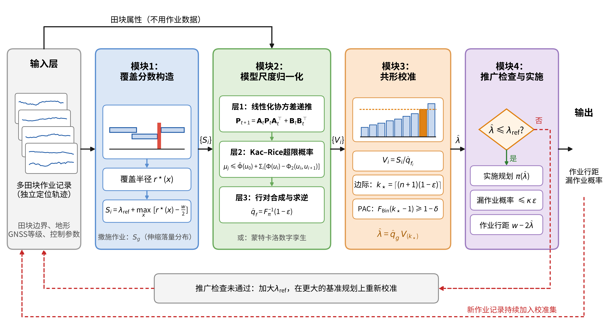

**图 2**　共形收缩法总体框架。黑色实线为数据流，红色虚线为重新校准和校准集更新

按作业顺序，方法的实施分为5个阶段（图 3）。首先，用使用者自己的路径规划软件，按一个留得比较宽的裕量$\lambda_\mathrm{ref}$生成基准规划$\pi(\lambda_\mathrm{ref})$，作业记录都在基准规划上采集；然后计算每次作业的覆盖分数；接着由次序统计量确定裕量，田块有作业记录时用本田块的记录，没有记录时用其他田块的记录并按模型尺度归一化；最后进行推广检查并生成实施规划。

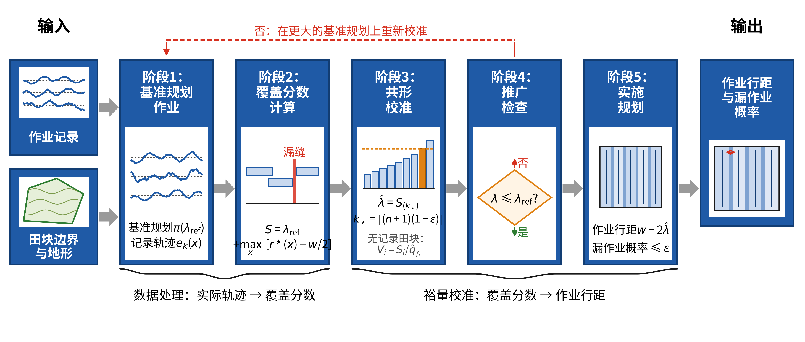

**图 3**　共形收缩法实施流程

该方法对作业记录有一定要求。记录的应是农机具作业中心而不是拖拉机的轨迹，而且要来自精度远高于裕量的独立定位，例如在农机具上安装PPK流动站，导航终端自身的日志不能用，因为接收机看不到自身的定位误差。参与校准的作业应在拖拉机、农机具、接收机、差分源、控制参数和作业速度上保持一致，季节和土壤墒情的构成也应与实际使用时相近。漏作业概率$\varepsilon$和后文的漏缝容许宽度$\tau$应在查看覆盖分数之前确定。根据作业记录的来源和是否对分数进行归一化，方法分为4种形式（表 1）。

| 形式 | 校准数据 | 分数归一化 | 实施规划 | 适用条件 |
|---|---|---|---|---|
| CE | 本田块的预试作业和验证作业 | 无 | 基准规划本身 | 各次作业可交换（附录 A.4） |
| CE-q | 本田块$n$次作业 | 无 | $\pi(\hat\lambda)$ | 另需耦合假设，漏作业概率至多放大$\kappa$倍（附录 A.15） |
| CE+ | 本田块$n$次作业和5块训练田 | 地头探测线横向偏差，交叉验证有效时采用 | $\pi(t\,\sigma(z))$ | 另需耦合假设（附录 A.9） |
| XCE-T、XCE-MC | 其他$n$块田各1次作业 | 解析模型或蒙特卡洛数字孪生计算的尺度$\hat q_f$ | $\pi(\hat q_g v^\star)$ | 各田块可交换（附录 A.17），实施规划另需耦合假设 |

*表 1　共形收缩法的4种形式*

## 3 共形收缩法

### 3.1 覆盖分数及其性质

在横截面$x$处，设$\ell(x)$和$u(x)$为作业主区在该截面上的两个端点，$c_1(x)<c_2(x)<\cdots$为覆盖该截面的各行实际中心位置（再加上两侧最近的各1行），其集合记为$Y(x)$。该截面被完全覆盖当且仅当覆盖半径$r^\star(x)\le w/2$。将实际作业带的半宽虚拟地改为$w/2-\lambda_\mathrm{ref}+t$（规划本身不变），记此时的漏作业面积为$M_\mathrm{ref}(t,e)$。在基准规划上作业一次，其覆盖分数定义为

$$
\begin{aligned}
r^\star(x)&=\max\Big\{\mathrm{dist}\big(\ell(x),Y(x)\big),\ \mathrm{dist}\big(u(x),Y(x)\big),\\
&\qquad\qquad\max_{i:\ \frac{c_i+c_{i+1}}{2}\in[\ell,u]}\frac{c_{i+1}(x)-c_i(x)}{2}\Big\},\\
S(e)&=\lambda_\mathrm{ref}+\sup_{x}\Big[r^\star(x)-\frac w2\Big]=\inf\big\{t\in\mathbb R:\ M_\mathrm{ref}(t,e)=0\big\},\\
M(\lambda_\mathrm{ref},e)=0\ &\iff\ S(e)\le\lambda_\mathrm{ref}
\end{aligned}
$$

式中：$\mathrm{dist}(\ell,Y)$和$\mathrm{dist}(u,Y)$为边界项，即最外侧一行到田块边界的距离，m；第三项为相邻两行实际中心距离的一半，m。覆盖分数表示这次作业所有作业带最多还能收窄多少（$S<\lambda_\mathrm{ref}$时）或者至少要加宽多少（$S>\lambda_\mathrm{ref}$时）才会恰好出现漏缝。式（2）最后一行对误差的分布没有任何要求（附录 A.1）。若另一分数$S'$满足“$S'(e)\le t$时$M_\mathrm{ref}(t,e)=0$”，则对每次作业都有$S(e)\le S'(e)$，次序统计量也有$S_{(k)}\le S'_{(k)}$（附录 A.3），因此用$S$校准得到的裕量不会比按逐对行间偏差或联合界校准的已有方法更大。计算时只需在每个1 m截面上对各行实际中心排序，计算量为$O(K\log K)$。

对按行距$w-2\lambda_\mathrm{ref}$等距布置的内部行对，相邻两行中心距离的一半为$(w-2\lambda_\mathrm{ref})/2+[e_{j+1}(x)-e_j(x)]/2$，代入式（2）可得覆盖分数的分解式

$$
\begin{aligned}
S(e)&=\max\Big\{\max_{j}\sup_{x}Z_j(x),\ \sup_{x}E_\ell(x),\ \sup_{x}E_u(x)\Big\},\\
Z_j(x)&=\frac{e_{j+1}(x)-e_j(x)}{2},\\
\mathrm{Var}\,Z_j(x)&=\frac14\Big[\nu_j(x)+\nu_{j+1}(x)-2\,\mathrm{Cov}\big(e_j(x),e_{j+1}(x)\big)\Big]
\end{aligned}
$$

式中：$Z_j(x)$为第$j$对相邻行的半漏缝过程，m；$E_\ell(x)=\lambda_\mathrm{ref}+\mathrm{dist}(\ell,Y)-w/2$和$E_u(x)$为两侧边界过程，m；$\nu_j(x)$为第$j$行横向偏移的方差，m²。式（3）说明行间项与边界项的统计性质不同：相邻两行共有的那部分误差在$Z_j$中相互抵消，两行偏移独立且方差均为$\nu_0$时$\mathrm{Var}\,Z_j=\nu_0/2$，而边界只受最外侧一行的影响，方差为$\nu_0$，边界项的标准差至少是行间项的$\sqrt2$倍。这一差别决定了DGPS条件下边界项不能忽略（第5.3节）。

### 3.2 有作业记录田块的裕量校准

将$n$次作业的覆盖分数从小到大排列为$S_{(1)}\le S_{(2)}\le\cdots\le S_{(n)}$。若历次作业与新的一次作业（记为第$n+1$次）可交换，按边际规则取$\hat\lambda=S_{(k_\star)}$，则

$$
1-\varepsilon\ \le\ \frac{k_\star}{n+1}\ \le\ \Pr\big[S_{n+1}\le S_{(k_\star)}\big]\ <\ 1-\varepsilon+\frac{1}{n+1},\qquad k_\star=\big\lceil(n+1)(1-\varepsilon)\big\rceil
$$

式中右侧不等式在分数无结时成立。例如30次作业取第28个。这一概率是对各种可能采到的作业记录平均而言的，单次抽样得到的裕量所对应的无漏作业率会围绕该值波动。若要求对手上这批记录成立，记条件覆盖率$\gamma=\Pr[S_{n+1}\le S_{(k)}\mid S_1,\dots,S_n]$，在分数分布连续时$\gamma$服从Beta分布，于是

$$
\begin{aligned}
\gamma&\sim\mathrm{Beta}(k,\ n+1-k),\\
\Pr\big[\gamma\ge1-\varepsilon\big]&=\sum_{i=0}^{k-1}\binom{n}{i}(1-\varepsilon)^{i}\,\varepsilon^{\,n-i},\\
k_\star&=\min\Big\{k:\ \Pr\big[\gamma\ge1-\varepsilon\big]\ge1-\delta\Big\}
\end{aligned}
$$

按PAC规则取式（5）中的$k_\star$，所得裕量以$1-\delta$的置信度满足$\Pr[S_{n+1}>\hat\lambda\mid S_1,\dots,S_n]\le\varepsilon$，本文取$\delta=0.1$。若$k_\star>n$，说明记录太少，不给出裕量。$\varepsilon=\delta=0.1$时，边际规则至少需要9次作业；PAC规则下$n=22$时$1-0.9^{22}=0.902$，$n=21$时为0.891，因此至少需要22次。

CE形式先确定一个够用的基准裕量，再加以验证。在$\pi(\lambda_\mathrm{ref})$上作业一批，计算覆盖分数的$(1-\varepsilon)$经验分位数$q$，若$q>\lambda_\mathrm{ref}$，则令$\lambda_\mathrm{ref}\leftarrow1.10\,q$并重复；基准裕量确定后，另外作业一批进行验证，验证批次的次序统计量$q^\star=S_{(k_\star)}$不超过$\lambda_\mathrm{ref}$时按基准规划作业，否则不给出裕量。CE实际作业时用的就是采集记录的那个规划，除各次作业可交换外不需要其他假设。CE-q在此基础上按$\pi(q^\star)$作业，行数更少，重叠也更少，但需要第3.4节的耦合假设。

CE+将作业次数固定为$n$次，基准裕量取5块训练田覆盖分数$(1-\varepsilon)$分位数最大值的1.25倍，并用每次作业前在地头开一条探测线时导航终端记录的横向偏差均方根$z$对分数归一化：

$$
\begin{aligned}
\tilde S_i&=\frac{S_i}{\sigma(z_i)},\qquad \sigma(z)=\max\big\{a+bz,\ 0.3\,\bar\sigma\big\},\\
\hat\lambda&=\sigma(z_{n+1})\,\tilde S_{(k_\star)},\qquad \Pr\big[S_{n+1}\le\hat\lambda\big]\ge1-\varepsilon
\end{aligned}
$$

式中：$a$、$b$为在训练田上拟合的系数，拟合前各田块的分数先除以该田块分数的中位数；$\bar\sigma$为拟合尺度的均值；$z_{n+1}$为本次作业探测线的横向偏差均方根，m。横向偏差反映的是当天地面的滑移和不平度，不包含GNSS定位误差。归一化方式只由训练田决定，与校准作业和新作业独立，因此各$\tilde S_i$仍可交换，式（6）中的概率保证成立（附录 A.9）。只有当归一化在训练田的留一交叉验证中能使平均裕量降低3%以上时才采用，否则$\sigma$取常数。

以平原RTK工况的第440号田块为例（幅宽3 m），基准裕量为17.5 cm，有29次作业记录，由式（4）得$k_\star=27$。29个覆盖分数在4.5~16.5 cm之间，中位数为7.0 cm，第27小的分数为9.4 cm，因此裕量取9.4 cm，作业行距为281.1 cm，作业主区重叠率为6.97%。该田块的理想裕量为10.7 cm，对应重叠率7.58%。用这29次记录得到的裕量，在测试作业中的无漏作业率为0.745；从该田块200次作业中重复抽取29次共2000次，无漏作业率平均为0.890，10%和90%分位数分别为0.811和0.963。可见式（4）只在平均意义上成立，需要对手上这批记录给出保证时应采用式（5）。

### 3.3 无作业记录田块的跨田块校准

对于没有作业记录的目标田块$g$，从其他$n$块田各取1次作业记录进行校准。对每块田$f$，先只根据控制器参数、地形模型和GNSS精度等级计算其覆盖分数$(1-\varepsilon)$分位数的模型值$\hat q_f$，再对比值进行共形校准：

$$
\begin{aligned}
V_i&=\frac{S_i}{\hat q_{f_i}},\qquad v^\star=V_{(k_\star)},\qquad \lambda_g=\hat q_g\,v^\star,\\
\Pr\big[S_g\le\lambda_g\big]&=\Pr\big[V_g\le v^\star\big]\ \ge\ \frac{k_\star}{n+1}\ \ge\ 1-\varepsilon,\\
H(v^\star)&\sim\mathrm{Beta}\big(k_\star,\ n+1-k_\star\big)
\end{aligned}
$$

式中：$S_i$为第$i$块校准田的覆盖分数，m；$V_{(k_\star)}$为$\{V_i\}$按边际规则或PAC规则取得的次序统计量；$\hat q_g$为目标田块的模型尺度，m；$\lambda_g$为目标田块的裕量，m；$H(\cdot)$为新田块比值的分布函数，$H(v^\star)$即作业记录固定时新田块的平均无漏作业率，$n=29$时其标准差为0.054。若某块田的模型尺度不是有限值，则令$V_i=+\infty$，若出现在目标田块上，则不给出裕量。只要各田块可交换，且$\hat q_f$只由田块属性决定，各$V_i$与目标田块的$V_g$就是可交换的，无论模型准不准，式（7）都成立（附录 A.17），这与Dunn 等 (Dunn et al., 2023) 的两层结构相同。模型只决定不同田块的分数如何折算到一起：模型不准时，裕量偏大，各田块之间也不均衡，但式（7）在田块平均意义上仍然成立。这一保证并不针对某一块田或某一机型配置。即使用各田块的理想裕量归一化，新田块的裕量也会按田块内的尾部比值放大，但这只是理想归一化下的结果，并不是所有归一化方法的下限（附录 A.20）。

模型尺度有2种算法。XCE-MC用车辆闭环仿真模型（即数字孪生）在基准规划上仿真1000次，取覆盖分数的0.9分位数。XCE-T用解析方法计算，分为3层。

第1层求单行横向偏移的条件分布。给定一次作业的作业条件$C$（土壤含水率、滑移和不平度增益、横滚补偿系数、安装偏差和GNSS误差序列），沿无噪声闭环路径将车辆-控制器系统线性化，转向饱和与转角速度限制用随机输入描述函数处理 (Booton, 1954; Kazakov, 1956)，积分器限幅用泄漏积分器近似，偏离标称路径的状态$\delta\boldsymbol x_t$满足

$$
\begin{aligned}
\delta\boldsymbol x_{t+1}&=\boldsymbol A_t\,\delta\boldsymbol x_t+\boldsymbol B_t\,\boldsymbol\xi_t,\qquad \boldsymbol\xi_t\sim\mathcal N(\boldsymbol 0,\boldsymbol I),\\
\boldsymbol P_{t+1}&=\boldsymbol A_t\boldsymbol P_t\boldsymbol A_t^{\top}+\boldsymbol B_t\boldsymbol B_t^{\top},\\
\mathrm{Cov}\big[e_k(x_t),e_k(x_s)\mid C\big]&=\boldsymbol h^{\top}\boldsymbol\Phi(t,s)\,\boldsymbol P_s\,\boldsymbol h,\qquad t\ge s,\\
\boldsymbol\Phi(t,s)&=\boldsymbol A_{t-1}\boldsymbol A_{t-2}\cdots\boldsymbol A_s
\end{aligned}
$$

式中：状态向量由横向偏差、航向偏差、转角、积分器和侧滑组成；$\boldsymbol A_t$、$\boldsymbol B_t$为沿标称路径线性化得到的时变矩阵；$\boldsymbol P_t$为状态协方差矩阵；$\boldsymbol h$为横向偏差的选择向量；$\boldsymbol\Phi(t,s)$为状态转移矩阵。给定$C$时，每行的横向偏移为高斯过程，均值$m_k(x)$由无噪声仿真得到，协方差由式（8）给出；由$\mathrm de/\mathrm dx=\psi+\beta$，其导数过程的方差为$P_{\psi\psi}+2P_{\psi\beta}+P_{\beta\beta}$（附录 A.10）。

第2层求单个行对和边界的超限概率。给定$C$时半漏缝过程$Z_j$为高斯过程，记其均值、标准差分别为$m(x)$、$s(x)$，导数过程的标准差为$s'(x)$，$r(x)=\mathrm{Cov}[Z_j(x),Z_j'(x)]$。超限概率$\mu_j(t;C)=\Pr[\sup_xZ_j(x)>t\mid C]$由Kac–Rice公式 (Azaïs and Wschebor, 2009; Piterbarg, 1996) 给出上界：

$$
\begin{aligned}
\mu_j(t;C)&\le\bar\Phi(u_0)+\int_0^{L}\tilde s'(x)\,R\Big(\frac{\tilde m'(x;t)}{\tilde s'(x)}\Big)\frac{1}{s(x)}\,\varphi\Big(\frac{t-m(x)}{s(x)}\Big)\mathrm dx,\\
\mu_j(t;C)&\le\bar\Phi(u_0)+\sum_{i}\Big[\Phi(u_i)-\Phi_2\big(u_i,u_{i+1};\rho_i\big)\Big],\qquad u_i=\frac{t-m(x_i)}{s(x_i)}
\end{aligned}
$$

式中：$\varphi$、$\Phi$分别为标准正态密度和分布函数，$\bar\Phi=1-\Phi$；$R(u)=\varphi(u)+u\Phi(u)$；$\tilde m'=m'+r(t-m)/s^2$和$\tilde s'=\sqrt{s'^2-r^2/s^2}$为$Z_j(x)=t$条件下导数的均值和标准差；$\Phi_2(\cdot,\cdot;\rho_i)$为相关系数$\rho_i$的二元标准正态分布函数；$x_i$为沿行方向的离散位置，间隔1 m；$L$为行长，m。式（9）第1行为连续形式，第2行由$\{\max_iZ_i>t\}\subseteq\{Z_0>t\}\cup\bigcup_i\{Z_i\le t<Z_{i+1}\}$得到。侧滑分量为Ornstein–Uhlenbeck过程，$Z_j$的样本路径一阶可导而二阶不可导，数值计算只用离散形式；开发阶段的检查中，连续形式在0.9分位数处偏松约29%，离散形式偏松0~17%（附录 A.11）。阈值较低、上界偏松时改用高斯蒙特卡洛抽样估计。对于田块边界上的一点$b$，只有覆盖它的各行都向内偏离时才会漏作业，给定$C$时各行的随机部分相互独立，因此

$$
\Pr\big[b\ \text{漏作业}\ \big|\ C\big]\ \le\ \prod_{k\in\mathcal K_b}\Pr\big[E_k(b)>t\ \big|\ C\big]=\prod_{k\in\mathcal K_b}\bar\Phi\Big(\frac{t-m_k(b)}{s_k(b)}\Big)
$$

式中：$\mathcal K_b$为规划作业带覆盖点$b$的作业行集合；$E_k(b)$为第$k$行相对边界的内缩量，m；$m_k(b)$、$s_k(b)$为其条件均值和标准差，m。沿边界各截面的结果用联合界合并后，作为一个边界“伪行对”进入下一层（附录 A.12）。

第3层对各行对和作业条件进行合成。给定$C$时不相邻的行对相互独立，记$\Lambda=\sum_j\mu_j$，由一阶和二阶Bonferroni不等式可得

$$
\begin{aligned}
F_\pi(t)&=\mathbb E_C\Big[\prod_{j\in\mathcal J_\pi}\big(1-\mu_j(t;C)\big)\Big]+\rho_\pi(t),\\
\big|\rho_\pi(t)\big|&\le\mathbb E_C\Big[\frac{\Lambda^2}{2}+\sum_j\min\big(\mu_j,\mu_{j+1}\big)\Big],\\
\hat q_f&=\inf\big\{t:\ F_\pi(t)\ge1-\varepsilon\big\}
\end{aligned}
$$

式中：$F_\pi(t)$为基准规划$\pi$上覆盖分数的分布函数；$\mathcal J_\pi$为行对（含边界伪行对）的集合；$\rho_\pi(t)$为乘积近似的余项。计算时取式（11）中的乘积项，对200种随机抽取的作业条件求平均。在0.9水平下余项的上界与$\varepsilon$同量级，不足以说明乘积形式的精度，其准确性依靠试验检验：3种工况下的预测值为0.888、0.882和0.900，真值为0.900（表 S5，附录 A.13）。

由式（11）还可得到覆盖分数尾部的极值性质。对平稳的行对过程，有

$$
\begin{aligned}
1-F_\pi(t)&\approx\mathbb E_C\big[1-\mathrm e^{-\Lambda(t;C)}\big],\qquad \theta_t\approx\frac{\mathbb E_C\big[1-\mathrm e^{-\Lambda}\big]}{\mathbb E_C[\Lambda]}\le\frac{1-\mathrm e^{-\mathbb E_C\Lambda}}{\mathbb E_C\Lambda},\\
t_\varepsilon&\approx m+s\Big[a_L-\frac{\ln\big(-\ln(1-\varepsilon)\big)}{a_L}\Big],\qquad a_L=\sqrt{2\ln L}
\end{aligned}
$$

式中：$\theta_t$为极值指数，其上界由Jensen不等式得到，作业条件之间的差异使$\theta_t$进一步降低，试验测得为0.30~0.66；$t_\varepsilon$为覆盖分数的$(1-\varepsilon)$分位数，m；$m$、$s$为行对过程的均值和标准差，m；$L$为田块有效长度。式（12）第2行由Gumbel极限分布反解得到 (Leadbetter et al., 1983)，田块扩大10倍时所需裕量约增大11%。正态极值收敛较慢 (Hall, 1979)，该式只用于构造一种对照用的归一化方法（尺度律）。

两种算法都只需对每块田离线计算一次。单核计算时，XCE-T不含边界项为每块田16~353 s，含边界项中位数为271 s（129~2356 s）；XCE-MC中位数为8~21 s。作为对比，本文还采用了不归一化直接合并（$\hat q_f\equiv1$）、按机型配置分组合并（Mondrian方法）、按厂商标称精度乘尺度律归一化、学习方法（CQR型岭回归 (Romano et al., 2019)）归一化以及按机型配置经验值归一化等做法。

### 3.4 推广检查

CE-q、CE+和XCE实际作业时用的行距与采集记录时不同。设基准规划$\pi_0$和实施规划$\pi_1$的覆盖分数分布函数分别为$F_{\pi_0}$和$F_{\pi_1}$，两者共用作业条件$C$和各行噪声，并按行对和截面一一对应。若对应位置的半漏缝过程和边界过程之差不依赖于噪声且有上界（耦合假设），则

$$
\begin{aligned}
Z^{(1)}_j(x)-Z^{(0)}_j(x)&=d_j(x;C)\le\bar\Delta,\\
1-F_{\pi_1}(t)&\le1-F_{\pi_0}(t-\bar\Delta)=\kappa(t)\big[1-F_{\pi_0}(t)\big],\\
\Pr\big[\text{漏作业}\mid\pi_1\big]&\le\sup_{t\le\lambda_\mathrm{ref}}\kappa(t)\,\varepsilon,\\
\ln\kappa(t)&\le\frac{\bar\Delta}{s}\Big(u+\frac1u\Big),\qquad u=\frac{t-m}{s}\ge1
\end{aligned}
$$

式中：$d_j(x;C)$为规划改变引起的确定性差值，m；$\bar\Delta$为其上界，m；$\kappa(t)$为漏作业概率的放大系数。式（13）第2行由$\{\sup Z^{(1)}>t\}\subseteq\{\sup Z^{(0)}>t-\bar\Delta\}$逐样本成立，不需要高斯假设；第4行的闭式上界利用了正态分布风险率$\vartheta(u)=\varphi(u)/\bar\Phi(u)$单调递增且$\vartheta(u)\le u+1/u$（附录 A.15）。带积分作用的控制器在地头转弯后的过渡过程结束后，$d_j$主要来自侧坡天线偏移的差异，其上界为$\frac12h_\mathrm a(1-c_\mathrm{min})\sup_x|\Delta g^{(1)}_j(x)-\Delta g^{(0)}_j(x)|$与GNSS时间平移项之和，规划改变对地形和作业时间的影响越小，$\kappa$越接近1。线性闭环系统满足耦合假设，作业时间改变使各行读到的GNSS误差平移时近似满足，而以上一行为参照导航时不满足。

式（13）要求$\hat\lambda\le\lambda_\mathrm{ref}$。作业行增多时覆盖分数通常变大，若在行数较少的规划上校准、在行数较多的规划上作业，且各行对分数独立同分布，则无漏作业率约为

$$
\big(1-\varepsilon\big)^{K_1/K_0}<1-\varepsilon,\qquad K_1>K_0
$$

式中：$K_0$和$K_1$分别为两种规划的行对数（附录 A.6）。因此零裕量规划$\pi(0)$不能作为基准规划，而$\hat\lambda>\lambda_\mathrm{ref}$时既不能按$\hat\lambda$作业，也不能退回按基准规划作业，因为校准结果已经说明$\lambda_\mathrm{ref}$偏小；正确的做法是加大基准裕量重新校准，CE形式需要另作一批预试作业，XCE形式则需要按更大的裕量重新规划各田块并重新计算模型尺度。预注册试验运行时还没有加入这一检查，第5.1节和第5.3节给出了其可能触发的情况。

### 3.5 漏缝容许宽度与撒施作业

有些作业可以容许很窄的漏缝，例如喷杆末端喷头的雾量逐渐减小，相邻一行可以补上一部分。撒肥、撒料等撒施作业的横向落量分布中间多、两侧少，作业带不能简单看作宽度为$w$的矩形，判断漏作业的依据应是各点的施用量是否达到要求。设撒施机具的横向落量分布为$g(\eta)$，$\eta$为相对机具中心线的横向距离，按标称作业宽度$w$归一化，使相邻两行按行距$w$作业时各点落量之和为1。容许宽度不超过$\tau$的漏缝时的覆盖分数、一次作业的相对施用量和撒施作业的覆盖分数分别为

$$
\begin{aligned}
S_\tau&=S-\frac{\tau}{2},\qquad D(x,y)=\sum_kg\big(y-y_k-e_k(x)\big),\\
S_g&=\lambda_\mathrm{ref}+\inf\Big\{t:\ \min_{(x,y)\in W}\sum_kg\Big(\frac{y-y_k-e_k(x)}{1+2t/w}\Big)\ge\rho_\mathrm{min}\Big\}
\end{aligned}
$$

式中：$\tau$为漏缝容许宽度，m，行间漏缝宽度为$2(r^\star-w/2)$，边界漏作业宽度为$r^\star-w/2$，$S_\tau$对边界偏保守，对应裕量为$\hat\lambda-\tau/2$；$D(x,y)$为点$(x,y)$处的相对施用量；$\rho_\mathrm{min}$为允许的最低相对施用量（如0.8）。$S_g$将各行落量分布虚拟地按$1+2t/w$倍横向伸缩。矩形作业带$g(\eta)=\mathbf 1\{|\eta|\le w/2\}$伸缩后的半宽为$w/2+t$，取$\rho_\mathrm{min}=1$时$S_g$与式（2）中的$S$相同。$S_g$随$t$单调，前述校准过程对它同样适用，只是覆盖分数的计算需要实测的落量分布。本文的仿真试验只针对矩形作业带，撒施作业的覆盖分数将结合无人撒料车的田间试验进一步检验。漏作业概率$\varepsilon$本身是经济问题，见第5.4节。

## 4 仿真试验设计

### 4.1 数据来源

试验数据均为公开数据。田块边界和作业方向取自全国农机作业监测平台的250条联合收割机GNSS轨迹 (Wu et al., 2023)，经密度聚类提取出964块田，筛选后使用南方丘陵区水田137块和华北平原麦田162块。地形数据采用Copernicus GLO-30高程数据 (European Space Agency, 2021)。GNSS误差取自美国中西部和大平原地区12对NOAA CORS站（基线长5~30 km），每对站在2024—2025年4个季节中各取2 d共8 d数据，用RTKLIB (Takasu and Yasuda, 2009) 的demo5版本 (Everett, n.d.) 按动态模式解算，得到4种接收机等级的误差序列（表 2）；30 s历元插值到1 Hz后，叠加一段车载GNSS/INS记录 (Tang et al., 2022) 的高频残差。

| 精度等级 | 解算方式 | RMS | 95% | 99.9% | 最大值 |
|---|---|---|---|---|---|
| RTK | 载波相位，模糊度解算（固定解历元占84%，浮点解占16%） | 2.4 cm | 3.3 cm | 24.5 cm | 1.39 m |
| RTK浮点解 | 载波相位，不解算模糊度 | 2.6 cm | 4.0 cm | 24.6 cm | 1.39 m |
| DGPS | 伪距差分 | 32.5 cm | 57.8 cm | 2.05 m | 6.05 m |
| 单点定位 | L1伪距 | 1.51 m | 2.78 m | 4.97 m | 7.16 m |

*表 2　CORS站解算序列的水平误差*

由表 2可知，RTK误差的大偏差主要来自持续数分钟的错误固定解和浮点解漂移，按RMS相同的正态分布估算，超过99.9%分位数的误差概率会被低估几个数量级。静态大地测量天线没有车载多路径和差分链路中断的影响，美国测站的误差用于中国田块也有一定差别，第5.3节对此进行了敏感性分析。

### 4.2 仿真平台

闭环仿真模型的步长$\Delta t=0.05$ s，车速$v=2$ m/s。车辆采用运动学模型，地形引起的侧滑与横向坡度成正比，地面不平度用Ornstein–Uhlenbeck过程描述，导航终端控制的是GNSS天线的横向偏差：

$$
\begin{aligned}
\dot d&=v\sin(\psi+\beta),\qquad \dot\psi=\frac{v\tan\delta}{l},\\
\dot\delta&=\mathrm{sat}_{30^\circ/\mathrm s}\Big(\frac{\delta_\mathrm{cmd}-\delta}{T_\delta}\Big),\qquad |\delta|\le35^\circ,\\
\beta&=-0.35\,k_s\,g_\mathrm{lat}+\beta_\mathrm{OU},\\
\mathrm d\beta_\mathrm{OU}&=-\theta\,\beta_\mathrm{OU}\,\mathrm dt+\sigma_\beta\sqrt{2\theta}\,\mathrm dW_t,\\
d_\mathrm m&=d-h_\mathrm a\sin\phi\,(1-c)+s_k\,\epsilon_y(t)+b,\\
\phi&=\arctan g_\mathrm{lat}
\end{aligned}
$$

式中：$d$为横向偏差，m；$\psi$为航向偏差，rad；$\delta$、$\delta_\mathrm{cmd}$为前轮转角及其指令，rad；$l$为轴距，m；$T_\delta=0.25$ s为转向滞后时间常数；$\mathrm{sat}$为转角速度限幅；$\beta$为侧滑角，rad；$k_s$为随土壤含水率变化的滑移增益；$g_\mathrm{lat}$为车辆坐标系下的横向坡度；$\theta=0.5\ \mathrm s^{-1}$，对应2 s的相关时间；$\sigma_\beta$为侧滑随机分量的标准差，rad，随每次作业的土壤含水率变化；$W_t$为标准维纳过程；$d_\mathrm m$为横向偏差测量值，m；$h_\mathrm a=2.6$ m为天线高；$\phi$为车身横滚角，rad；$c$为横滚补偿系数，每次作业取$0.85\pm0.05$；$\epsilon_y(t)$为实测GNSS误差在田块横向上的投影，m，按各行实际作业时刻取值；$s_k=\pm1$表示作业行的往返方向；$b$为每次作业的安装偏差，标准差1.5 cm。由于横滚补偿不完全，侧坡上的天线偏移会把车辆拉向上坡，且往返两行的符号相反，这是坡地上相邻作业行间距忽大忽小的主要原因。各行按实际时间顺序作业，包括地头转弯。

控制器默认采用带积分的LQR控制（LQR-I）。以$\boldsymbol x=[d_\mathrm m,\ \psi,\ \delta,\ \textstyle\int d_\mathrm m\mathrm dt]^\top$为状态，在计入转向滞后的离散模型上求解离散代数Riccati方程：

$$
\begin{aligned}
\boldsymbol x_{t+1}&=\underbrace{\begin{bmatrix}1&v\Delta t&0&0\\0&1&v\Delta t/l&0\\0&0&1-\Delta t/T_\delta&0\\\Delta t&0&0&1\end{bmatrix}}_{\boldsymbol A}\boldsymbol x_t+\underbrace{\begin{bmatrix}0\\0\\\Delta t/T_\delta\\0\end{bmatrix}}_{\boldsymbol B}\delta_{\mathrm{cmd},t},\\
\boldsymbol P&=\boldsymbol Q+\boldsymbol A^{\top}\boldsymbol P\boldsymbol A-\boldsymbol A^{\top}\boldsymbol P\boldsymbol B\big(R_u+\boldsymbol B^{\top}\boldsymbol P\boldsymbol B\big)^{-1}\boldsymbol B^{\top}\boldsymbol P\boldsymbol A,\\
\delta_{\mathrm{cmd},t}&=-\big(R_u+\boldsymbol B^{\top}\boldsymbol P\boldsymbol B\big)^{-1}\boldsymbol B^{\top}\boldsymbol P\boldsymbol A\,\boldsymbol x_t
\end{aligned}
$$

式中：权重取$\boldsymbol Q=\mathrm{diag}(4,\ 1,\ 0.1,\ 0.4)$、$R_u=4$。转角饱和时暂停积分（条件积分抗饱和），积分项限幅$\pm0.3$ m·s。作业带以车辆参考点为中心，对应刚性悬挂农机具。此外还实现了纯追踪、Stanley和不带积分的LQR控制器，详见附录C。

### 4.3 机型配置与对比方法

试验设置了3种机型配置（表 3），分别为平原麦田RTK导航3 m幅宽（R1）、丘陵水田RTK导航1.5 m幅宽（R2）和丘陵水田DGPS导航6 m幅宽（R3），三者合在一起作为混合机队。

| 机型配置 | 田块 | 导航等级 | 幅宽$w$ | 土壤含水率 | 厂商标称行间精度 |
|---|---|---|---|---|---|
| R1 | 麦田（平原） | RTK | 3 m | Beta(2, 3) | 2.5 cm |
| R2 | 水田（丘陵） | RTK | 1.5 m | 0.6~0.9 | 2.5 cm |
| R3 | 水田（丘陵） | DGPS | 6 m | Beta(2, 3) | 20 cm |

*表 3　机型配置*

有作业记录时，主要对比方法为共形预测规划（CPrP） (Zhao et al., 2024) 和按行对联合界的共形规划（UBCP） (Lindemann et al., 2023)，二者在零裕量规划上按各自的分数校准，并分别实现了边际和PAC两种形式。另外还比较了生产经验规则（厂商标称行间精度的2倍、在训练田上调定的农户经验裕量）、基于模型的方法（逐点和Rice极值修正的高斯置信、基于模型的蒙特卡洛机会约束、高斯机会约束）、场景法 (Campi and Garatti, 2008)、Wasserstein分布鲁棒优化 (Mohajerin Esfahani and Kuhn, 2018)、高斯过程谨慎裕量 (Hewing et al., 2020)、管道模型预测控制半径裕量 (Mayne et al., 2005)，以及Fields2Cover、三维地形行距修正、跟随上一行导航、Lenain侧滑观测控制、滑模控制和无静差模型预测控制等路径规划或控制改进方法与厂商重叠量的组合，共20余种。

### 4.4 评价指标

设共有$F$块测试田，第$f$块田的实施裕量为$\hat\lambda_f$，在该裕量下进行$N=200$次测试作业，第$j$次作业的漏作业面积占比为$M_{fj}$，其中无漏作业的次数为$m_f$。无漏作业率、平均漏作业面积、超额重叠率和达标判据分别为

$$
\begin{aligned}
\hat P&=\frac{1}{FN}\sum_{f=1}^{F}\sum_{j=1}^{N}\mathbb 1\{M_{fj}=0\},\qquad \bar M=\frac{1}{FN}\sum_{f=1}^{F}\sum_{j=1}^{N}M_{fj},\\
\Delta J_f&=J_f(\hat\lambda_f)-J_f(\lambda_f^\mathrm{or}),\\
\text{第}f\text{块田达标}\ &\iff\ \sum_{i=0}^{m_f}\binom{N}{i}0.9^{\,i}\,0.1^{\,N-i}\ge0.05
\end{aligned}
$$

式中：$\bar M$的单位为%；$J_f$为第$f$块田作业主区的重叠率；$\Delta J_f$的单位为个百分点；$\lambda_f^\mathrm{or}$为理想裕量，即按测试作业求得的无漏作业率为0.9的最小裕量，只作为参照，并不是一种可用的方法。达标率为单侧二项检验下无漏作业率不显著低于0.9的田块所占比例。由于每块田的校准结果随所用记录而波动，校准正确的边际规则方法达标率约为85%，PAC规则方法约为99%（附录 A.19）。

### 4.5 试验方案

按田块编号划分数据，保证每项验证性试验所用田块都没有参与该试验的设计（附录 C.2）。仿真试验分为3组：A组针对有作业记录的田块，包括与已有方法的对比（A1）和作业记录数量的影响（A2）；B组针对没有作业记录的田块，包括3项早期试验（B1~B3）、重复抽样检验（B4）和混合机队对比（B5）；C组为稳健性分析，包括模型失配（C1）和地头绕行（C2）。此外进行了成本分析。各项验证性试验的方案和判定标准均在试验运行前存入带时间戳的代码仓库，未达到预期的结果也一并报告（表 S20）。

## 5 结果与分析

### 5.1 有作业记录田块的校准效果

覆盖分数在6块田、每块200次作业中对是否漏作业的判断与漏作业面积的计算结果完全一致（附录 A.3）。

A1试验在每种机型配置的30块新田上进行，每块田用100次作业记录校准，路径规划和控制均采用牛耕式分区和LQR-I。由表 4和图 4可知，预注册的2项预期结论在3种机型配置下均成立：CE+在边际规则下的无漏作业率不显著低于0.9，PAC规则下没有田块未达标；在2种规则下，CE+的作业主区重叠率均低于CPrP和UBCP。与CPrP和UBCP相比，CE+在R1中重叠率分别降低18.9%和22.7%（边际规则）、21.2%和34.3%（PAC规则），在R2中分别降低4.1%和9.7%、4.0%和37.2%，在R3中分别降低23.8%和35.1%、25.5%和54.7%，12项比较经Holm校正后均显著（最大校正p值0.0225）。

| 机型配置 | 方法 | 无漏作业率 | 达标率 | 漏作业面积/% | 重叠率/% | 超额重叠率/百分点 |
|---|---|---|---|---|---|---|
| R1 | CE+ / CE+ PAC | 0.903 / 0.941 | 0.93 / 1.00 | 0.001 / 0.001 | **8.39** / **9.04** | −0.26 / +0.38 |
| | CPrP / CPrP PAC | 0.944 / 0.967 | 1.00 / 1.00 | 0.001 / 0.000 | 10.35 / 11.47 | +1.69 / +2.82 |
| | UBCP / UBCP PAC | 0.959 / 0.988 | 1.00 / 1.00 | 0.001 / 0.000 | 10.86 / 13.76 | +2.20 / +5.10 |
| | 厂商经验规则；农户经验裕量 | 0.000；0.897 | 0.00；0.70 | 0.216；0.001 | 1.75；9.22 | −6.90；+0.57 |
| R2 | CE+ / CE+ PAC | 0.911 / 0.944 | 0.90 / 1.00 | 0.001 / 0.001 | **25.62** / **28.14** | +0.70 / +3.22 |
| | CPrP / CPrP PAC | 0.923 / 0.956 | 0.97 / 1.00 | 0.001 / 0.001 | 26.72 / 29.32 | +1.80 / +4.40 |
| | UBCP / UBCP PAC | 0.944 / 0.991 | 0.97 / 1.00 | 0.001 / 0.000 | 28.38 / 44.80 | +3.46 / +19.87 |
| | 厂商经验规则；农户经验裕量 | 0.000；0.834 | 0.00；0.20 | 0.642；0.001 | 3.46；23.00 | −21.46；−1.92 |
| R3 | CE+ / CE+ PAC（预注册） | 0.896 / 0.933 | 0.90 / 1.00 | 0.027 / 0.020 | **15.73** / **19.30** | +0.45 / +4.02 |
| | CE+ / CE+ PAC（推广检查） | 0.901 / 0.921 | — | 0.027 / 0.022 | **16.06** / **17.40** | +0.78 / +2.12 |
| | CPrP / CPrP PAC | 0.946 / 0.969 | 1.00 / 1.00 | 0.017 / 0.013 | 20.63 / 25.89 | +5.35 / +10.61 |
| | UBCP / UBCP PAC | 0.960 / 0.983 | 1.00 / 1.00 | 0.014 / 0.006 | 24.22 / 42.61 | +8.94 / +27.33 |
| | 厂商经验规则；农户经验裕量 | 0.403；0.834 | 0.00；0.47 | 0.120；0.036 | 7.59；13.53 | −7.69；−1.75 |

*表 4　有作业记录田块的对比结果（A1试验，每种机型配置30块田）*

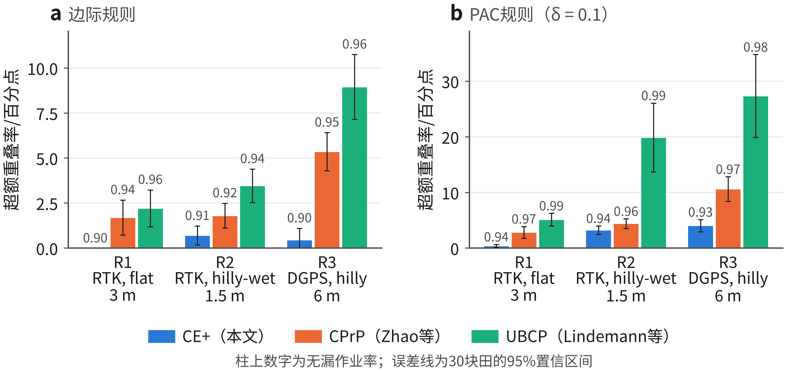

**图 4**　A1试验中CE+与2种共形规划方法的超额重叠率。a为边际规则，b为PAC规则；柱上数字为无漏作业率，误差线为30块田的95%置信区间

各方法都是从同一组规划中选取实施规划，差别只在于裕量的取法，所以重叠率的差别反映的是校准是否过于保守。对比方法在零裕量规划上按逐行对或逐约束的分数校准，或者采用联合界，名义水平为0.9时实测无漏作业率达到0.92~0.99，多出来的重叠正是为这部分多余的可靠性付出的代价。CE+的无漏作业率则与目标值基本一致。重叠率的降低主要来自覆盖分数和基准规划，与探测线归一化关系不大：不归一化、也不用训练田确定基准裕量的CE-q，在R1~R3中的重叠率分别为8.82%、25.51%和16.19%，仍低于CPrP的10.35%、26.72%和20.63%。计入伸入地头部分的实际重叠率，12项比较的结论方向相同（表 S22）。

图 5将全部20余种方法放在同一坐标中比较。横轴为漏作业概率，纵轴为超额重叠率，越靠近左下角越好；位于竖线右侧的方法未达到设定的漏作业水平。厂商经验规则以及各种路径规划、控制改进方法与厂商重叠量的组合几乎每次作业都会漏作业，其超额重叠率为负值；管道模型预测控制、分布鲁棒优化和联合界共形规划从不或极少漏作业，但超额重叠率达到10~160个百分点；基于模型的方法中，逐点高斯置信和不加Bonferroni校正的高斯过程裕量漏作业概率过高，Rice极值修正和蒙特卡洛机会约束在部分配置下接近目标。各方法大致沿一条可靠性与重叠率此消彼长的前沿分布。在无漏作业率不低于0.895的方法中，CE+的超额重叠率在R1和R3中最低（−0.26和0.45个百分点）；R2中高斯机会约束（0.38个百分点，无漏作业率0.897）和CE-q（0.58个百分点）低于CE+（0.70个百分点），但高斯机会约束在R3中的超额重叠率为2.46个百分点，是CE+的5倍以上。

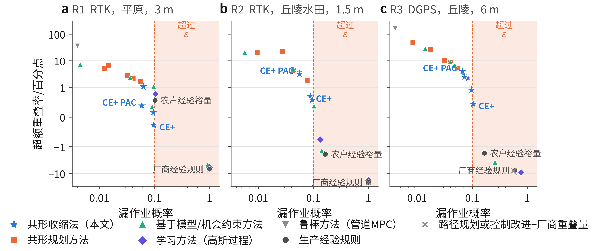

**图 5**　A1试验中各类方法的漏作业概率与超额重叠率（牛耕式分区+LQR-I，每种机型配置30块田）。横轴为对数坐标，纵轴为对称对数坐标；阴影区为漏作业概率超过$\varepsilon=0.1$；从未漏作业的方法画在左边界

R1和R2中CE+的实施裕量都没有超过基准裕量。R3中，边际规则下有9块田、PAC规则下有19块田的平均实施裕量超过了基准裕量，这些田块上耦合假设不适用，但实测无漏作业率仍达到了要求。加入推广检查后，这些田块改用CE，CE+在R3中的无漏作业率为0.901（边际规则）和0.921（PAC规则），重叠率分别为16.06%和17.40%。按预注册结果，与对比方法相比重叠率降低4%~55%，加入推广检查后为4%~59%。

在6种路径规划与控制组合下，CE和CE+基本都达到了预期的达标率，只有R2中采用跟随上一行导航的CE+例外，其无漏作业率为0.850，达标率为0.70。这种导航方式以上一行的实际轨迹为参照，使前后两行相互关联，不满足耦合假设，而CE在这种情况下仍能达到目标（表 S23）。厂商经验规则几乎每次作业都会留下漏作业带，但漏作业面积只占作业主区的0.12%~0.64%。农户经验裕量在R1、R2和R3中分别有70%、20%和47%的田块达标，重叠率在R1中比CE+高0.8个百分点，在R2和R3中分别低2.6和2.2个百分点，相当于用较低的可靠性换取较少的重叠，在成本比低于第5.4节的盈亏平衡值时，这种做法更划算。

A2试验考察作业记录数量的影响。对每种机型配置的45块田，从每块田200次作业中抽取9~100次，重复2000次，用CE-q校准后在独立的测试作业上评价（图 6）。边际规则下无漏作业率的均值为0.896~0.943，随$n$的变化与理论值$k_\star/(n+1)$一致，$n=15$时的峰值是$k_\star$取整造成的；PAC规则下无漏作业率达到0.9的抽样所占比例为0.890~0.951，高于要求的0.88（表 S24）。作业记录少的代价是重叠增加：只有9次记录时，边际规则在R1~R3中的超额重叠率分别为1.3、4.0和8.3个百分点；PAC规则至少需要22次记录，此时为3.4、10.0和18.7个百分点，记录增至100次时降为1.1、3.2和4.3个百分点。

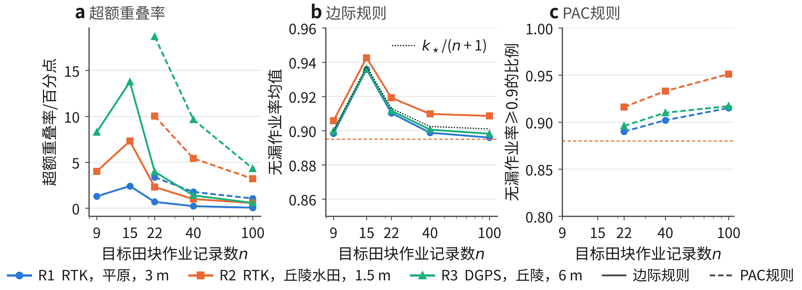

**图 6**　作业记录数量对CE-q校准结果的影响（A2试验，每种机型配置45块田，每块田重复抽样2000次）。a为超额重叠率，实线为边际规则，虚线为PAC规则；b为边际规则下的无漏作业率均值，点线为理论值$k_\star/(n+1)$；c为PAC规则下无漏作业率不低于0.9的抽样比例；橙色虚线为预注册判定标准

### 5.2 无作业记录田块的校准效果

每块田的作业记录少于20次左右时，宜采用跨田块校准。先看模型尺度的精度。这里是用模型所依据的仿真模型来检验模型本身，反映的是内部一致性，而不是与实际的符合程度，模型失配的影响见第5.3节。如图 7所示，在每种机型配置的45块田上，将预测的覆盖分数0.9分位数与200次独立仿真作业的经验分位数相比，蒙特卡洛数字孪生的对数偏差标准差在R1~R3中分别为0.030、0.032和0.083，基本等于200次作业分位数本身的抽样误差；解析模型分别为0.039、0.038和0.107，平均偏差为+1.0%、+0.1%和+0.9%，扣除抽样误差后，RTK条件下解析模型自身的误差约为2%~3%。不含边界项时，解析模型在DGPS条件下偏低5.2%；边界项是在15块田上发现这一偏差后推导的，在另外30块田上直接计算后，偏差由−5.7%变为+0.9%，但离散程度由0.089增大到0.106（附录 B.3）。

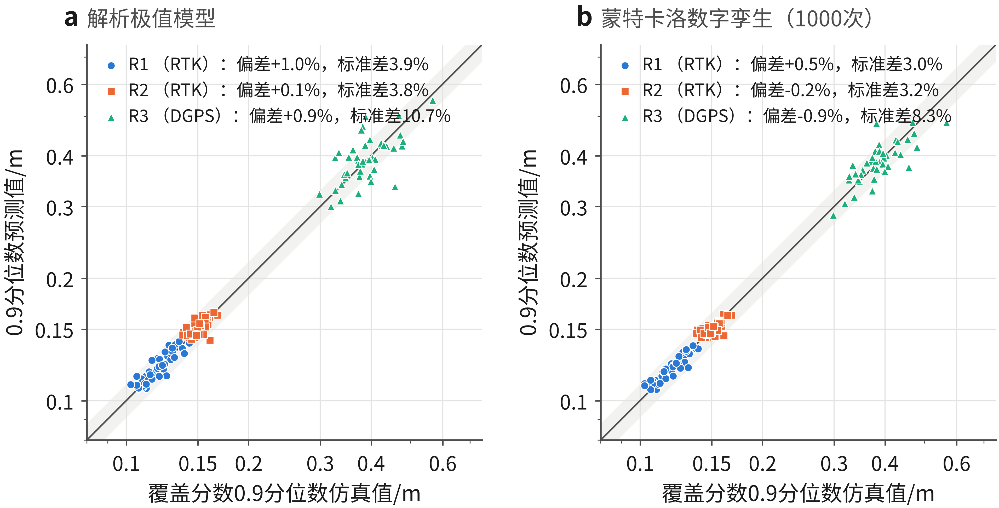

**图 7**　覆盖分数0.9分位数预测值与仿真值的对比（双对数坐标）。a为解析极值模型（R3含边界项），b为蒙特卡洛数字孪生；每个点代表一块田，阴影带为±10%

模型尺度能否用数据驱动的方法代替，取决于每块田能提供多少作业数据。图 8比较了解析模型与以田块特征（行长、面积、作业行数、平均坡度、横坡特征和横向宽度）为输入、按机型配置分别训练的岭回归。解析模型不用任何作业数据，对数误差标准差在R1~R3中为0.029、0.029和0.056；每块田只有1次作业记录时，回归方法即使用全部训练田（R1、R2为57~60块，R3为30块），误差标准差仍为0.095、0.049和0.206，是解析模型的1.7~3.7倍。只有在每块田都有数百次作业、可以直接求出理想裕量作为训练目标时，回归方法在RTK条件下才略优于解析模型（0.020~0.021），而在DGPS条件下仍不如解析模型（0.080）。

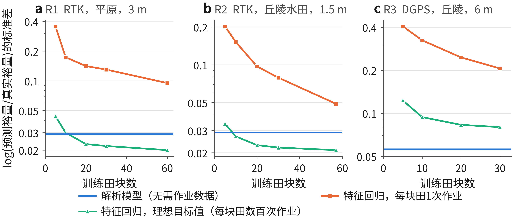

**图 8**　解析模型与特征回归方法预测裕量的误差随训练田块数的变化。a、b、c分别为R1、R2和R3；纵轴为log(预测裕量/真实裕量)的标准差

早期的3项跨田块试验确定了按比值归一化的做法（表 S30）。B1采用概率积分变换归一化，未达到预期；B2的2项预期结论都成立，但主要得益于该次校准抽样的实际无漏作业率较高；B3部分达到预期。R1边际规则下，单次校准抽样的无漏作业率在B2中为0.844，在B3中为0.877。B4试验对校准田块和每块田所用的作业记录同时重新抽样4000次，全部26组条件都达到了判定标准，边际规则的无漏作业率均值为0.919~0.929，理论值为0.923（图 9，表 S19a），说明前述偏低的结果属于单次抽样的正常波动。不过，B4的随机划分无法检验田块不可交换的情况。

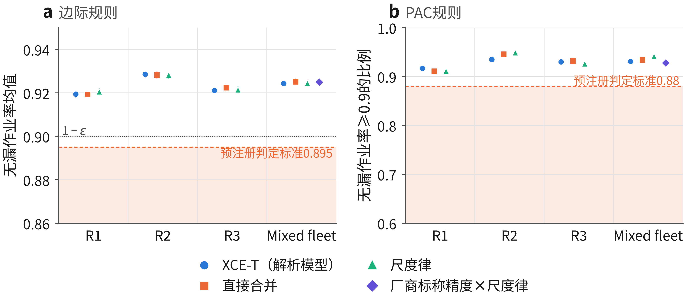

**图 9**　跨田块校准的重复抽样检验（B4试验，4000次）。a为边际规则下的无漏作业率均值及其95%置信区间，点线为$1-\varepsilon$；b为PAC规则下无漏作业率不低于0.9的比例；虚线和阴影为预注册判定标准

B5试验将模型归一化与其他考虑机型配置的方法放在由135块田组成的混合机队中对比（表 5、图 10），预注册的4项预期结论均成立。不归一化直接合并时，DGPS田块的无漏作业率只有0.779，而RTK田块高达0.999，可见总体上满足要求并不代表每种机型配置都满足要求。采用模型归一化后，边际规则下各机型配置的无漏作业率在0.885~0.936之间；加入边界项后，DGPS田块由0.834~0.904提高到0.899~0.924，超额重叠率不变。按机型配置分组合并（Mondrian方法）每种配置至少需要9块（边际规则）或22块（PAC规则）校准田，25块校准田分给3种配置时，有56%（边际规则）和全部（PAC规则）的新田块无法给出裕量。校准田增至60块时，模型归一化的超额重叠率在边际规则下为0.55~0.63个百分点，学习方法和按配置经验值归一化为1.20~1.29个百分点，Mondrian方法为4.35个百分点；PAC规则下分别为4.2~4.4、6.2~6.4和12.2个百分点（Mondrian方法只计入了能给出裕量的26%的田块）。学习方法和按配置经验值归一化下，DGPS田块的无漏作业率只有0.82~0.87，原因是用每块田1次作业学到的尺度反映不出DGPS误差分布的长尾。解析模型和蒙特卡洛数字孪生的结果在各组条件下相差不超过0.8个百分点。

| 归一化方法 | $n=25$无漏作业率R1 / R2 / R3（边际） | $n=25$超额重叠率，边际 / PAC | $n=60$超额重叠率，边际 / PAC |
|---|---|---|---|
| 直接合并 | 0.999 / 0.998 / **0.779** | +29.19 / +63.97 | +17.12 / +37.98 |
| 厂商标称精度 × 尺度律 | 0.944 / **0.840** / 0.993 | +12.95 / +23.09 | +9.93 / +14.98 |
| Mondrian（分机型配置） | 0.958 / 0.960 / 0.957 | 56% / 100%的田块无法给出裕量 | +4.35 / 74%的田块无法给出裕量 |
| 按机型配置经验值 | 0.939 / 0.958 / **0.842** | +4.57 / +19.94 | +1.29 / +6.42 |
| CQR（考虑机型配置） | 0.961 / 0.942 / **0.866** | +4.09 / +18.86 | +1.20 / +6.19 |
| **XCE-T**（解析模型） | 0.931 / 0.936 / 0.904 | **+2.89** / +14.56 | **+0.57** / +4.37 |
| **XCE-T**（含边界项） | 0.927 / 0.931 / 0.917 | +3.03 / **+13.69** | +0.63 / +4.36 |
| **XCE-MC**（蒙特卡洛数字孪生） | 0.924 / 0.929 / 0.913 | **+2.68** / **+13.76** | **+0.55** / **+4.19** |

*表 5　混合机队中各归一化方法的对比（B5试验，135块田，重复抽样4000次）。超额重叠率单位为百分点；无漏作业率低于0.88者加粗*

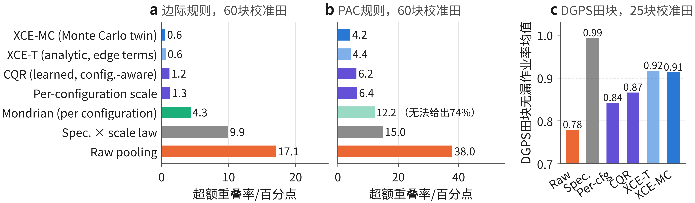

**图 10**　混合机队中各归一化方法的超额重叠率和DGPS田块无漏作业率。a、b分别为60块校准田时边际规则和PAC规则下的超额重叠率，浅色柱表示部分田块无法给出裕量；c为25块校准田、边际规则下DGPS田块的平均无漏作业率，虚线为0.9

### 5.3 稳健性分析

C1试验设置了6种与模型不一致的“真实”条件，而各归一化方法仍使用原模型：T1为局部湿软区，车轮滑移呈重尾脉冲；T2为牵引式农机具（牵引杆长5 m，有下坡侧偏）；T3为车速1.5~3.0 m/s，转向延迟0.15 s，转向死区0.3°；T4为GNSS误差放大到1.5倍；T5为地形坡度减小到1/4（平整后的格田）；T6为T1~T4的组合。每种条件下对每块田仿真了200次校准作业，并计算了28个裕量下的无漏作业率和重叠率。结果见表 6和图 11，预注册的4项预期结论都没有在全部6种条件下同时成立（表 S27）。

| 真实条件 | 模型偏差$\log(\hat q/q)$，R1 / R2 / R3 | XCE-T无漏作业率：总体 / DGPS（直接合并DGPS） | 超额重叠率/百分点：XCE-T / XCE-MC / 厂商标称 / Mondrian / 直接合并 | CE-q（$n=100$）无漏作业率R1 / R2 / R3 |
|---|---|---|---|---|
| 标称 | +0.01 / +0.00 / +0.01 | 0.902 / 0.899（**0.718**） | 0.63 / 0.55 / 9.93 / 4.35 / 17.12 | 0.896 / 0.909 / 0.898 |
| T1 局部湿软区 | −0.73 / −0.72 / −0.02 | **0.895** / 0.984（**0.823**） | 2.39 / 1.77 / 45.53 / 23.49 / 7.81 | **0.893 / 0.891** / 0.897 |
| T2 牵引式农机具 | +0.42 / +0.43 / +0.09 | 0.903 / **0.808**（**0.716**） | 0.49 / 0.52 / 3.93 / 3.81 / 17.86 | 0.900 / 0.903 / 0.902 |
| T3 车速、延迟 | +0.00 / +0.01 / −0.99 | 0.903 / **0.853**（**0.801**） | −18.07† / −17.51† / −9.02† / 40.68 / 3.93 | 0.899 / 0.899 / 0.924 |
| T4 GNSS × 1.5 | −0.04 / −0.02 / −0.35 | 0.901 / **0.803**（**0.711**） | 0.69 / 0.75 / 7.66 / 6.99 / 42.73 | 0.896 / 0.902 / 0.897 |
| T5 平整地形 | −0.01 / +0.01 / +0.02 | 0.902 / 0.908（**0.717**） | 0.56 / 0.47 / 9.99 / 3.98 / 16.47 | 0.904 / 0.899 / 0.904 |
| T6 组合 | −0.48 / −0.45 / −1.82 | 0.905 / **0.780**（**0.753**） | 14.09 / 12.33 / 8.71 / 51.01 / 58.34 | 0.908 / 0.899 / 0.949 |

*表 6　模型失配条件下的结果（C1试验）。混合机队为边际规则、60块校准田、重复抽样2000次；总体不高于0.895或单一机型配置低于0.88者加粗；†为负值是因为DGPS田块覆盖不足，并非效率提高*

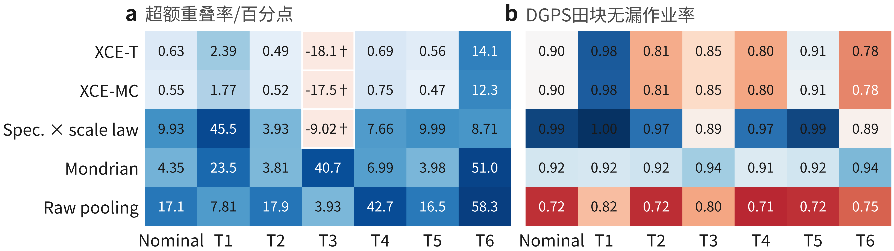

**图 11**　模型失配条件下各归一化方法的超额重叠率和DGPS田块无漏作业率（C1试验，边际规则，60块校准田）。a中†表示超额重叠率为负值，原因是DGPS田块覆盖不足；b中颜色以0.9为中点，红色表示低于目标

从可靠性看，6种条件中有5种所有归一化方法总体上都满足要求。T1中滑移脉冲使RTK所需裕量增加约1倍，60块校准田时各方法的总体无漏作业率降到0.892~0.895（判定标准0.895，理论期望0.902），用100次作业记录的CE-q在R1和R2中分别为0.893和0.891。问题出在推广环节而不在校准本身：基准裕量是按标称条件下的训练田确定的，T1中大多数田块的RTK实施裕量都超过了基准裕量。如果加入推广检查，这些作业会被拒绝并在更大的基准规划上重新校准，但本文没有计算重新校准增加的重叠。

从模型精度看，失配只是改变误差大小时，模型仍然有用。牵引式农机具使模型对裕量的预测偏大约50%（对数偏差+0.42），这是因为农机具对拖拉机的横向误差有低通滤波作用；GNSS误差放大时，模型对DGPS所需裕量预测偏小（−0.35）；平整地形下模型仍然准确。这3种条件下XCE-T仍是超额重叠最小的方法（0.5~0.7个百分点，其他方法为3.8~42.7个百分点）。失配改变了误差的性质时，模型就失去了优势：局部湿软区条件下模型对RTK所需裕量低估了一半；车速提高并加入转向延迟和死区后，DGPS控制回路失稳，模型低估到实际值的1/2.7；组合条件下，按厂商标称精度归一化反而比模型更好（8.7和14.1个百分点）。蒙特卡洛数字孪生与解析模型建立在相同的假设上，在这些条件下同样失效。从各机型配置看，失配对某一种配置的影响明显大于其他配置时（T2、T3、T4、T6），模型归一化就不能再使各配置均衡，DGPS田块的无漏作业率为0.78~0.85，虽高于直接合并的0.71~0.80，但低于目标值（图 11b）。

C2试验在作业主区每条边外加了一圈地头绕行，规划时使其与作业主区重叠$\lambda$，在田内作业完成后进行。不加地头绕行时，由边界项决定覆盖分数的作业在R1~R3中分别占1.0%、0.8%和10.0%，加地头绕行后降为0.1%、0.1%和1.9%。地头绕行对RTK所需裕量没有影响，使DGPS所需裕量减小约6%（理想裕量由0.391 m降至0.366 m，重叠率由15.12%降至14.01%）。2项预注册预期都得到满足：DGPS下边界项所占比例低于预注册时设定的50%（设定该阈值时预计边界项会是DGPS漏作业的主要来源，实际不加地头绕行时也只有10.0%）；加地头绕行后CE-q仍满足要求，边际均值为0.897~0.902，PAC比例为0.885~0.907（表 S28）。

### 5.4 零漏作业裕量的经济性分析

以“0.9的概率不出现漏作业带”为目标时，1 cm的细缝和1 m的漏作业带被同等看待。设成本比$r$为单位面积漏作业的损失与单位面积重复作业的损失之比，对节约农资的作业而言，即漏作业带上减少的产量或防治效果与农资成本之比。一种裕量的期望成本（以作业主区面积的百分比计）、零漏作业校准裕量$\lambda_\mathrm c$与厂商经验规则$\lambda_\mathrm v$成本相等时的盈亏平衡成本比以及成本最优裕量分别为

$$
\begin{aligned}
C(\lambda;r)&=J(\lambda)+r\,\bar M(\lambda),\qquad \lambda^\dagger(r)=\mathop{\arg\min}_{\lambda}C(\lambda;r),\\
r_\mathrm{be}&=\frac{J(\lambda_\mathrm c)-J(\lambda_\mathrm v)}{\bar M(\lambda_\mathrm v)-\bar M(\lambda_\mathrm c)}
\end{aligned}
$$

$r>r_\mathrm{be}$时校准裕量的期望成本低于厂商经验规则。$\lambda^\dagger(r)$需要已知测试分布，只作为参照。这里只计入了农资成本：重复作业还会增加作业时间和油耗，重复施药可能造成倒伏或药害，这些都会使重叠的代价更高，零漏作业裕量的盈亏平衡点随之提高；另一方面，细小的漏缝可能被相邻作物行部分弥补，而漏防的杂草则可能连续多年结籽。按每种机型配置45块测试田的裕量曲线计算的结果见表 7和图 12。

| 机型配置 | 策略 | 无漏作业率 | 重叠率/% | 漏作业面积/% | 成本，$r=10$ | $r=30$ | $r=100$ | $r=300$ |
|---|---|---|---|---|---|---|---|---|
| R1 | 厂商经验规则 | 0.000 | 2.12 | 0.160 | 3.72 | 6.92 | 18.10 | 50.04 |
| | 农户经验裕量 | 0.882 | 9.05 | 0.001 | 9.06 | 9.07 | 9.11 | 9.24 |
| | 校准裕量，$\varepsilon=0.1$（理想） | 0.900 | 8.91 | 0.001 | 8.92 | 8.93 | 8.98 | 9.11 |
| | 成本最优裕量 | 0.02~0.50 | 2.5~6.0 | | **3.54** | **4.69** | **5.92** | **7.10** |
| R2 | 厂商经验规则 | 0.000 | 5.38 | 0.336 | 8.74 | 15.45 | 38.95 | 106.09 |
| | 农户经验裕量 | 0.844 | 23.02 | 0.001 | 23.03 | 23.05 | 23.11 | 23.30 |
| | 校准裕量，$\varepsilon=0.1$（理想） | 0.900 | 24.93 | 0.001 | 24.94 | 24.95 | 24.99 | 25.11 |
| | 成本最优裕量 | 0.00~0.32 | 5.9~15.0 | | **8.58** | **11.58** | **14.78** | **17.75** |
| R3 | 厂商经验规则 | 0.437 | 7.56 | 0.112 | 8.68 | 10.91 | 18.73 | 41.07 |
| | 农户经验裕量 | 0.853 | 13.35 | 0.033 | 13.68 | 14.33 | 16.62 | 23.16 |
| | 校准裕量，$\varepsilon=0.1$（理想） | 0.900 | 15.10 | 0.026 | 15.36 | 15.88 | 17.69 | 22.87 |
| | 成本最优裕量 | 0.21~0.89 | 4.6~14.4 | | **7.15** | **10.31** | **15.21** | **21.90** |

*表 7　不同裕量设定方法的期望成本（重叠率% + $r$ × 漏作业面积%）。校准裕量取各田块的理想裕量；成本最优裕量需要已知测试分布，仅作参照*

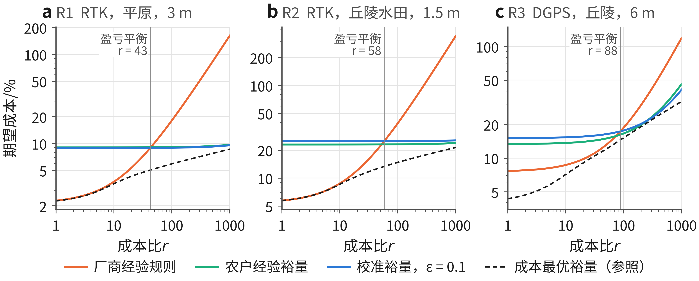

**图 12**　期望成本随成本比的变化（双对数坐标）。a、b、c分别为R1、R2和R3，竖线为校准裕量与厂商经验规则的盈亏平衡点

由表 7和图 12可以看出，与厂商经验规则相比，零漏作业校准裕量在成本比超过约43（R1）、58（R2）和88（R3）后才更经济，按A1试验各机型配置的结果计算，RTK为31~35，DGPS为88~117。RTK条件下成本最优裕量允许经常出现很细的漏缝（漏作业面积为0.004%~0.03%），即使$r=300$，其无漏作业率也只有0.50（R1）和0.32（R2）；只有DGPS条件下漏缝较宽，成本最优裕量的无漏作业率在$r=300$时接近0.9（0.89）。作业幅宽较窄时，设定漏缝容许宽度的效果更明显：容许2 cm的漏缝可使裕量减小1 cm，R1~R3的重叠率分别减少0.9、2.0和0.4个百分点，容许5 cm时分别减少2.0、5.0和1.1个百分点。

$r$的取值与作业类型、作物和价格有关，本文没有估计。举一个假设的例子：若漏施一条肥料带使该处减产三分之一，作物价值为肥料成本的5倍，则$r\approx1.7$；若漏防一处会引发检疫、抗药性治理等方面的损失，$r$可能达到数百。成本比低于盈亏平衡点时，只要事先确定$\varepsilon$或$\tau$，本方法同样可以给出成本更低的裕量所对应的漏作业概率。若直接以漏作业面积的期望值为控制目标，可采用共形风险控制 (Angelopoulos et al., 2024)，但其有限样本误差项$B/(n+1)$（$B$为最大可能损失）比这里关心的漏作业面积水平（0.01%~0.1%）还大，除非有上千次作业记录。

## 6 讨论

### 6.1 概率保证的成立条件

试验表明，只要实施裕量不超过基准裕量，并且各行独立导航，实测的无漏作业率就与目标值相符：A1加入推广检查后达到目标，A2、B4、B5和C2中边际规则的无漏作业率均值为0.896~0.943。低于目标值的情况有2种：一是实施裕量超过基准裕量，如C1局部湿软区条件下为0.891~0.895，这种情况可以用推广检查排除；二是采用跟随上一行的导航方式，无漏作业率降至0.850，本方法中没有能发现这种情况的环节。跟随上一行导航时，后一行的偏差会随前一行变化，式（13）中的确定性差值$d_j$不再与噪声无关，而推广检查只比较裕量大小，检查不出这一问题。

模型归一化不影响田块平均意义上的概率保证，但会影响裕量的大小、推广检查被触发的频率以及各机型配置之间的均衡。直接合并时，DGPS田块的无漏作业率只有0.78；在仿真模型无失配的条件下采用模型归一化，各机型配置为0.885~0.936。不同导航等级的误差水平相差很大，直接合并后的分数主要反映RTK田块的情况，而模型把各田块折算到同一尺度上，DGPS田块才不会被忽视。

### 6.2 方法的适用范围

有目标田块作业记录时，2种共形规划方法偏于保守，CE+在达到目标的同时重叠率低4%~55%。但与调校良好的生产经验相比，节省的重叠并不多：农户经验裕量在R1中比CE+多用0.8个百分点重叠，在R2和R3中少用2.2~2.6个百分点，只是达标的田块只有20%~70%。在这种情况下，本方法的主要价值在于说清楚漏作业的概率。

没有目标田块作业记录时，在比较的几种归一化方法中，只有模型归一化能使各机型配置都接近目标值，同时超额重叠较小，比理想裕量高0.6个百分点，考虑机型配置的其他方法高1.2~4.4个百分点，直接合并高17个百分点。已有仿真模型时，蒙特卡洛数字孪生与解析模型效果相当，而且更容易建立；解析模型的优势在于不需要仿真平台，并能由式（12）给出裕量随田块尺寸变化的规律。不过在同一机型配置内，无漏作业率相同时各种按田块归一化的方法之间重叠率只差0.1~0.4个百分点（附录 D.4），这与第3.3节关于理想归一化的分析一致，说明模型归一化的优势主要体现在混合机队中。

作业记录较少时，PAC规则的代价较高，$n=22$时超额重叠率为3~19个百分点。在$\varepsilon=0.1$下，成本比超过40~90时零漏作业裕量比厂商经验规则划算，但只有当漏作业损失达到重复作业损失的几百倍时，它才是成本最优的选择（$r=300$时，R3中成本最优裕量的无漏作业率为0.888，R1中仅为0.495）。对于大多数以节约农资为目的的作业，设定漏缝容许宽度或采用较大的$\varepsilon$更合适。

### 6.3 与生产实际的比较

校准得到的裕量比田间经验值大。R1的理想裕量约为12 cm，是厂商经验规则裕量2.5 cm的5倍左右；R2的裕量与之相近，约为15 cm，但幅宽只有1.5 m，重叠率达到约25%。造成差异的原因主要有3点。一是本文考察的是整块田一次作业不出现任何漏缝，需要几十到几百对相邻行全部覆盖，比厂商标称的95%行间精度要求高得多，由式（12）可知所需裕量随田块有效长度按$\sqrt{2\ln L}$增长。二是所用的RTK数据中浮点解历元占16%，还有持续数分钟的错误固定解（表 2），带完好性监测的导航终端可能会对此报警，仿真中的误差尾部可能比商用RTK偏重。三是30 m分辨率的地形模型使平整过的水田格田也带有坡度。另外，厂商经验规则造成的漏作业面积只占作业主区的0.12%~0.64%，试验中没有记录漏缝宽度，较窄的漏缝可能会被雾滴飘移或撒施边缘部分补上。

以上比较都假定发现漏缝后不补作，适用于无人驾驶或无人看管的作业。采用自动分段控制会降低重复作业的成本，相应提高$r$。本方法输出的只是作业行距$w-2\hat\lambda$这一个导航参数，可以直接用于现有导航终端和作业控制器的操作流程，实际应用时的主要额外要求是采集作业记录时要有独立的农机具定位，例如在农机具上安装PPK流动站。

### 6.4 应用建议

使用本方法时，应先根据作业类型确定成本比$r$，再确定$\varepsilon$和$\tau$，这一步要在看到覆盖分数之前完成。成本比低于40~90（按A1结果为31~117）时，$\varepsilon=0.1$的零漏作业裕量比厂商经验规则成本高，宜设定漏缝容许宽度或放宽$\varepsilon$。采集作业记录时应同时获取农机具的真实位置，并只合并条件可比的记录。基准规划的作业行数不能少于实际作业，不能用零裕量规划作为基准。每块田有22次以上作业记录（边际规则为9次，重叠增加1~8个百分点）时可直接在本田块上校准；记录较少时采用模型归一化进行跨田块校准，模型用蒙特卡洛数字孪生即可，但应按机型配置分别检查无漏作业率，并用各配置的少量作业记录对模型进行验证。校准后进行推广检查，若$\hat\lambda>\lambda_\mathrm{ref}$，则加大基准裕量重新校准。最后将作业行距$w-2\hat\lambda$输入导航终端；更换农机、农机具、接收机、差分源或作业速度后应重新校准。在地头加一圈与作业主区重叠的绕行，可以消除大部分由边界引起的漏作业。

### 6.5 研究不足

本研究还存在以下不足：一是只进行了仿真试验，田块边界、地形和GNSS误差虽为实测数据，但作业过程为仿真，主要试验采用运动学车辆模型、刚性悬挂农机具和单一车速，GNSS误差来自美国CORS站，坡度取自30 m分辨率地形模型，C1试验表明模型失配时概率保证基本成立，但模型的效率优势只在误差大小改变时得以保持，田间验证有待进一步开展；二是覆盖分数的计算需要农机具真实位置，定位基准的误差会直接带入覆盖分数；三是CE-q、CE+和XCE依赖耦合假设，跟随上一行的导航方式不满足这一假设；四是校准田块和新田块须来自同一总体，同一天作业的田块GNSS条件相同，试验中没有考虑；五是研究限于作业主区内的直线平行作业行，没有涉及曲线导航线、障碍物和地头作业，零漏作业的目标也没有考虑漏缝的大小；六是撒施作业的覆盖分数（式（15））只给出了计算方法，仿真中作业带均按宽度为$w$的矩形处理，落量分布不均匀时的校准效果尚未检验。

## 7 结论

本文提出了基于作业记录的行间重叠量校准方法——共形收缩法，以覆盖分数判定每次作业是否漏作业，以次序统计量给出具有有限样本概率保证的裕量，并以车辆-地形-GNSS模型为尺度对无作业记录田块进行跨田块校准。利用真实田块边界、地形和GNSS误差数据进行了预注册仿真试验，主要结论如下：

1）覆盖分数与全田块无漏作业事件精确等价，并在所有有效分数中逐点最小。每块田有100次作业记录时，该方法能达到目标漏作业水平，所需重叠率比2种共形规划方法低4%~55%，加入推广检查后为4%~59%；在20余种对比方法中，无漏作业率达到目标的方法里CE+在R1和R3中重叠率最低。

2）没有目标田块作业记录时，在仿真模型无失配的条件下，采用解析模型或蒙特卡洛数字孪生归一化，混合机队各机型配置的无漏作业率为0.885~0.936，重叠率比逐田块理想裕量高0.6个百分点，考虑机型配置的其他方法高1.2~4.4个百分点。

3）牵引式农机具、GNSS精度下降和平整地形条件下，模型归一化的优势仍然存在，滑移呈重尾分布或转向失稳时则不再存在。实施裕量大于基准裕量以及跟随上一行导航时，漏作业概率会超过设定值，前者可由推广检查排除。

4）单位面积漏作业损失达到重复作业损失的40~90倍以上时，零漏作业裕量才比厂商经验规则经济；成本比较低时，宜设定漏缝容许宽度或放宽漏作业概率，其漏作业概率同样可由本方法给出。

下一步将在采用激光雷达定位的无人撒料车上开展田间试验，以独立测得的作业带实际位置验证漏作业概率，并检验撒施作业的覆盖分数（式（15））。

## 数据可用性

本研究的代码、处理后的输入数据、预注册文件（带版本时间戳）、原始结果和生成全部图表的脚本均存放于项目代码仓库，复现方法见仓库中的README文件，论文录用后将为存档版本申请DOI。输入数据均为公开数据，包括农机作业轨迹数据集 (Wu et al., 2023)、Copernicus GLO-30高程数据 (European Space Agency, 2021)、NOAA CORS观测数据 (NOAA, n.d.) 和 Tang 等 (Tang et al., 2022) 的车载GNSS/INS数据。

## 英文摘要

**Calibrating pass overlap from logged runs to bound the probability of missed strips in agricultural field coverage**

**Abstract:** The overlap between adjacent passes of auto-steered field machines is set by rules of thumb, and the probability that a run leaves a missed strip is unknown. This paper proposes conformal erosion, a method that calibrates the pass overlap from logged runs. For each run on a reference plan with margin $\lambda_\mathrm{ref}$, the covering radius $r^\star(x)$ of the executed pass centres on every cross-section defines a coverage score $S=\lambda_\mathrm{ref}+\sup_x[r^\star(x)-w/2]$. The event that the whole field is covered is equivalent to $S\le\lambda_\mathrm{ref}$, and $S$ is pointwise the smallest of all scores that decide coverage correctly, so the reliability of hundreds of pass pairs and field edges reduces to inference on the order statistics of one scalar. The $k_\star$-th smallest of $n$ scores, $k_\star=\lceil(n+1)(1-\varepsilon)\rceil$, bounds the miss probability by $\varepsilon$ under exchangeability; choosing the rank from a binomial tail makes the bound hold with confidence $1-\delta$ for the runs at hand. For fields without logged runs, a model scale $\hat q_f$ is computed from covariance propagation of the linearised closed loop, a discrete Kac–Rice upcrossing bound and an extreme-value product over pass pairs, and the ratios $S_i/\hat q_{f_i}$ are calibrated across fields. A shift bound $1-F_{\pi_1}(t)\le\kappa(t)[1-F_{\pi_0}(t)]$ under a coupling assumption covers the change from the reference to the deployed line spacing. Replacing the rectangular footprint with a stretched lateral distribution pattern extends the score to fertiliser and feed spreading. In pre-registered simulations on real field boundaries, terrain and GNSS error records, the miss probability stayed within the target except when guidance coupled adjacent passes or the deployed margin exceeded the reference margin. With 100 logged runs per field, the method needed 4%–55% less overlap than two conformal planners; without runs on the target field, its overlap exceeded the per-field optimum by 0.6 percentage points, against 1.2–4.4 for other configuration-aware methods. A zero-miss margin was cheaper than the vendor rule only when a missed unit area cost 40–90 times more than an overlapped one.

**Keywords:** agricultural machinery; automatic guidance; coverage path planning; spreading; pass overlap; conformal prediction
